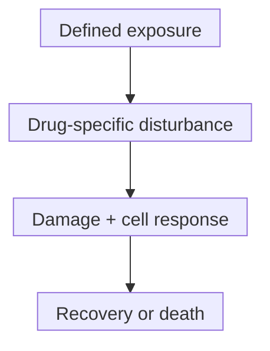
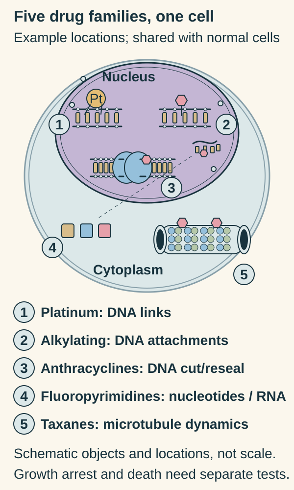

# Chemotherapy: disrupting cell survival and division

## In one sentence

Cytotoxic chemotherapy uses drugs to disrupt processes such as copying DNA (deoxyribonucleic acid) or dividing cells, affecting cancer cells and susceptible normal cells.

## The intuition

Picture a busy workshop that copies instructions and moves materials. Different chemotherapy drugs interfere with different jobs. Cancer cells can be vulnerable because they repeatedly need those processes; healthy cells need them too. The analogy has limits: a cell has no single off switch. Exposure, repair and survival responses affect the outcome.

## How it works

Chemotherapy is a family of treatments, not one mechanism. Here it means conventional **cytotoxic** drugs, whose effects can damage or kill cells. Some sources use the word more broadly for drug treatment, so check its intended meaning.

[DNA, RNA (ribonucleic acid) and protein](/wiki/education/concepts/biology-basics/genetics/central-dogma) provide a starting map. The [cell cycle](/wiki/education/concepts/biology-basics/cells/cell-cycle) organizes copying and division. [Division-related vulnerability](/wiki/education/concepts/biology-basics/cells/cell-division-and-why-chemo-hits-dividing-cells) depends on the drug and process, rather than a universal rule that only dividing cells are affected.

| Family | A job it disrupts | Mechanism example |
|---|---|---|
| [Taxanes](/wiki/education/concepts/therapeutics/chemotherapy/taxanes) | Microtubule reorganization for division and other functions | Paclitaxel |
| [Platinum agents](/wiki/education/concepts/therapeutics/chemotherapy/platinum-agents) | DNA use and copying through platinum attachments and cross-links | Carboplatin |
| [Anthracyclines](/wiki/education/concepts/therapeutics/chemotherapy/anthracyclines) | DNA handling, including topoisomerase II cut-and-reseal processes | Doxorubicin |
| [Classic alkylating agents](/wiki/education/concepts/therapeutics/chemotherapy/alkylating-agents) | Cellular functions through reactive attachments, including DNA lesions | Cyclophosphamide's active metabolites |
| [Fluoropyrimidines](/wiki/education/concepts/therapeutics/chemotherapy/capecitabine-and-fluoropyrimidines) | Nucleotide metabolism and RNA biology | Fluorouracil; capecitabine supplies a prodrug route |

These consequences overlap without identical chemistry. “Chemotherapy damages DNA” is therefore too narrow. Paclitaxel's microtubule effects include interphase functions outside division. Fluorouracil metabolites affect nucleotide synthesis and can enter RNA or DNA.

A mechanism-specific sequence, not a guarantee of cell death. Growth arrest and cell killing require different readouts.

Rapidly renewing healthy tissues are also vulnerable. The [therapeutic index](/wiki/education/concepts/therapeutics/how-drugs-work/therapeutic-index) concerns useful effects versus harm. [Dose and dose intensity](/wiki/education/concepts/therapeutics/how-drugs-work/dose-and-dose-intensity) describe administered amounts and their delivery over time. [Dose-dense scheduling](/wiki/education/concepts/therapeutics/chemotherapy/dose-dense-scheduling) shortens intervals relative to a comparison regimen; it need not increase each dose.

Dose is not concentration at every cell. [Pharmacokinetics](/wiki/education/concepts/therapeutics/how-drugs-work/pharmacokinetics-and-half-life) connects delivery to exposure. A rest interval does not mean every biological effect has ended. Uptake, repair and survival pathways also differ between [tumor populations](/wiki/education/concepts/cancer-biology/what-cancer-is/tumor-heterogeneity).

*Different drug families disturb different jobs in shared cellular machinery.*

Follow each number from the legend back into the cell. The DNA attachments in 1 and 2 involve different chemistry. The protein-held DNA ends in 3 represent topoisomerase-related cut-and-reseal handling. Number 4 connects nucleotide handling with an RNA example; number 5 points to a microtubule. These are selected examples, not complete drug structures, binding pockets or a map of every cellular drug concentration. Susceptible normal cells use this machinery too. [Primary topoisomerase experiment](https://pubmed.ncbi.nlm.nih.gov/6093249/), [Paclitaxel mechanism, section 12.1](https://dailymed.nlm.nih.gov/dailymed/drugInfo.cfm?setid=15ca4829-8fee-45f9-b4bc-b31c15732cd6), [Fluorouracil mechanism, section 12.1](https://dailymed.nlm.nih.gov/dailymed/drugInfo.cfm?setid=b268684b-487f-4716-a2e8-6e6d3e117b14).

**Read the cell:** Is every example a DNA mechanism? **Answer:** No. Nucleotide and RNA biology, and microtubule organization, also appear. Seeing a disturbance does not establish growth arrest or death.

## Why it matters in cancer

Treatment can aim to shrink disease before local treatment, reduce recurrence risk afterward, control disease or relieve symptoms. A mechanism diagram cannot establish which purpose has clinical evidence in a given setting.

Many [antibody-drug conjugates](/wiki/education/concepts/therapeutics/antibody-based/antibody-drug-conjugate) carry cytotoxic payloads. Attaching a payload changes delivery and exposure; it does not make the payload harmless to every healthy cell.

## How effects are assessed

| Observation card | Record and interpret |
|---|---|
| Exposure | Named drug/metabolite, concentration (such as micromoles per liter), duration and removal/recovery conditions |
| Laboratory output | DNA damage, division, cell number, viability or direct death measures; a lower metabolic signal alone does not distinguish arrest from killing |
| Controls | Untreated/vehicle controls, appropriate normal-cell models and time-matched recovery measurements |
| Clinical evidence | Defined disease, setting, comparator, endpoint and follow-up; model sensitivity supplies no validated patient-dose or benefit conversion |

## Worked example

In a fictional study, Drug A reduces survival in two tumor populations after the same exposure. One recovers more readily after removal. This supports different sensitivity under those conditions. It does not establish which population a person contains, whether safe exposure reaches it, or whether treatment improves an outcome.

A second drug's result is a separate observation. Failure of A does not prove every cytotoxic drug fails. A new name also does not prove that the relevant [resistance mechanism](/wiki/education/concepts/therapeutics/how-drugs-work/drug-resistance) has been bypassed.

## Common confusions

- **Fast division is not a complete response predictor.** Delivery, repair and drug-specific mechanisms matter.
- **Chemotherapy is not exclusively a DNA mechanism.** Microtubules and RNA biology are also targets.
- **Route is not mechanism.** Oral and intravenous treatments can both be chemotherapy.
- **Side effects do not measure benefit.** Symptoms alone cannot establish tumor control.
- **Shrinkage is not cure.** Response, recurrence and survival are different outcomes.

## Try it

A fictional assay shows half as many cells after exposure, but no direct death measurement and no recovery phase. Has it demonstrated that half the cells were killed?

**Answer:** No. Slower proliferation can also lower the final count. Compare timed death measures, starting counts and recovery after removal. A result about growth cannot silently become a result about killing.

## Explain it back

“Chemotherapy response depends on ___, not just ___.”

**One answer:** the mechanism, exposure and cellular response; growth speed.

## Takeaway

**Follow the actual chemical mechanism and measurement before translating a laboratory response into a clinical claim.**

## Related concepts

- [Clinical actionability](/wiki/education/concepts/evidence-and-statistics/biomarkers/actionability)

## Sources and scope

Source check: October 10, 2026. General mechanisms with fictional practice; no drug, dose or schedule selection. Expert and learner review remain pending.

- [NCI: chemotherapy to treat cancer](https://www.cancer.gov/about-cancer/treatment/types/chemotherapy) — purposes, routes and renewing-tissue effects.
- [Tewey et al., 1984](https://pubmed.ncbi.nlm.nih.gov/6093249/) — topoisomerase II-mediated damage in laboratory experiments.
- [Paclitaxel albumin-bound label, May 2025, section 12.1](https://dailymed.nlm.nih.gov/dailymed/drugInfo.cfm?setid=15ca4829-8fee-45f9-b4bc-b31c15732cd6) — microtubule effects in interphase and mitosis.
- [Fluorouracil label, section 12.1](https://dailymed.nlm.nih.gov/dailymed/drugInfo.cfm?setid=b268684b-487f-4716-a2e8-6e6d3e117b14) — distinct metabolite effects on nucleotide synthesis, RNA and DNA.

<!-- BEGIN GENERATED USED IN -->
## Used in

- [Aiming a drug at a surface target](/wiki/education/guides/aiming-a-drug-at-a-surface-target/index)
- [Connect treatment jobs with evidence](/wiki/education/guides/start-here/03-connect-treatment-and-evidence)
- [Read the jobs in the treatment plan](/wiki/education/guides/treating-early-tnbc/01-read-the-jobs-in-the-plan)
- [Understand how treatment is sequenced](/wiki/education/guides/treating-early-tnbc/index)
- [Follow delivery, exposure, and the treatment clock](/wiki/education/targeted-therapy-modalities/02-timing)
- [Compare formats with evidence and normal-tissue risk](/wiki/education/targeted-therapy-modalities/06-comparisons)
- [Targeted therapy mechanisms and comparisons](/wiki/education/targeted-therapy-modalities/index)
<!-- END GENERATED USED IN -->
