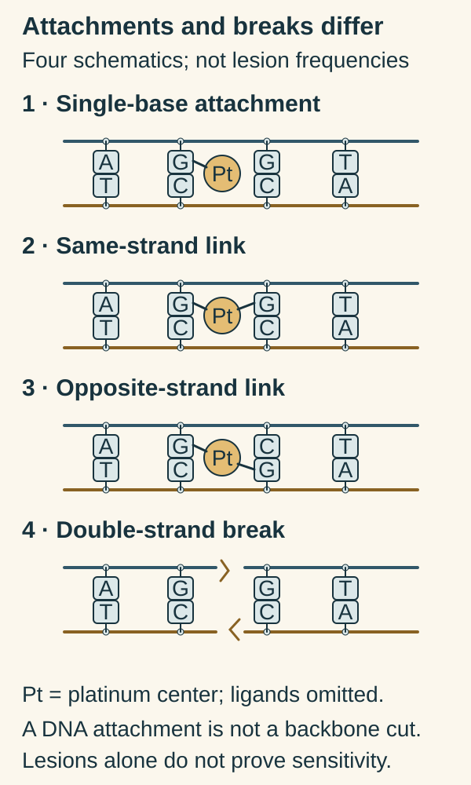

# Platinum agents

## In one sentence

Platinum agents are chemotherapy drugs whose reactive platinum complexes attach to DNA (deoxyribonucleic acid) and can form cross-links that disrupt its use and copying.

## The intuition

Imagine stapling together parts of an instruction book. Some staples join nearby words; others join pages that need to separate. The information remains present, but copying and reading it become harder.

Platinum damage resembles unwanted attachments. The analogy stops at the chemistry: a cell can recognize, repair or tolerate some lesions. A damaged book is not automatically destroyed.

## How it works

[DNA (deoxyribonucleic acid)](/wiki/education/concepts/biology-basics/genetics/central-dogma) stores genetic instructions. Platinum drugs such as cisplatin, carboplatin and oxaliplatin contain a metal atom in a chemical complex. Reactive forms can attach to DNA bases. These attachments are called **adducts**.

Some adducts link sites within one DNA strand; others link the two strands. Different platinum products do not create an identical mixture of lesions at an identical rate. Lesions can obstruct copying or reading DNA and trigger responses that lead to cell death.

Platinum drugs are often grouped with “alkylating-like” chemotherapy because both can damage DNA and form cross-links. Their chemistry differs from [classic alkylating agents](/wiki/education/concepts/therapeutics/chemotherapy/alkylating-agents): platinum coordination does not transfer an alkyl group. The broad clinical category and the precise chemical mechanism are both worth keeping.

Response also depends on uptake, removal, lesion repair and survival responses. [Homologous recombination and its deficiency](/wiki/education/concepts/cancer-biology/genome-instability-and-repair/homologous-recombination-and-hrd) explain one part of the DNA-repair picture. A historical repair scar does not guarantee present platinum sensitivity, and resistance to one product cannot be summarized by one repair gene alone.

*A chemical link and a broken backbone are different lesions.*

Look at where each connector ends. G means guanine and C means its complementary cytosine base. A platinum center attaches to one base in the first picture. The next two pictures distinguish a link within one strand from a link between strands. The fourth has physical gaps in both backbones. The metal circle omits its other chemical partners; the positions illustrate connectivity, not atomic bond angles. These are separate categories, not a reaction sequence or a distribution of lesions made by a product. [NCI cisplatin definition](https://www.cancer.gov/publications/dictionaries/cancer-drug/def/cisplatin), [NCI platinum-history discussion](https://discover.nci.nih.gov/kohn/book/drugs_against_cancer_chapter3_v221004be3.pdf).

**Read the DNA:** Which picture shows a double-strand break? **Answer:** The fourth. The attachments in the other pictures do not by themselves show a severed backbone or prove drug sensitivity.

## Why it matters in cancer

Platinum agents are components of several cancer treatments. Their common DNA-damage theme does not make their indications, combinations or toxicity profiles interchangeable. Clinical usefulness needs evidence for the actual regimen and disease setting.

Carboplatin also provides a useful example of exposure-based dosing. Its administered amount and intended blood exposure are different quantities. Kidney-function assessment contributes to the clinical calculation; a reader should not reconstruct an order from an isolated exposure target.

## How it is measured

Laboratory studies can measure platinum–DNA adducts, cellular damage responses and survival after a specified exposure. An adduct assay measures an attachment, not a guaranteed clinical benefit.

For carboplatin, reports may state a target **area under the concentration–time curve (AUC)**, often in mg·minute/mL. The resulting administered dose is in milligrams. [Pharmacokinetics](/wiki/education/concepts/therapeutics/how-drugs-work/pharmacokinetics-and-half-life) explains exposure units; this AUC is distinct from a prediction model's area under a ranking curve. The Calvert study established a renal-function-based dosing approach in adults, rather than a universal target for every combination.

## Common confusions

- **Cross-link versus double-strand break:** an attachment between sites and a severed DNA backbone are different lesions. Downstream processing can connect their biology.
- **Platinum versus classic alkylation:** similar consequences do not mean identical chemistry.
- **Carboplatin versus cisplatin:** neither efficacy nor toxicity can be exchanged drug for drug.
- **AUC versus milligrams:** an exposure target is not the amount in the infusion bag.

## Try it

A fictional report says that treated cells contain more platinum–DNA adducts. Its author concludes, “The cancer is now proven sensitive.”

**Answer:** The experiment supports drug-related DNA attachment. Cell survival, repair, exposure and clinical response need additional evidence.

## Explain it back

“Platinum makes ___ in DNA; what happens next depends partly on ___.”

**One possible answer:** “Chemical attachments and cross-links; exposure and cellular repair or tolerance.”

## Related concepts

- [Alkylating agents](/wiki/education/concepts/therapeutics/chemotherapy/alkylating-agents)
- [Dose and dose intensity](/wiki/education/concepts/therapeutics/how-drugs-work/dose-and-dose-intensity)

## Sources and scope

Source-checked October 9, 2026; expert and learner review pending. Mechanism and measurement education; no dosing calculation or response forecast.

- [NCI Drug Dictionary: carboplatin](https://www.cancer.gov/publications/dictionaries/cancer-drug/def/carboplatin) — adducts and cross-links.
- [NCI Drug Dictionary: cisplatin](https://www.cancer.gov/publications/dictionaries/cancer-drug/def/cisplatin) — platinum chemistry and DNA effects.
- [Kurt Kohn's NCI book, chapter 3: the platinum story](https://discover.nci.nih.gov/kohn/book/drugs_against_cancer_chapter3_v221004be3.pdf) — platinum versus the preceding alkylating-agent history.
- [Calvert and colleagues, 1989](https://pubmed.ncbi.nlm.nih.gov/2681557/) — primary adult exposure/renal-function study; combination targets require separate definition.

<!-- BEGIN GENERATED USED IN -->
## Used in

- [Read the jobs in the treatment plan](/wiki/education/guides/treating-early-tnbc/01-read-the-jobs-in-the-plan)
<!-- END GENERATED USED IN -->
