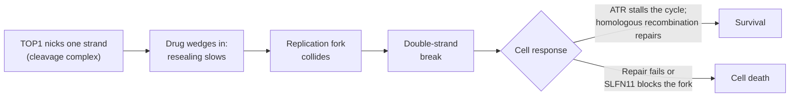

# Topoisomerase I inhibitors

## In one sentence

Topoisomerase I inhibitors trap the enzyme that relieves twisting in DNA while it is bound to a cut strand, so DNA copying turns those trapped complexes into lethal double-strand breaks.

## The intuition

Unwinding a rope ahead of you makes the rope beyond twist tighter. Copying or reading DNA does the same. Topoisomerase I (TOP1) is a worker that snips one strand, lets the twist spin out, and rejoins the strand. A TOP1 inhibitor jams the worker in the moment it is holding the cut open. When the cell's copying machinery runs into the jammed worker, the single nick becomes a full break. The analogy breaks because the jam alone is rarely lethal: most of the harm comes when the copying machinery collides with it.

## How it works

1. **TOP1 nicks one DNA strand** and attaches to it briefly, forming a *cleavage complex*. Normally the strand is resealed within moments.
2. **Camptothecin-class drugs wedge into that complex** and slow resealing. Drugs that act this way are called *TOP1 poisons*, a kind of *interfacial inhibitor*: they stabilize an enzyme–DNA intermediate rather than switching the enzyme off [1, 2].
3. **Replication converts damage into breaks.** A replication fork that collides with a trapped complex produces a double-strand break. That is why these drugs mainly kill cells that are copying DNA, in the S phase of the [cell cycle](/wiki/education/concepts/biology-basics/cells/cell-cycle).
4. **The cell's response decides survival.** The replication-stress checkpoint kinase ATR stalls the cell to buy repair time. [Homologous recombination](/wiki/education/concepts/cancer-biology/genome-instability-and-repair/homologous-recombination-and-hrd) repairs the breaks. The protein SLFN11 blocks stressed forks and sensitizes cells to TOP1 poisons; cells lacking it are often more tolerant [3, 6].

*The drug turns a normal, brief nick into a roadblock; copying DNA turns the roadblock into a break.*

The family shares one chemical core, camptothecin. **Irinotecan** is a prodrug converted to **SN-38**; **topotecan** is given directly. As payloads in [antibody-drug conjugates (ADCs)](/wiki/education/concepts/therapeutics/antibody-based/antibody-drug-conjugate), **SN-38** (sacituzumab govitecan), **DXd**, an exatecan derivative released from the drug-linker deruxtecan (trastuzumab deruxtecan, datopotamab deruxtecan), and **exatecan** itself are the most used. They differ in potency, membrane permeability and how readily [drug efflux transporters](/wiki/education/concepts/therapeutics/how-drugs-work/drug-efflux-transporters) pump them out.

## Why it matters in cancer

- **TOP1 is the dominant ADC payload class in breast cancer.** The approved ADCs for triple-negative and HER2-low disease all deliver TOP1 inhibitors; see [ADC payload classes](/wiki/education/concepts/therapeutics/antibody-based/adc-payload-classes).
- **Repair biology links to sensitivity.** Replication-stress and repair defects are why ATR, PARP and WEE1 inhibitors are studied alongside TOP1 drugs; see [DDR inhibitors](/wiki/education/concepts/therapeutics/targeted-small-molecules/ddr-inhibitors).
- **Resistance is measurable.** Cells can lower TOP1 levels, pump the drug out, or acquire TOP1 mutations. In one metastatic breast cancer cohort, plasma testing found TOP1 mutations in 4 of 31 patients (12.9%) at progression on an ADC versus 3 of 420 (0.7%) without ADC treatment, and the three mutant enzymes tested in the laboratory resisted SN-38 and deruxtecan [4].
- **Side effects follow the mechanism and the metabolism.** Low neutrophil counts and diarrhea are typical; see [ADC payload toxicities](/wiki/education/concepts/therapeutics/toxicities-and-supportive-care/adc-payload-toxicity). SN-38 is inactivated by the enzyme UGT1A1, mainly in the liver. In a 66-patient irinotecan study, grade 4 neutropenia occurred in 3 of 6 people with two copies of the reduced-function UGT1A1*28 variant, versus none of 29 with two normal copies [5]. The sacituzumab govitecan label carries the same warning for people homozygous for UGT1A1*28 [7].

## Common confusions

- **TOP1 is not TOP2.** [Anthracyclines](/wiki/education/concepts/therapeutics/chemotherapy/anthracyclines) such as doxorubicin act on topoisomerase II, which cuts both strands. Resistance to one does not by itself imply resistance to the other, although a shared efflux pump can affect both.
- **A different antibody is not a different payload.** Two ADCs aimed at different proteins can both deliver a camptothecin.
- **"Inhibitor" undersells the mechanism.** The drug does harm by trapping an active enzyme on DNA, not by removing the enzyme. Less TOP1 can mean less damage.
- **Lung inflammation is not a uniform TOP1 effect.** Interstitial lung disease is a boxed warning for trastuzumab deruxtecan and a labeled warning (not boxed) for datopotamab deruxtecan, which carry the same payload at different loadings. It is reported less often with sacituzumab govitecan, and it also occurs with some ADCs outside the TOP1 class. Each product's risk comes from its own trials; the rates are kept in [ADC payload toxicities](/wiki/education/concepts/therapeutics/toxicities-and-supportive-care/adc-payload-toxicity) and [pneumonitis](/wiki/education/concepts/therapeutics/toxicities-and-supportive-care/pneumonitis).

## How it is measured

In the laboratory, sensitivity is measured by cell survival across drug concentrations, and DNA damage by markers such as γH2AX. Resistance mechanisms are measured as TOP1 protein level, TOP1 sequence (in tissue or plasma), SLFN11 expression and efflux-transporter activity. None is a validated clinical selection test for a TOP1 ADC.

## Related concepts

- [ADC payload classes](/wiki/education/concepts/therapeutics/antibody-based/adc-payload-classes)
- [Cross-resistance between ADCs](/wiki/education/concepts/therapeutics/antibody-based/adc-cross-resistance)
- [Replication stress](/wiki/education/concepts/cancer-biology/genome-instability-and-repair/replication-stress)
- [Drug efflux transporters](/wiki/education/concepts/therapeutics/how-drugs-work/drug-efflux-transporters)
- [Chemotherapy](/wiki/education/concepts/therapeutics/chemotherapy/chemotherapy)

## Sources and scope

Source check: November 7, 2026. Established mechanism plus named clinical and laboratory examples, each limited to its population or model. Expert and learner review remain pending.

1. [Pommier, 2006: Topoisomerase I inhibitors: camptothecins and beyond](https://pubmed.ncbi.nlm.nih.gov/16990856/) — mechanism, replication collision and resistance.
2. [Pommier et al., 2010: DNA topoisomerases and their poisoning by anticancer and antibacterial drugs](https://pubmed.ncbi.nlm.nih.gov/20534341/) — interfacial poisoning.
3. [Zoppoli et al., 2012](https://pubmed.ncbi.nlm.nih.gov/22927417/) — SLFN11 sensitizes cancer cells to DNA-damaging agents, including TOP1 inhibitors, in cell-line panels.
4. [Abelman et al., 2025](https://pubmed.ncbi.nlm.nih.gov/39745368/) — TOP1 mutations after ADC progression in metastatic breast cancer; small selected cohort.
5. [Innocenti et al., 2004](https://pubmed.ncbi.nlm.nih.gov/15007088/) — UGT1A1 variants and severe neutropenia with irinotecan.
6. [Murai et al., 2018](https://pubmed.ncbi.nlm.nih.gov/29395061/) — SLFN11 blocks stressed replication forks independently of ATR.
7. [Sacituzumab govitecan prescribing information, June 2026](https://dailymed.nlm.nih.gov/dailymed/drugInfo.cfm?setid=57a597d2-03f0-472e-b148-016d7169169d) — UGT1A1*28 neutropenia warning.

<!-- BEGIN GENERATED USED IN -->
## Used in

- [Separate the address from the killing mechanism](/wiki/education/guides/aiming-a-drug-at-a-surface-target/01-mechanism)
- [Match the payload to the failure](/wiki/education/guides/aiming-a-drug-at-a-surface-target/04-match-the-payload-to-the-failure)
- [Read a new payload strategy](/wiki/education/guides/aiming-a-drug-at-a-surface-target/05-read-a-new-payload-strategy)
- [Aiming a drug at a surface target](/wiki/education/guides/aiming-a-drug-at-a-surface-target/index)
<!-- END GENERATED USED IN -->
