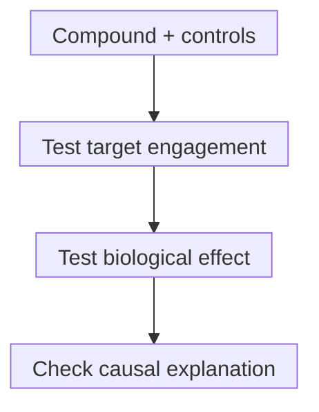

# Chemical probes, medicines and target engagement

## In one sentence

A chemical probe helps test a biological mechanism, while target engagement asks whether a compound reaches and interacts with its intended target under the measured conditions.

## The intuition

A test tool can reveal how one part behaves without being suitable for everyday use. A chemical probe helps ask what a biological target does. The analogy stops at selectivity: a molecule can affect several cellular parts at once, including ones researchers have not measured.

## How it works

A **chemical probe** is a research compound used to perturb a defined biological process. Characterize identity, concentration-dependent activity, relevant selectivity and effects in the experimental system. Higher concentrations can introduce additional effects; there is no universal “clean” concentration for every probe.

**Target engagement** asks whether a compound interacts with its intended target where the experiment requires it. Binding a purified protein does not establish cell entry or engagement in a tumor. Engagement also differs from changing target function, a downstream effect or clinical benefit.

A **medicine** needs evidence suited to use in people: product quality, [pharmacokinetics](/wiki/education/concepts/therapeutics/how-drugs-work/pharmacokinetics-and-half-life), tolerability and evidence matching the intended clinical use. A useful probe may lack adequate delivery, stability or safety. An approved medicine can be a poor tool for isolating one target if several interactions contribute to its effects.

An evidence-building workflow. Each question needs its own measurement; agreement does not supply clinical benefit.

### Controls help distinguish competing explanations

| Control | What it helps ask | Important limit |
|---|---|---|
| Closely related inactive compound | Does activity track the target-binding feature rather than shared chemistry? | Its uptake or other properties may also differ |
| Structurally different, well-characterized probe | Does an independent chemical perturbation support the same mechanism? | Shared off-target effects remain possible |
| Genetic perturbation or engineered resistance/rescue | Does changing the target change the effect as predicted? | Removing a whole protein can differ from inhibiting one function |

These tests complement each other. Record conflicts rather than choosing only results that fit the hypothesis. [Perturbation and controls](/wiki/education/concepts/evidence-and-statistics/study-design/perturbation-and-controls) develops this reasoning.

## Why it matters in cancer

An altered gene or elevated protein can suggest a target hypothesis. It does not establish that inhibiting the target will harm cancer cells selectively. Controlled perturbations test dependence; safe exposure and appropriate clinical studies answer later questions. [Synthetic lethality](/wiki/education/concepts/therapeutics/how-drugs-work/synthetic-lethality) also needs evidence for the proposed interaction, rather than a drug name alone.

## How it is measured

The **cellular thermal shift assay (CETSA)** measures compound-associated changes in a target protein's thermal behavior. The original experiments used ligand-associated stabilization in cells and tissues. A shift can support engagement under its assay conditions; it is not automatically an inhibition or occupancy percentage.

| Observation card | Record and interpret |
|---|---|
| Input and consumption | Defined compound and target-containing cells, tissue or lysate; heated aliquots are consumed |
| Conditions | Compound concentration, exposure duration, temperature series, system and controls |
| Output and units | Remaining soluble target signal versus temperature, or versus concentration at a fixed temperature; degrees Celsius and concentration units belong to different axes |
| Failures and validation | Target detectability, baseline thermal behavior and indirect protein-complex effects can limit interpretation; no universal shift cutoff, tumor-delivery proof or clinical-benefit conversion |

Use independent evidence when the proposed mechanism requires it. Engagement, a biochemical functional change and cell survival may all need separate assays.

## Worked example

A fictional compound lowers cultured-cell viability at 10 micromoles per liter. Engagement and selectivity have not been measured. The supported conclusion is an effect in this culture at this concentration. It does not identify the responsible target or establish that a safe human dose reaches it.

## Common confusions

- **Probe is not medicine.** Their purpose and evidence requirements differ.
- **Binding is not cellular engagement.** Location and exposure matter.
- **Engagement is not inhibition.** Interaction need not cause the intended functional change.
- **One active compound is not causal proof.** Other interactions can explain the effect.
- **A culture concentration is not a patient dose.** The quantities and settings differ.

## Try it

Someone concludes from the fictional viability result that the proposed target is essential and the compound is clinically usable. Which next tests would distinguish the missing claims?

**Answer:** Measure engagement and relevant selectivity, compare inactive and independent probes, and use a suitable target perturbation/rescue. These address causality. Exposure, quality, safety and clinical evidence remain separate; controls do not certify a medicine.

## Explain it back

“Engagement tells me ___; a controlled effect experiment adds ___.”

**One answer:** interaction occurred under measured conditions; evidence about the consequences and their causal explanation.

## Takeaway

**Use probes to test a mechanism, then keep target interaction, biological consequence and clinical use as separate claims.**

## Related concepts

- [Drug targets and mechanisms](/wiki/education/concepts/therapeutics/how-drugs-work/drug-target-and-mechanism)
- [Clinical actionability](/wiki/education/concepts/evidence-and-statistics/biomarkers/actionability)

## Sources and scope

Source check: October 10, 2026. General research-method teaching and fictional practice; no patient-use recommendation. Expert and learner review remain pending.

- [Workman and Collins, 2010](https://pubmed.ncbi.nlm.nih.gov/20609406/) — methodological review of fit-for-purpose probes.
- [Arrowsmith et al., 2015](https://pubmed.ncbi.nlm.nih.gov/26196764/) — authoritative methodological perspective on selectivity and complementary controls.
- [Martinez Molina et al., 2013](https://pubmed.ncbi.nlm.nih.gov/23828940/) — original primary CETSA cellular/tissue engagement experiments.
- [Ball et al., 2020](https://www.nature.com/articles/s42003-020-0795-6) — primary thermal-profiling method study; cell-state and indirect stability effects complicate direct-binding interpretation.

<!-- BEGIN GENERATED USED IN -->
## Used in

- [Read the validation behind the claim](/wiki/education/guides/judging-a-test-or-vendor-claim/02-read-the-validation)
- [Connect evidence to a decision](/wiki/education/guides/judging-a-test-or-vendor-claim/03-connect-evidence-to-a-decision)
- [Judge a test or company claim](/wiki/education/guides/judging-a-test-or-vendor-claim/index)
- [Autophagy and proteostasis: amount, flow, and dependence](/wiki/education/molecular-profiling/evee-pathways/01-autophagy-and-proteostasis)
- [Lipid supply and mTOR: measuring resource control](/wiki/education/molecular-profiling/evee-pathways/02-lipid-and-mtor)
- [Stress defenses and chromatin readers: test the direction](/wiki/education/molecular-profiling/evee-pathways/04-cul3-nrf2-ferroptosis-and-bet)
<!-- END GENERATED USED IN -->
