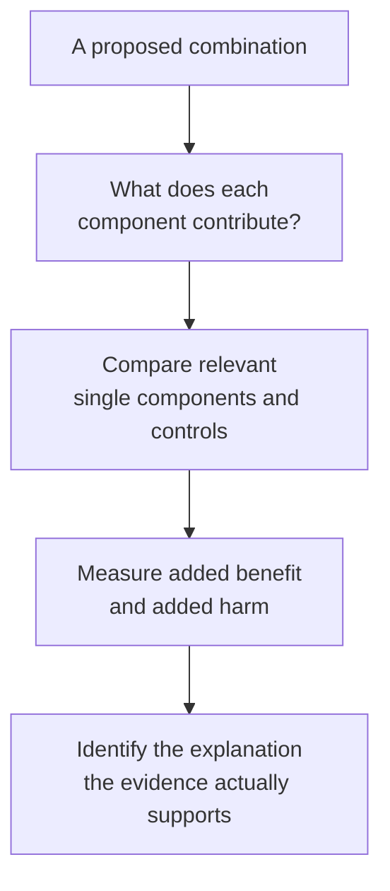
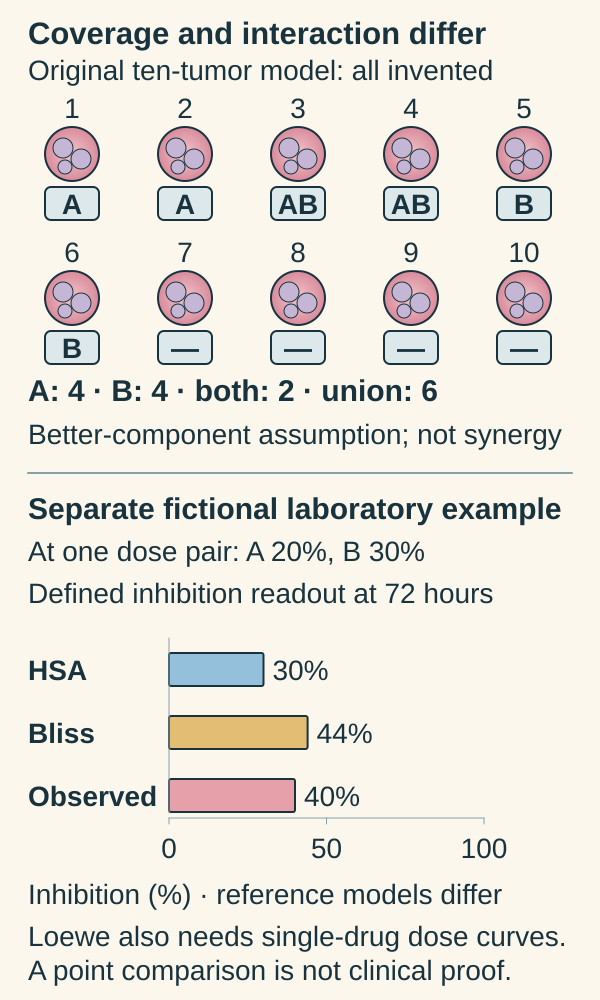

# Why combine cancer treatments?

## In one sentence

Combination therapy uses more than one treatment to pursue a defined benefit, which must be tested against an appropriate alternative along with its added harms.

## The intuition

Two tools can tackle different parts of a job. They can also interfere with one another or damage the same material. “More tools” is therefore a proposal, not a result.

The analogy misses an important cancer feature: tumors and people vary. A combination can help a broader group because different tumors respond to different components, even without a stronger interaction inside each tumor.

## How it works

A rationale should name the job of each component. One might attack a [growth pathway](/wiki/education/concepts/biology-basics/signaling/signal-transduction-and-kinases), while another affects a survival route. Different treatments may act at different locations or stages. A proposed combination can also seek to limit [resistant populations](/wiki/education/concepts/therapeutics/how-drugs-work/drug-resistance). Each story makes predictions that need testing.

**Synergy** is a narrower claim: the combined effect exceeds a stated reference model. A result that is stronger than either single drug does not automatically exceed every reference. [The functional-experiment lesson](/wiki/education/guides/from-variant-to-drug/07-reading-a-functional-experiment) compares highest-single-agent, Bliss and Loewe expectations using explicit fictional data.

**Independent drug action** asks a different question. In that model, a person's outcome on a combination is the better of the outcomes the components would produce alone. If different people are sensitive to different components, the group can benefit without an extra within-person interaction. Palmer and Sorger tested this explanation using clinical data, tumor-model data and simulations. Their analysis supports an important alternative explanation, not a rule that all effective combinations lack synergy.

The phrase “independent action” also does not mean every statistical assumption is independence. Correlation between responses to the components affects the predicted group benefit. Shared resistance can reduce the advantage of covering different responders.

*A useful combination and a proven synergistic interaction are different conclusions.*

## Why it matters in cancer

Combining mechanisms may broaden activity or address a measured escape route. It may also increase toxicity, alter [drug exposure](/wiki/education/concepts/therapeutics/how-drugs-work/pharmacokinetics-and-half-life) or force lower doses. Simultaneous and sequential treatment are different strategies; a molecular diagram cannot choose between them.

Clinical comparison should specify disease, prior treatment, doses, schedule, comparator and outcome. Evidence that one regimen beats one component does not establish superiority to every alternative, or identify which component supplied the benefit.

## Worked example

An **invented response model** contains ten hypothetical tumors. Four are assigned sensitivity to A, and four to B. Two appear in both groups. The model assumes each tumor receives the better component's effect, with no extra interaction and no added toxicity.

The union is `4 + 4 − 2 = 6`. Under those assumptions, six tumors have a modeled response to at least one component. This is a counting example, not a measured clinical response rate. The combination itself still needs testing; changing correlation, exposure, schedule or toxicity can change the result.

*Covering different responders and exceeding a laboratory reference model are separate ideas.*

Count the badges above: A marks tumors 1–4; B marks 3–6. The overlap is counted once, leaving six in the union and four in neither group. This retains the original better-component model, including its no-extra-interaction and no-added-toxicity assumptions. Independent drug action is not a requirement that the two response groups be statistically independent. [Primary independent-action analysis](https://pubmed.ncbi.nlm.nih.gov/29245013/).

The lower chart is a separate invented experiment in one cultured tumor-cell model at 72 hours. Inhibition means reduction in a vehicle-normalized viable-cell endpoint count; it is not a direct death measurement. At the chosen fixed dose pair, A gives 20%, B gives 30%, and the combination gives 40%. Highest single agent (HSA) expects the larger single effect, 30%. Bliss expects `0.20 + 0.30 − 0.20 × 0.30 = 0.44`, or 44%. Loewe needs single-drug dose-response curves to compare doses giving the same effect; these three values are insufficient. No uncertainty or statistical test is supplied. [Reference-model method](https://pubmed.ncbi.nlm.nih.gov/28379339/), [Authors’ reference-model documentation](https://www.bioconductor.org/packages/release/bioc/vignettes/synergyfinder/inst/doc/User_tutorual_of_the_SynergyFinder_plus.html).

**Read the references:** Does 40% exceeding HSA establish excess over every model? **Answer:** No. It is below the 44% Bliss expectation. A broader synergy claim still needs appropriate data and uncertainty.

## How it is measured

Laboratory interaction analysis needs suitable single-drug dose-response data, combination conditions, controls and variation estimates. Clinical trials instead compare treatment strategies and meaningful outcomes. A group survival advantage does not by itself measure a cell-level synergy mechanism.

## Common confusions

- **Different targets versus proven benefit:** separate target names can still share a bottleneck.
- **Better than one component versus synergistic:** name the reference and measurement scale.
- **Population coverage versus stronger action in every tumor:** variation among responders can matter.
- **Mechanistic complementarity versus safe scheduling:** drug interactions and toxicity need direct evidence.

## Try it

A combination improves a group outcome compared with A alone. B alone was not studied, and no interaction model was tested. What is the justified conclusion?

**Answer:** The combination outperformed A in that study's setting, subject to its design and uncertainty. The result alone cannot establish synergy, B's independent contribution, or superiority to B alone.

## Explain it back

“A combination rationale names ___; a useful comparison tests ___; a synergy claim needs ___.”

One possible answer: “the contribution of each component; added benefit and harm; a stated interaction reference with appropriate data.”

## Takeaway

**A combination earns its use through a relevant benefit–harm comparison; synergy is a separate claim.**

## Related concepts

- [Synthetic lethality](/wiki/education/concepts/therapeutics/how-drugs-work/synthetic-lethality).
- [Trial phases and randomization](/wiki/education/concepts/evidence-and-statistics/study-design/trial-phases-and-randomization).
- [Immune escape](/wiki/education/concepts/immunology/tumor-immunology/immune-escape).

## Sources and scope

Source check: October 9, 2026. The ten-tumor arithmetic is fictional. This explains rationales and evidence boundaries, not a regimen or sequence for an individual. Expert and learner review pending.

- [Palmer and Sorger, 2017: independent action and variation between tumors](https://pubmed.ncbi.nlm.nih.gov/29245013/) — primary analysis of clinical datasets, tumor models and simulations; an explanatory model with assumptions.
- [Ianevski et al., 2017: combination dose-response analysis](https://pubmed.ncbi.nlm.nih.gov/28379339/) — primary computational method for named laboratory interaction references.
- [NCI: targeted cancer therapies](https://www.cancer.gov/about-cancer/treatment/types/targeted-therapies) — general resistance and combination rationale; not validation of every pairing.

<!-- BEGIN GENERATED USED IN -->
## Used in

Browse the [concept index](/wiki/education/concepts/index) for related learning paths.
<!-- END GENERATED USED IN -->
