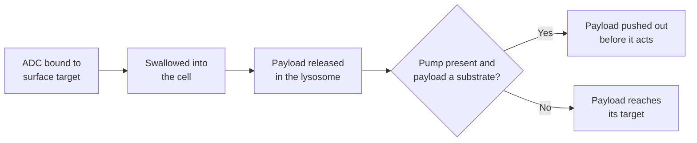

# Drug efflux transporters

## In one sentence

Drug efflux transporters are membrane pumps that use cellular energy to move drugs out of a cell, lowering the drug level inside and contributing to resistance when cancer cells make more of them.

## The intuition

Picture a boat taking on water with a bilge pump running. The water that matters is what stays in the boat, not what came over the side. A drug works only at the concentration it reaches at its target inside the cell. A pump that bails it out faster lowers that concentration even when plenty of drug surrounds the cell. The analogy breaks because pumps are selective: each moves some drugs well and ignores others.

## How it works

The best-studied pumps belong to the **ATP-binding cassette (ABC) transporter** family. They use energy from ATP to carry substrates across the membrane, outward [1]. Three matter most for cancer drugs:

| Pump | Gene | Examples of substrates |
|---|---|---|
| **P-glycoprotein (P-gp)** | ABCB1, also called MDR1 | Taxanes, anthracyclines, vinca alkaloids; the ADC payload MMAE in resistance models [2] |
| **Breast cancer resistance protein (BCRP)** | ABCG2 | Topotecan, SN-38 [3] |
| **Multidrug resistance protein 1 (MRP1)** | ABCC1 | Anthracyclines, vinca alkaloids, etoposide, methotrexate, and drugs the body has tagged with glutathione or glucuronide |

These pumps have normal jobs. They protect the brain, gut, placenta and stem cells by keeping foreign chemicals out. That is one reason some drugs reach the brain poorly.

Cancer cells can raise pump levels under drug pressure. Because one pump handles many unrelated drugs, a single change can cause **multidrug resistance**: resistance to drugs the cell has never seen [1].

**Antibody-drug conjugates meet pumps after delivery.** An [antibody-drug conjugate (ADC)](/wiki/education/concepts/therapeutics/antibody-based/antibody-drug-conjugate) enters by being swallowed into the cell, so the pump cannot block entry. Once the payload is released inside, a pump can push it out before it acts. Pumps on neighboring cells can likewise expel payload that diffused in, blunting the bystander effect.

*Pumps cannot stop an ADC from entering, but they can remove the payload after release.*

In breast cancer cell lines made resistant to trastuzumab deruxtecan or sacituzumab govitecan, resistance came mainly from more efflux-transporter activity while the target protein remained; ADCs with a different payload class still worked [4].

## Why it matters in cancer

- **Pumps link resistance across drugs that share a substrate profile**, which matters when choosing what to try next; see [cross-resistance between ADCs](/wiki/education/concepts/therapeutics/antibody-based/adc-cross-resistance).
- **Payload chemistry can be designed around a pump.** Developers report that some newer TOP1 payloads, such as exatecan released without a linker remnant, are less affected by multidrug-resistance pumps than DXd or SN-38 in preclinical models [5].
- **Blocking pumps has not worked well in patients.** Several generations of P-gp inhibitors improved drug levels in laboratory models but did not improve outcomes in clinical trials, partly because they raised toxicity and because tumors rely on more than one pump [1].

## Common confusions

- **More pump RNA is not proof of pumping.** Function depends on protein at the membrane and on whether the drug is a substrate. Functional efflux assays answer that directly.
- **A pump is not a receptor.** Pumps do not need to be the drug's target; they act on the drug after it arrives.
- **Efflux is not antigen loss.** A cell can keep the ADC's target protein, take up the ADC normally, and still resist because it removes the payload.
- **Substrate status is drug-specific.** "Pumped out" for SN-38 does not establish the same for every TOP1 payload.

## How it is measured

Pump expression can be measured as RNA or by protein staining. Pump **function** is measured with fluorescent substrates that cells retain less when a pump is active, with and without a pump inhibitor, or by measuring the drug's level inside the cell. For ADC resistance, the most informative comparison tests the intact ADC and the free payload on the same cells, with and without a pump inhibitor.

## In Diana's case

How this applies to her is owned by the [drug-panel preferences](/wiki/diagnostics/drug-panel-preferences) page.

## Related concepts

- [Drug resistance](/wiki/education/concepts/therapeutics/how-drugs-work/drug-resistance)
- [Pharmacokinetics and half-life](/wiki/education/concepts/therapeutics/how-drugs-work/pharmacokinetics-and-half-life)
- [ADC payload classes](/wiki/education/concepts/therapeutics/antibody-based/adc-payload-classes)
- [Topoisomerase I inhibitors](/wiki/education/concepts/therapeutics/chemotherapy/topoisomerase-i-inhibitors)

## Sources and scope

Source check: November 7, 2026. Established transporter biology and laboratory resistance models; no pump measurement is a validated clinical selection test. Expert and learner review remain pending.

1. [Robey et al., 2018: Revisiting the role of ABC transporters in multidrug-resistant cancer](https://pubmed.ncbi.nlm.nih.gov/29643473/) — transporter families, substrates and the clinical inhibitor experience. See also [Gottesman, Fojo and Bates, 2002](https://pubmed.ncbi.nlm.nih.gov/11902585/).
2. [Chen et al., 2015](https://pubmed.ncbi.nlm.nih.gov/25840583/) — MDR1 upregulation and MMAE resistance in brentuximab vedotin–resistant lymphoma models.
3. [Chang et al., 2016](https://pubmed.ncbi.nlm.nih.gov/27207776/) — ABCG2 inhibitors restored SN-38 activity in SN-38-resistant breast and gastric cell lines; combined with sacituzumab govitecan, an inhibitor prolonged survival in a gastric xenograft.
4. [Rampa et al., 2026](https://pubmed.ncbi.nlm.nih.gov/41591991/) — efflux-driven, payload-specific resistance to trastuzumab deruxtecan and sacituzumab govitecan in breast cancer cell and animal models.
5. [Weng et al., 2023](https://pubmed.ncbi.nlm.nih.gov/36693125/) — exatecan conjugates overcoming resistance to DXd and SN-38 conjugates in preclinical multidrug-resistant models.

<!-- BEGIN GENERATED USED IN -->
## Used in

- [Match the payload to the failure](/wiki/education/guides/aiming-a-drug-at-a-surface-target/04-match-the-payload-to-the-failure)
- [Aiming a drug at a surface target](/wiki/education/guides/aiming-a-drug-at-a-surface-target/index)
<!-- END GENERATED USED IN -->
