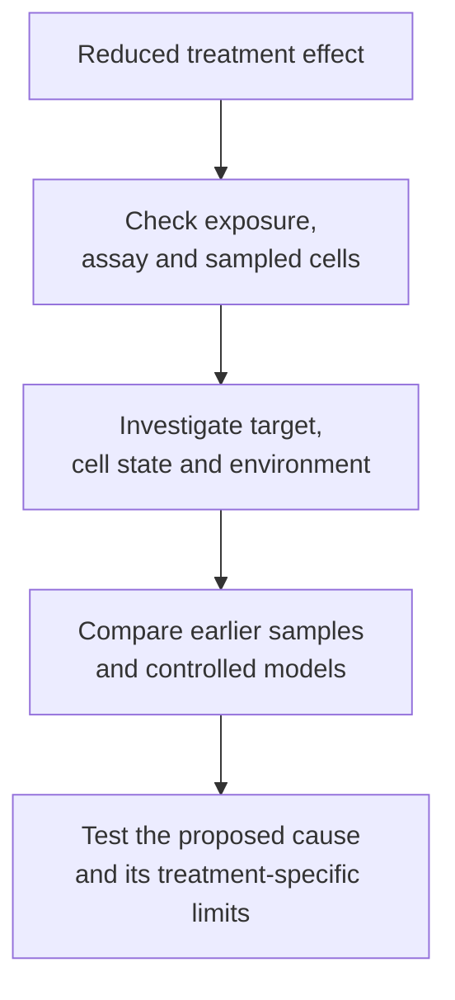
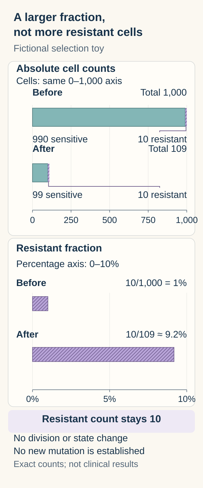

# Drug resistance: selection, adaptation and escape

## In one sentence

Drug resistance means a cancer population is less affected by a treatment in a defined setting, through mechanisms that may already exist or emerge over time.

## The intuition

Imagine removing weeds from a garden with one method. Plants that were already harder to remove may make up more of what remains. That does not mean the method taught every plant the same trick.

The analogy is incomplete: cells can also acquire sequence changes, change their state or receive protection from nearby tissue. Several mechanisms can coexist, and the treatment's exposure matters too.

## How it works

**Intrinsic resistance** describes limited sensitivity from the outset. **Acquired resistance** describes loss of a response after earlier sensitivity. These are timing descriptions, not complete molecular explanations. An initially rare resistant population may become easier to detect after treatment.

Treatment changes which populations survive and grow. This is **selection**. New [sequence changes](/wiki/education/concepts/biology-basics/genetics/mutation-types) can also arise over time. Finding a variant in a later resistant sample does not establish when it arose, whether it caused resistance, or whether it was present below the earlier test's detection limit.

A target can change, disappear or become less accessible. Cells can use an alternative [signaling route](/wiki/education/concepts/biology-basics/signaling/signal-transduction-and-kinases), change drug handling, or avoid the process that normally causes death. The surrounding [stroma](/wiki/education/concepts/biology-basics/cells/epithelium-and-stroma) can affect exposure and survival signals. The proposed mechanism must fit the actual treatment's requirements.

Sequence changes are not the only explanation. Sharma and colleagues observed reversible drug-tolerant states in defined human cancer cell-line experiments. Some survivors regained sensitivity after drug removal. That supports a model-specific state mechanism; it neither proves that every resistant tumor is reversible nor identifies a safe treatment strategy in people.

*A resistance label starts an investigation; it does not identify one universal escape route.*

## Why it matters in cancer

The same later sample can contain several resistant populations. A finding from one region need not explain every disease site. **Cross-resistance** means resistance to one treatment also reduces sensitivity to another; it must be established for the particular drugs and mechanism.

Likewise, avoiding one failure point creates new requirements. A [combination rationale](/wiki/education/concepts/therapeutics/how-drugs-work/combination-therapy-rationale) must show that its components address the measured problem at useful exposures, with tolerable harm. A pathway diagram or a new target name cannot establish a clinical rescue.

## Worked example

An **invented culture** begins with 990 sensitive cells and ten resistant cells. Treatment removes 90% of the sensitive cells and none of the resistant cells. For this short illustration, assume no new division or state change.

There are now 99 sensitive cells and ten resistant cells. The resistant fraction rose from `10/1,000 = 1%` to `10/109 ≈ 9.2%`, although its absolute count stayed ten. Enrichment does not require the treatment to have created a new mutation. Real cultures need direct counts, time points and controls; these are fictional values.

  
  
A larger share does not mean more resistant cells. In this invented culture, resistant cells stay at ten while the total falls from 1,000 to 109, so their fraction rises from 1% to about 9.2%. The count and percentage axes are separate; no division or state change is assumed, and the chart does not establish a new mutation or a clinical treatment effect.

## How it is measured

Clinical disease assessments establish whether treatment benefit persists under specified criteria. They do not identify the mechanism alone. Research compares earlier and later samples, [drug exposure](/wiki/education/concepts/therapeutics/how-drugs-work/pharmacokinetics-and-half-life), target engagement, pathway activity and response in suitable models.

Drug removal and re-exposure can test reversibility in a culture. Genetic perturbation and rescue can test a proposed causal function. Neither reproduces all human tissue, immune and safety conditions.

## Common confusions

- **Later detection versus new origin:** an earlier low-frequency population may have been missed.
- **Resistant fraction versus resistant count:** a changing denominator can enrich a population.
- **Tolerance versus permanent genetic resistance:** state and sequence mechanisms can differ and coexist.
- **Failure to respond versus a proven escape mutation:** inadequate exposure or an inadequate model can obscure interpretation.

## Try it

A later sample contains a variant that the earlier assay did not detect. The earlier report lacks enough coverage at that site. Has a new treatment-induced resistance mutation been proved?

**Answer:** No. Confirm the comparison's adequacy, quantify the earlier detection limit and test whether the variant causes resistance. Timing, origin and mechanism are separate claims.

## Explain it back

“Resistance describes ___; selection changes ___; a causal mechanism requires ___.”

One possible answer: “reduced effect in a defined setting; which populations remain; evidence that the proposed process explains the drug-specific response.”

## Takeaway

**Explain the failed treatment requirement and the sampled population before naming a way around resistance.**

## Related concepts

- [Immune escape](/wiki/education/concepts/immunology/tumor-immunology/immune-escape).
- [Cell lineage and differentiation](/wiki/education/concepts/biology-basics/cells/cell-lineage-and-differentiation).
- [Variant allele fraction and cancer-cell fraction](/wiki/education/concepts/measurement/sequencing-basics/variant-allele-fraction-and-cancer-cell-fraction).
- [Preclinical evidence](/wiki/education/concepts/evidence-and-statistics/study-design/preclinical-evidence).

## Sources and scope

Source check: October 9, 2026. General resistance reasoning; all cell counts are fictional. Defined laboratory mechanisms do not establish personal treatment choices. Expert and learner review pending.

- [NCI: targeted cancer therapies and resistance](https://www.cancer.gov/about-cancer/treatment/types/targeted-therapies) — target changes and alternative growth routes.
- [Sharma et al., 2010: reversible drug tolerance in cancer cell models](https://pubmed.ncbi.nlm.nih.gov/20371346/) — primary cell-line experiments, including sensitive and re-exposed populations.

<!-- BEGIN GENERATED USED IN -->
## Used in

- [Find the step an immune response can lose](/wiki/education/oncology-101/4-escape-mechanisms)
<!-- END GENERATED USED IN -->
