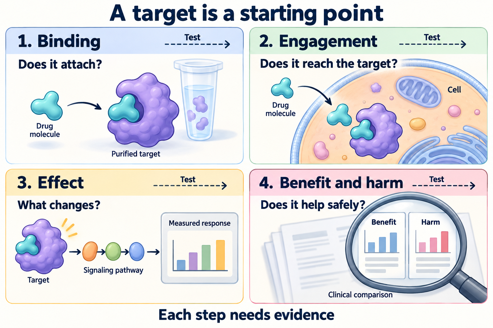
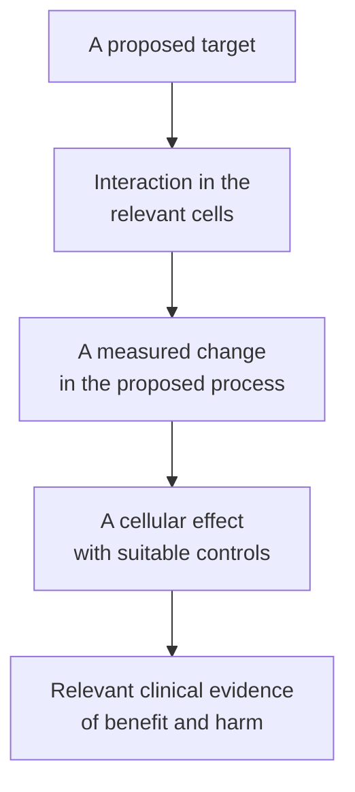

# Drug targets and mechanisms of action

## In one sentence

A drug target is a biological molecule or structure a treatment acts on; its mechanism of action explains how that action produces an effect.

## The intuition

Knowing which button a tool presses helps explain its design. It does not tell you whether the button is reachable, whether the machine depends on it, or whether changing it does useful work. A target name answers the first question. The mechanism and its evidence answer the others.

The analogy has limits: drugs can interact with several targets, and cells can change their response. There may be more than one route from the initial interaction to the observed effect.

## How it works

*Binding, engagement, effect and benefit require separate evidence. The charts are schematic; the cell panel illustrates one intracellular target.*

Start with **binding**, an interaction between molecules. [Affinity and specificity](/wiki/education/concepts/biology-basics/molecules/enzymes-and-binding) describe different aspects of that interaction. Binding to a purified protein does not show that a compound reaches it inside a cell.

[Target engagement](/wiki/education/concepts/therapeutics/how-drugs-work/chemical-probe-vs-drug-and-target-engagement) asks whether the interaction occurs in the relevant system. [Drug exposure](/wiki/education/concepts/therapeutics/how-drugs-work/pharmacokinetics-and-half-life), target location and the [cell membrane](/wiki/education/concepts/biology-basics/cells/cell-and-membrane) affect that question. A blood concentration and a concentration at an intracellular target are different observations.

Next ask what changes. A compound might inhibit an [enzyme](/wiki/education/concepts/biology-basics/molecules/enzymes-and-binding), activate a [receptor](/wiki/education/concepts/biology-basics/signaling/agonist-and-antagonist), or carry a payload to an accessible address. A targeting antibody's binding site and its attached cell-killing payload have different jobs. The target need not drive cancer growth for delivery to be useful; successful binding alone does not prove successful delivery.

Then measure the resulting behavior: altered signaling, slower division, death, or another specified outcome. These effects need controls that test the proposed explanation. A second compound, genetic perturbation or rescue experiment can strengthen attribution. They also have limitations, so one positive experiment should not carry the whole claim.

*Each step requires evidence; a target label does not fill the later steps.*

## Why it matters in cancer

Some treatments interrupt growth signals. Others exploit a delivery address or change an immune interaction. Those mechanisms require different measurements. The National Cancer Institute describes these distinct treatment jobs; a common “targeted” label does not make them interchangeable.

A target may also occur in healthy tissue. A useful [therapeutic margin](/wiki/education/concepts/therapeutics/how-drugs-work/therapeutic-index) depends on achieved benefit and harm, not simply stronger binding. Clinical evidence must match the disease, treatment setting, product and outcome being discussed.

## How it is measured

Binding assays test interaction under specified conditions. Engagement assays examine the relevant cells or tissue. The original cellular thermal shift assay measured changes in protein thermal behavior after compound exposure. A downstream signal instead measures a biological consequence; it is not automatically a direct occupancy measurement.

Growth, death and regrowth assays add other layers. A well-controlled cellular mechanism remains distinct from a clinical trial showing patient benefit. Always name the measured layer before using the word “worked.”

## Common confusions

- **Target present versus target reached:** location and exposure still matter.
- **Binding versus changing function:** a binder may leave the target's activity unchanged.
- **Address versus growth driver:** a delivery target and a signaling dependency are different roles.
- **Mechanism versus benefit:** a credible explanation can still fail to produce a useful clinical outcome.

## Try it

A fictional antibody binds protein A on cancer cells. Its assay shows no change in growth. Has the team shown that protein A is a growth driver or that the antibody treats cancer?

**Answer:** No. Binding is supported under the assay conditions. Driver dependence, functional inhibition, delivery by a finished payload-bearing product, safety and clinical benefit require their own evidence.

## Explain it back

“The target names ___; the mechanism explains ___; clinical evidence tests ___.”

One possible answer: “what is acted on; the route from action to effect; benefit and harm in a specified setting.”

## Takeaway

**Follow the interaction through its measured effects before turning a target name into a treatment claim.**

## Related concepts

- [Receptor types](/wiki/education/concepts/biology-basics/signaling/receptor-types).
- [Drug resistance](/wiki/education/concepts/therapeutics/how-drugs-work/drug-resistance).
- [Antibody-drug conjugates](/wiki/education/concepts/therapeutics/antibody-based/antibody-drug-conjugate).
- [Clinical actionability](/wiki/education/concepts/evidence-and-statistics/biomarkers/actionability).

## Sources and scope

Source check: October 9, 2026. General mechanism education; the antibody example is fictional. No target finding establishes an individual treatment choice. Expert and learner review pending.

- [NCI: targeted cancer therapies](https://www.cancer.gov/about-cancer/treatment/types/targeted-therapies) — distinct treatment mechanisms, resistance and normal-tissue harms.
- [Martinez Molina et al., 2013: original cellular thermal shift assay](https://pubmed.ncbi.nlm.nih.gov/23828940/) — primary target-engagement method, not a clinical-benefit assay.

<!-- BEGIN GENERATED USED IN -->
## Used in

- [Ask whether protein is present, placed and active](/wiki/education/molecular-profiling/03-protein-expression-and-activation)
<!-- END GENERATED USED IN -->
