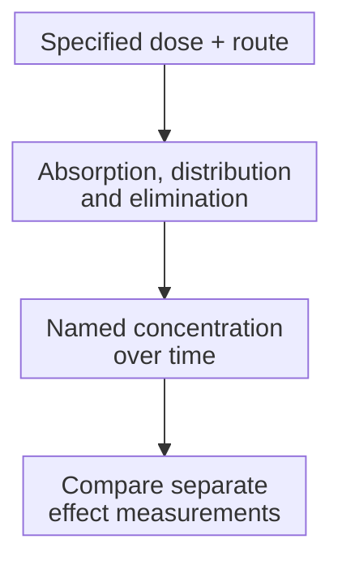
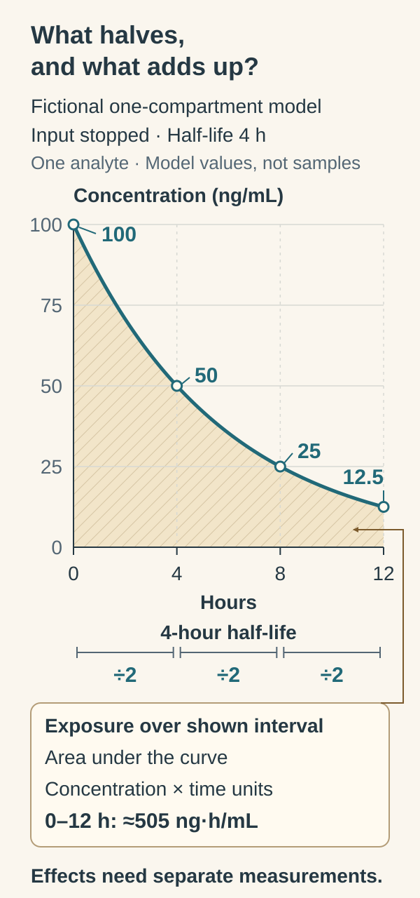

# Pharmacokinetics and half-life

## In one sentence

Pharmacokinetics describes a product's concentration over time as the body handles it, while half-life describes a specified concentration decline under stated conditions.

## The intuition

Imagine adding dye to a stream. The amount poured in differs from the concentration at a particular downstream point. Flow, mixing and removal change the pattern over time. This helps separate dose from exposure, but a body has many compartments, transport processes and active metabolites; one stream cannot represent them all.

## How it works

**Pharmacokinetics (PK)** studies absorption, distribution, metabolism and excretion. **Dose** is the amount administered. **Exposure** is a named substance's concentration–time history in a named place. Route, organ function, interactions and product properties can make the same dose produce different exposure.

- **Absorption** concerns entry into systemic circulation after a nonintravenous dose. **Bioavailability** concerns how much reaches that circulation; first-pass metabolism or other losses can reduce it. An oral dose and an intravenous dose are not interchangeable inputs.
- **Distribution** concerns movement between blood and tissues, including protein binding. Plasma concentration need not equal unbound concentration at an intracellular target.
- **Metabolism and excretion** change or remove material. Metabolites may have their own activity and exposure. **Clearance** expresses removal relative to concentration, commonly as volume per time.

**Half-life** describes a halving of concentration in a specified phase or model. Early distribution and a terminal decline can have different slopes. An **effective half-life** can characterize accumulation and time toward steady state during repeated dosing; it need not equal a long terminal half-life. With nonlinear handling, a reported half-life can depend on dose or concentration. Always ask which substance, phase, model and conditions the number describes.

PK describes measured exposure. Comparing it with effects is another task, not proof that exposure produces benefit.

**Pharmacodynamics** concerns biological effects. Exposure can fall while downstream effects or injury persist. Conversely, detectable material does not guarantee productive [target engagement](/wiki/education/concepts/therapeutics/how-drugs-work/chemical-probe-vs-drug-and-target-engagement). One half-life cannot choose a treatment interval or establish that harm has ended.

## How it is measured

Repeated samples measure a named analyte: parent drug, metabolite, total or unbound substance, or a specified biological product. Sampling must capture the phases the question requires. A sparse late sample cannot reconstruct an unobserved early peak reliably.

| Measure | Example units | What it describes |
|---|---|---|
| Concentration | Nanograms per milliliter (ng/mL) | Amount per sampled volume |
| Maximum concentration (Cmax) | ng/mL | Peak under the stated sampling/model |
| Concentration–time area under the curve (AUC) | ng·hour/mL | Exposure integrated over a specified interval |
| Half-life | Hours or days | Decline in a specified phase/model |
| Clearance | Liters per hour (L/hour) | Removal relative to concentration |

Record dose, route, assay, analyte, time interval and population. Validated bioanalysis and an appropriate model are needed; no generic concentration threshold establishes target action. This AUC differs from the [area under a prediction curve](/wiki/education/concepts/evidence-and-statistics/tests-and-prediction/auc-and-c-index).

## Why it matters in cancer

[Antibody-drug conjugates](/wiki/education/concepts/therapeutics/antibody-based/antibody-drug-conjugate) can have different concentration histories for conjugated antibody, total antibody, unconjugated payload and active breakdown products. A long-lasting antibody signal does not prove active payload exposure in every cancer cell.

Living cell products can expand or persist. [Radioligand therapy](/wiki/education/concepts/therapeutics/antibody-based/radioligand-therapy) adds radioactive decay alongside biological clearance. A freely circulating drug's half-life supplies no universal clock for these modalities.

## Worked example

In a fictional single-compartment model, input has stopped and concentration is 100 ng/mL. Assume a constant four-hour half-life: concentration is 50 ng/mL after four hours and 25 ng/mL after eight. The assumptions make this arithmetic valid; they do not describe every medicine.

  
  
Each four-hour step halves this fictional concentration; the shaded area adds concentration across time. Input has stopped in a one-compartment, constant-half-life toy. Its area under the curve (AUC) from 0 to 12 hours is about 505 ng·h/mL, not total lifetime exposure or dose. Effects need separate measurements, and this curve cannot choose a safe treatment interval.

## Common confusions

- **Dose is not exposure.** Administered amount and sampled concentration have different units.
- **Half-life is not time until completely gone.** Halving leaves material present.
- **Terminal is not automatically effective.** Distribution and accumulation can have different time scales.
- **Longer persistence is not automatically better delivery.** Location, active species and safety matter.
- **PK is not biological benefit.** Exposure and effects need separate evidence.

## Try it

What concentration does the fictional model predict after 12 hours? Does that determine a safe next treatment time?

**Answer:** Three halvings give 100 ÷ 2³ = 12.5 ng/mL. No: the model predicts one substance's concentration under its assumptions. Active metabolites, persistent effects, injury and clinical evidence are not supplied by the arithmetic.

## Explain it back

“Before using a half-life, I need to know ___.”

**One answer:** the analyte, phase/model, dose conditions, compartment and question it was measured to answer.

## Takeaway

**Follow named exposure and named effects separately, rather than treating half-life as a universal biological timer.**

## Related concepts

- [Dose and dose intensity](/wiki/education/concepts/therapeutics/how-drugs-work/dose-and-dose-intensity)

## Sources and scope

Source check: October 10, 2026. General PK teaching with an idealized fictional model, not dosing or sequencing advice. Expert and learner review remain pending.

- [FDA, December 2016: clinical pharmacology labeling](https://www.fda.gov/media/74346/download) — exposure, absorption, clearance and effective versus terminal half-life.
- [FDA, 2024: ADC clinical pharmacology](https://www.fda.gov/media/155997/download) — named constituent-part exposure and appropriate bioanalysis.
- [FDA, 2019: therapeutic radiopharmaceutical development](https://www.fda.gov/media/129547/download) — biodistribution and radioactive/biological time considerations.

<!-- BEGIN GENERATED USED IN -->
## Used in

- [Build the readiness picture](/wiki/education/guides/accessing-experimental-therapy/03-build-the-readiness-picture)
- [Read the validation behind the claim](/wiki/education/guides/judging-a-test-or-vendor-claim/02-read-the-validation)
- [Connect evidence to a decision](/wiki/education/guides/judging-a-test-or-vendor-claim/03-connect-evidence-to-a-decision)
- [Judge a test or company claim](/wiki/education/guides/judging-a-test-or-vendor-claim/index)
- [Follow delivery, exposure, and the treatment clock](/wiki/education/targeted-therapy-modalities/02-timing)
<!-- END GENERATED USED IN -->
