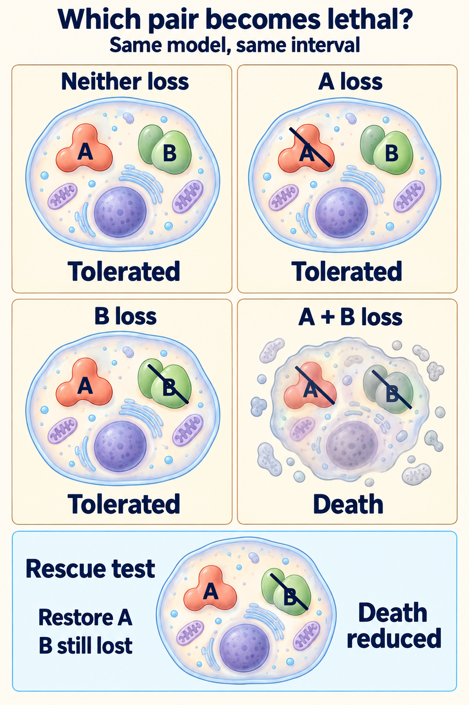

# Synthetic lethality

## In one sentence

Synthetic lethality occurs when two impairments together kill a cell even though either impairment alone can be tolerated.

## The intuition

Picture a town with two routes for an essential delivery. Closing either still leaves a way through. Closing both stops the delivery. A cell can likewise tolerate losing one function while depending on another. Real cells have more than two routes, and a drug rarely closes one route perfectly.

The useful question is, “What becomes essential after the first loss?” It is different from simply asking which protein is abundant.

## How it works

One impairment may already exist in a tumor. A drug can create the second, exploiting a consequence of the first loss. A two-loss mechanism therefore does not necessarily require two drugs.

A classic example involves [homologous recombination (HR)](/wiki/education/concepts/cancer-biology/genome-instability-and-repair/homologous-recombination-and-hrd), a [deoxyribonucleic acid (DNA)](/wiki/education/concepts/biology-basics/molecules/dna) repair process, and [poly(ADP-ribose) polymerase (PARP) inhibitors](/wiki/education/concepts/therapeutics/targeted-small-molecules/parp-inhibitors-and-trapping). Adenosine diphosphate-ribose, or ADP-ribose, is a chemical unit used to build damage-response signals. In experimental models, impaired BRCA1 or BRCA2 repair function increased sensitivity to PARP inhibition. This was mechanistic evidence in cells and experimental tumors, not a guarantee for every genetic finding.

**Homologous recombination deficiency (HRD)** means this repair process is impaired. PARP drugs can suppress enzyme activity and trap PARP on DNA; these effects are not identical. Cells also vary in repair restoration and management of replication stress, stress during DNA copying. The two-route analogy is therefore useful but incomplete.

To test a proposed interaction, compare matched cells with neither impairment, each alone and both together. Verify that the intended functions changed. [Target engagement](/wiki/education/concepts/therapeutics/how-drugs-work/chemical-probe-vs-drug-and-target-engagement) and a downstream biochemical effect are separate measurements. Independent perturbations help exclude an unrelated drug effect.

A **rescue experiment** restores a relevant function and asks whether the predicted harm diminishes. Rescue strengthens the causal explanation when restoration works and appropriate controls are included. Failed rescue is not automatically disproof: expression, localization or timing may be inadequate.

## Why it matters in cancer

A [tumor suppressor](/wiki/education/concepts/cancer-biology/what-cancer-is/oncogene-and-tumor-suppressor) may be missing or inactive. It can be easier to disrupt a remaining dependency experimentally than replace the lost function. But the first genetic label does not establish its functional effect, and high expression does not establish dependence.

Normal tissues can still be harmed. Exposure, tumor context and clinical safety evidence remain necessary. A synthetic-lethal mechanism does not settle an indication or a post-treatment decision.

## How it is measured

Measure death separately from slower growth. A metabolic “viability” signal can fall because cells divide less or change metabolism. Cell counts combine division and loss. Pair suitable death measurements with longer-term survival or colony formation, recording concentration, time and the denominator. Colony formation itself measures reproductive survival, not the mechanism of death.

An interaction can weaken growth without meeting the strict lethal definition. Specify the measured outcome rather than upgrade reduced proliferation to cell killing.

## Common confusions

- **Synthetic lethality versus oncogene addiction:** oncogene addiction is dependence on an active cancer-driving signal for survival or proliferation. Synthetic lethality asks how two impairments interact. They can coexist, but are not interchangeable explanations.
- **Synthetic lethality versus synergy:** [combination synergy](/wiki/education/concepts/therapeutics/how-drugs-work/combination-therapy-rationale) exceeds a stated expectation from single-drug effects. Its value depends on the reference model, concentrations and endpoint. A synergy score does not identify the paired causal functions.
- **Rescue versus benefit:** restoring function in a model supports attribution; it does not establish patient benefit.
- **More target versus more dependence:** abundance is a snapshot, not a loss-of-function test.

## Try it

<em>Fictional matched cultures: each single loss is tolerated, while the pair causes validated death. Restoring A before the assay in a separate culture reduces death; it does not revive dead cells. A/B are function symbols, not a universal pathway or measured cell counts. Independent perturbations and appropriate controls are assumed. Fewer cells or a synergy score alone cannot establish this mechanism; neither rescue nor a genotype establishes normal-cell safety or treatment benefit. Research context: <a href="https://pubmed.ncbi.nlm.nih.gov/1996092/">Bender and Pringle 1991</a> (conditional genetic viability), <a href="https://pmc.ncbi.nlm.nih.gov/articles/PMC2754824/">Sakai 2009</a> (restoration and drug-sensitivity controls), <a href="https://pmc.ncbi.nlm.nih.gov/articles/PMC4759128/">Yadav 2015</a> (synergy references) and <a href="https://pubmed.ncbi.nlm.nih.gov/16287996/">Hay 2005</a> (normal-tissue vulnerability).</em>

<strong>Read the comparison:</strong> A loss alone and B loss alone are tolerated here. Paired, validated death plus independent reproduction supports a lethal interaction in this model. Reduced death after restoring A tests causal attribution while B remains impaired. If the only observation were fewer cells, the lethal conclusion would remain unresolved.

Four fictional, matched cultures have neither impairment, A only, B only or A plus B. Only the pair shows substantial death by a validated assay; each single impairment is tolerated over the same interval. Independent perturbations reproduce the result. Restoring A's function while B remains impaired reduces death. A separate short assay reports only fewer cells in the paired condition. Which evidence supports synthetic lethality?

**Answer:** The controlled paired-death result, independent perturbations and appropriate rescue support that interpretation in this model. The short cell-count result alone cannot distinguish slower division from death. Testing other cell backgrounds and normal cells would examine context and selectivity; neither experiment establishes clinical benefit.

## Explain it back

“To call the interaction lethal, I need ___; rescue tests ___; a synergy score alone does not tell me ___.”

One answer: “death from the pair with tolerated single impairments; causal attribution to a restored function; which biological losses caused the interaction.”

## Takeaway

**Test the two impairments and the lethal outcome before turning a plausible dependency into a mechanism claim.**

## Related concepts

- [Germline versus somatic variants](/wiki/education/concepts/biology-basics/genetics/germline-vs-somatic): where a change belongs.
- [Reading a functional experiment](/wiki/education/guides/from-variant-to-drug/07-reading-a-functional-experiment).

## Sources and scope

Source check: October 10, 2026. General mechanism education; cultures are fictional. Expert and learner review remain pending.

- [Farmer et al. (2005)](https://www.nature.com/articles/nature03445) and [Bryant et al. (2005)](https://pubmed.ncbi.nlm.nih.gov/15829966/): complementary BRCA/PARP experimental studies, not universal clinical selection rules.
- [Murai et al. (2012)](https://pubmed.ncbi.nlm.nih.gov/23118055/): PARP trapping and catalytic inhibition differ in experimental models.
- [Sharma et al. (2006)](https://pmc.ncbi.nlm.nih.gov/articles/PMC2673136/), with its [2009 Figure 3A correction](https://doi.org/10.1016/j.ccr.2009.10.010): dependence on active oncogenic signals in studied kinase-driven models.
- [Yadav et al. (2015)](https://pmc.ncbi.nlm.nih.gov/articles/PMC4759128/): drug-interaction reference models and concentration-dependent synergy.

<!-- BEGIN GENERATED USED IN -->
## Used in

- [Connect repair biology to PARP sensitivity](/wiki/education/guides/from-variant-to-drug/02-connect-repair-biology-to-parp-sensitivity)
- [PARP trapping and recycling](/wiki/education/guides/from-variant-to-drug/04-parp-trapping-and-recycling)
- [PI3K, AKT, and mTOR: competing effects on repair and recycling](/wiki/education/guides/from-variant-to-drug/06-pi3k-akt-mtor-and-repair)
- [Reading a functional experiment](/wiki/education/guides/from-variant-to-drug/07-reading-a-functional-experiment)
- [From a variant to a drug claim](/wiki/education/guides/from-variant-to-drug/index)
<!-- END GENERATED USED IN -->
