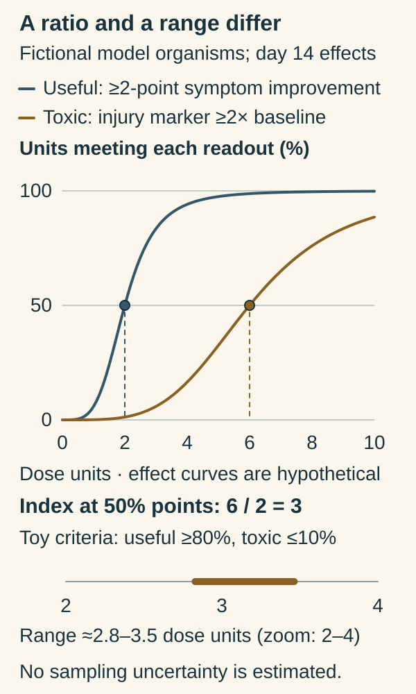

# Therapeutic index

## In one sentence

Therapeutic index compares doses producing defined toxic effects with doses producing defined useful effects, helping describe the separation between benefit and harm.

## The intuition

Imagine adjusting a heater in a room with delicate equipment. Too little heat does not do the job; too much can cause damage. You want enough separation between useful heating and harmful heating to work safely.

The body has many rooms, and different people respond differently. Cancer control and toxicity also unfold over different times. The analogy introduces a margin, rather than a precise personal “safe zone.”

## How it works

[Drug dose](/wiki/education/concepts/therapeutics/how-drugs-work/dose-and-dose-intensity) can influence both intended effects and harms. A formal therapeutic index is a ratio of a dose producing a specified toxic effect to a dose producing a specified useful effect. The effect definitions, studied population and measurement conditions belong beside the ratio.

Because both quantities use compatible dose units, the ratio is **dimensionless**. A larger separation in one experiment can be encouraging, but it does not make the medicine harmless. A measure focused on one toxicity can miss another toxicity or a later effect.

The related **therapeutic window** usually describes a range of doses or concentrations associated with useful effects and acceptable harm. It is related to the index, but a range and a ratio are different measurements. Neither should be treated as a universal guarantee that every person stays safe within fixed boundaries.

[Pharmacokinetics](/wiki/education/concepts/therapeutics/how-drugs-work/pharmacokinetics-and-half-life) connects dose with exposure. [Target engagement](/wiki/education/concepts/therapeutics/how-drugs-work/chemical-probe-vs-drug-and-target-engagement) describes interaction with an intended biological target. Engaging that target does not establish that enough cancer control occurs before unacceptable normal-tissue harm.

Formulation, tissue distribution, schedule and drug combinations can alter the relationship. A tumor assay and a normal-cell assay may also use different conditions, which can make a laboratory “margin” difficult to transfer into people.

*An index is a ratio; a window describes a range under stated effect criteria.*

Read the vertical axis as the percentage of fictional experimental units from the same model-organism population meeting each specified day-14 readout after one administration of fictional Agent Q. The useful readout is a decrease of at least two points on an invented 0-to-10 symptom score; the toxic readout is an organ-injury marker at least twice its pre-dose baseline. Both rules are invented endpoint definitions. These are constructed curves, not observations or fitted clinical data. Their chosen 50% points occur at two and six compatible dose units, giving `6/2 = 3` without units. [Formal ratio definition](https://www.ncbi.nlm.nih.gov/mesh/2023303).

For contrast, the lower axis zooms from two to four dose units. The arbitrarily chosen criteria—at least 80% meeting the useful readout and at most 10% meeting the toxic readout—give a range of about 2.83 to 3.46 dose units. Those criteria do not define acceptable clinical harm or a personal safe zone. Sampling uncertainty has not been estimated, and a different effect, time, population or criterion could change the range. [FDA benefit, exposure and tolerability context](https://www.fda.gov/media/164555/download).

**Read the two summaries:** Is the index value 3 a dose range? **Answer:** No. It is a dimensionless ratio. The separate range keeps dose units and its selected criteria.

## Why it matters in cancer

Cancer treatments often affect processes shared with normal cells. Dose selection therefore asks about activity and tolerability together. The highest tolerable dose in a short study is not automatically the best dose for long treatment.

The Food and Drug Administration's oncology dosage-optimization guidance emphasizes integrating exposure, activity, safety and tolerability. Its stated scope excludes specific guidance for several modalities, including cellular/gene therapies and cancer vaccines, and it does not specifically address pediatric development. The general lesson is useful; the document is not a dosing template for every cancer treatment.

## How it is measured

Experiments or clinical development programs examine dose–effect and exposure–effect relationships. A report should name the beneficial and toxic readouts, time horizon, population and uncertainty. Depending on the measure, results may be a ratio without units or a window expressed in concentration units.

Clinical benefit requires meaningful outcomes, not only a laboratory target readout. Likewise, persistent symptoms, organ injury and ability to continue treatment can matter beyond the initial dose-limiting-toxicity window.

## Common confusions

- **Potent versus useful:** acting at a low concentration does not establish a favorable margin between cancer effects and harm.
- **Window versus index:** a range and a ratio answer related but different questions.
- **Maximum tolerated versus optimized:** tolerating a dose does not prove that a higher dose adds benefit.
- **Class label versus formal narrow-index classification:** do not assign a regulatory category to every cancer medicine from a general teaching analogy.

## Try it

A fictional study compares tumor-cell inhibition with injury in one normal-cell culture. Drug A looks more selective than Drug B. Can its authors claim that A is clinically safer?

**Answer:** They can describe the separation in those assays. Clinical safety still needs achievable exposure, other normal tissues, time-dependent effects and evidence in people.

## Explain it back

“A useful therapeutic margin depends on which ___ and ___ were measured, in whom and over what time.”

**One possible answer:** “Beneficial effects; harmful effects.”

## Related concepts

- [Chemotherapy](/wiki/education/concepts/therapeutics/chemotherapy/chemotherapy)
- [Antibody-drug conjugate](/wiki/education/concepts/therapeutics/antibody-based/antibody-drug-conjugate)

## Sources and scope

Source-checked October 9, 2026; expert and learner review pending. Conceptual benefit–harm separation; no personal therapeutic window is estimated.

- [National Library of Medicine: therapeutic index, drug](https://www.ncbi.nlm.nih.gov/mesh/2023303) — formal toxic-dose/effective-dose ratio definition.
- [FDA: setting standards for narrow therapeutic index drugs](https://www.fda.gov/drugs/cder-conversations/setting-and-implementing-standards-narrow-therapeutic-index-drugs) — narrow margins and monitoring; not a classification of all chemotherapy.
- [FDA final oncology dosage-optimization guidance, August 2024](https://www.fda.gov/media/164555/download) — integrated benefit, exposure and tolerability considerations, with explicit modality/development limits.

<!-- BEGIN GENERATED USED IN -->
## Used in

- [The journey through a solid tumor](/wiki/education/cellular-therapies/08-solid-tumor-barriers)
- [Read the jobs in the treatment plan](/wiki/education/guides/treating-early-tnbc/01-read-the-jobs-in-the-plan)
<!-- END GENERATED USED IN -->
