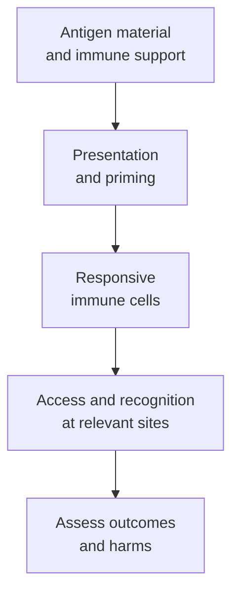

# Cancer vaccines: an overview

## In one sentence

Cancer vaccines train immune responses against antigens to help prevent cancer or treat cancer.

## The intuition

Think of a vaccine as a lesson in recognition. It offers immune cells material to learn from, together with a setting that supports the response. The lesson may concern a cancer-causing infection or features of cancer cells themselves.

The analogy has a limit: teaching recognition does not guarantee that responders can reach a tumor, recognize its naturally displayed targets or control it. “Vaccine” describes a strategy; each product still needs evidence.

**Before you start:** [antigens and epitopes](/wiki/education/concepts/immunology/antigen-presentation/antigen-and-epitope) explain what is recognized; [T-cell priming](/wiki/education/concepts/immunology/t-cells/t-cell-priming-three-signals) explains how a response starts.

## How it works

First ask **what the vaccine is trying to prevent or treat**. Preventive vaccines against human papillomavirus (HPV) or hepatitis B virus reduce infection-related cancer risk. They do not thereby treat an established tumor. Therapeutic cancer vaccines seek responses against cancer-related antigens. A therapeutic study can also enroll people after visible cancer has been removed, aiming to reduce recurrence; the absence of a measurable mass does not turn it into an infection-prevention vaccine. [NCI's prevention overview](https://www.cancer.gov/about-cancer/causes-prevention/patient-prevention-overview-pdq) and [treatment-vaccine explanation](https://www.cancer.gov/about-cancer/treatment/types/immunotherapy/cancer-treatment-vaccines) describe the different purposes.

Next ask **how antigens are selected**. A personalized vaccine is tailored using a person's tumor information or material. A shared-antigen vaccine uses targets found across multiple people's cancers. Shared targets can include [tumor-associated antigens](/wiki/education/concepts/immunology/antigen-presentation/tumor-associated-antigen) or recurring mutation-derived [neoantigens](/wiki/education/concepts/immunology/antigen-presentation/neoantigen). A personalized product can include shared targets, too. Neither label proves that every cancer cell carries or presents the target.

Then ask **how antigen material is supplied**. Designed vaccines provide selected material or instructions: peptides, nucleic acids, cells or other platforms. In [in-situ vaccination](/wiki/education/concepts/immunology/tumor-immunology/in-situ-vaccination), the tumor within the body supplies material, while interventions try to support its collection and useful immune activation. Local injury alone does not establish vaccination. An early lymphoma study combined local radiation with an immune-sensor stimulus and assessed responses at untreated sites; that defined regimen is not evidence for every local intervention. [Brody and colleagues](https://pubmed.ncbi.nlm.nih.gov/20697067/).

These are separate axes. “Personalized” does not mean “messenger RNA,” “shared” does not mean “peptide,” and an in-situ strategy does not control antigen selection in the same way as a manufactured product. A personal long-peptide vaccine study in melanoma demonstrated feasibility and antigen-reactive responses, providing a concrete example without establishing a universal platform ranking. [Ott and colleagues](https://pubmed.ncbi.nlm.nih.gov/28678778/).

*Each arrow is a requirement to investigate, not an assurance that the next step occurs.*

## Why it matters in cancer

Vaccine design connects a chosen target to a hoped-for immune response. It must also address tumor variation, target display, immune restraint and safety. A promising result in one cancer, treatment combination or disease setting does not establish benefit in another.

## How it is measured

Separate manufacturing feasibility, **immunogenicity**—a measurable immune response—and clinical outcomes. An antigen-reactive blood assay does not establish recognition of naturally processed tumor targets. Recognition experiments do not establish recurrence reduction. Clinical comparisons need a defined population, accompanying treatments, endpoint, follow-up and harms.

## Common confusions

- Preventing a cancer-causing infection and treating cancer use different targets and evidence.
- Personalized versus shared describes target selection, not automatic superiority.
- More encoded targets do not guarantee broader functional immunity; [immunodominance](/wiki/education/concepts/immunology/t-cells/immunodominance) can concentrate responses.
- A [vaccine adjuvant](/wiki/education/concepts/therapeutics/immunotherapy/vaccine-adjuvants) supports immune responses; adjuvant cancer therapy describes a treatment's role after the main treatment.

## Try it

A fictional vaccine uses a shared tumor antigen, delivered as messenger RNA, after surgery. Blood cells respond to the antigen. Is it personalized, preventive, or proven to prevent recurrence?

**Answer:** Shared antigen selection does not establish personalization. Its postoperative cancer-treatment setting is therapeutic. The assay supports immunogenicity under its test conditions; recurrence prevention requires clinical outcome evidence.

## Explain it back

Describe a vaccine using three questions: “What is the goal? How are targets selected? How is material supplied?” Then name the evidence still needed.

## Takeaway

Classify the strategy before interpreting the result. Recognition, tumor activity and patient benefit are different claims.

## Related concepts

- [Cancer-immunity cycle](/wiki/education/concepts/immunology/tumor-immunology/cancer-immunity-cycle)
- [Immune escape](/wiki/education/concepts/immunology/tumor-immunology/immune-escape)
- [How a personalized cancer vaccine is designed](/wiki/education/guides/personalized-cancer-vaccine/index)

## Sources and scope

Source-checked October 10, 2026. General education and a fictional exercise; expert and learner review remain pending. Primary examples concern defined melanoma and lymphoma studies, without transferring their outcomes to another population.

- [NCI: cancer prevention overview](https://www.cancer.gov/about-cancer/causes-prevention/patient-prevention-overview-pdq) — infection-prevention vaccines and cancer risk.
- [NCI: cancer treatment vaccines](https://www.cancer.gov/about-cancer/treatment/types/immunotherapy/cancer-treatment-vaccines) — treatment purposes and antigen sources.
- [Ott et al., 2017: a personal neoantigen vaccine in melanoma](https://pubmed.ncbi.nlm.nih.gov/28678778/) — a defined long-peptide approach and immune measurements.
- [Brody et al., 2010: in-situ vaccination in lymphoma](https://pubmed.ncbi.nlm.nih.gov/20697067/) — local radiation plus an immune stimulus, with untreated-site assessments.

<!-- BEGIN GENERATED USED IN -->
## Used in

- [How a personalized cancer vaccine is designed](/wiki/education/guides/personalized-cancer-vaccine/index)
<!-- END GENERATED USED IN -->
