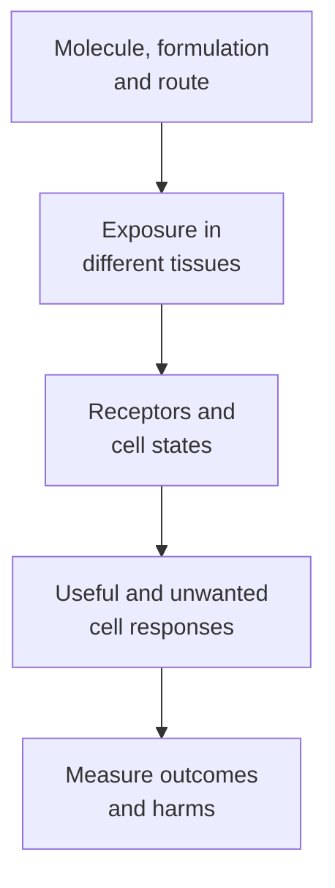

# Cytokine therapy

## In one sentence

Cytokine therapy uses signaling proteins as treatment, with effects shaped by the molecule, its delivery and the responding cells.

## The intuition

Imagine sending a message to a neighborhood rather than handing a worker a new tool. Different residents receive and interpret the message differently. A cytokine can alter cell growth, survival, movement or activity, depending on the receptors and surrounding signals.

The analogy has limits: cytokines do not carry a literal instruction to “fight cancer.” Supporting immune cells does not automatically give them the right tumor specificity or keep the signal away from healthy tissue.

**Before you start:** [cytokines and chemokines](/wiki/education/concepts/immunology/immune-regulation/cytokine-and-chemokine) explain the signaling family; [ligands and receptors](/wiki/education/concepts/biology-basics/signaling/ligand-and-receptor) explain the receiving step.

## How it works

Cytokine treatments have different jobs. Interleukin-2 (IL-2) can influence lymphocyte growth and activity. [Interferons](/wiki/education/concepts/immunology/the-immune-system/interferons) engage different receptor systems and can affect immune responses and cancer-cell behavior. Hematopoietic growth factors support blood-cell production; “hematopoietic” means related to making blood cells. Their supportive-care purpose must be distinguished from a cancer-directed intervention. [NCI's immune-system-modulator overview](https://www.cancer.gov/about-cancer/treatment/types/immunotherapy/immune-system-modulators) describes these roles.

The receiver matters. IL-2 can support both responding lymphocytes and [regulatory T cells](/wiki/education/concepts/immunology/t-cells/regulatory-t-cells), which help restrain immune responses. Cells differ in receptor composition, sensitivity and prior state. In mouse experiments, different IL-2–antibody complexes preferentially expanded different T-cell populations. That is evidence that formulation can change biological activity, not proof that a particular engineered version benefits people with every cancer. [Boyman and colleagues](https://pubmed.ncbi.nlm.nih.gov/16484453/).

Exposure matters too. A circulating protein, a locally administered formulation and an engineered cell producing a cytokine can expose different tissues for different durations. Local production does not guarantee local confinement. In a metastatic-melanoma study, transferred cells engineered for inducible IL-12 secretion produced measurable systemic cytokine exposure and serious toxicity. The finding belongs to that construct and regimen; it does not establish identical behavior for every locally produced cytokine. [Zhang and colleagues](https://pubmed.ncbi.nlm.nih.gov/25695689/).

Clinical use belongs to a **specific medicine and population**. For example, aldesleukin, a recombinant IL-2 medicine, has a prescribing label for particular metastatic kidney-cancer and melanoma settings. Its label also describes potentially fatal capillary leak, in which fluid escapes blood vessels, and the need for specialized monitoring. Those facts concern that medicine and regimen; neither benefit nor toxicity can be copied across the cytokine class. [Aldesleukin prescribing information](https://dailymed.nlm.nih.gov/dailymed/drugInfo.cfm?setid=f3c516ad-d405-4fbe-af6a-962080dbfa7d).

*The signal's identity and the cells receiving it both shape the result.*

## Why it matters in cancer

Cytokines can support a response or change its environment, but tumor recognition and access remain separate requirements. A cytokine can accompany a vaccine or cell therapy without becoming the antigen or recognition receptor. [Armoring](/wiki/education/concepts/therapeutics/cell-therapies/armoring) describes added cell-therapy functions, including some cytokine-producing designs.

There is no diagnosis-only rule that selects the cytokine class. Assess the exact molecule, formulation, combination, disease setting, study evidence and harms. Biological plausibility does not establish clinical benefit or eligibility.

## How it is measured

Researchers can measure drug exposure, receptor signaling, absolute cell counts, cell states and functional activity. A greater cell count can reflect survival or redistribution as well as division. Changes in blood do not automatically describe tumor tissue. Clinical studies then assess tumor outcomes, durability and toxicity in the defined population. A high cytokine concentration or an inflammatory reaction alone is not an efficacy endpoint.

## Common confusions

- Endogenous cytokine biology, a cytokine measurement and cytokine treatment are different topics.
- More immune activation does not guarantee more useful immunity.
- [Granulocyte colony-stimulating factor (G-CSF)](/wiki/education/concepts/therapeutics/toxicities-and-supportive-care/neutropenia-and-g-csf) can support neutrophil production; this is not proof of cancer-cell killing.
- A secreted protein may reach cells beyond the intended site.

## Try it

A fictional cytokine product increases circulating T-cell counts. Investigators have not measured antigen specificity or tumor-cell recognition. Does the count prove a better antitumor response?

**Answer:** No. It supports a cell-number change under those conditions. Which cells increased, why they increased, whether they recognize tumor and whether the treatment improves outcomes safely remain open questions.

## Explain it back

“Which molecule was delivered, which cells received it, and what response was actually measured?” Use all three questions before saying the therapy worked.

## Takeaway

Cytokine therapy changes signaling. Useful recognition, clinical benefit and safety each need their own evidence.

## Related concepts

- [Vaccine adjuvants](/wiki/education/concepts/therapeutics/immunotherapy/vaccine-adjuvants)
- [T-cell states](/wiki/education/concepts/immunology/t-cells/t-cell-states)
- [Therapeutic index](/wiki/education/concepts/therapeutics/how-drugs-work/therapeutic-index)

## Sources and scope

Source-checked October 10, 2026. General education and a fictional exercise; expert and learner review remain pending. The mouse experiment, human engineered-cell study and medicine label support different levels of evidence, without a class-wide treatment rule.

- [NCI: immune system modulators](https://www.cancer.gov/about-cancer/treatment/types/immunotherapy/immune-system-modulators) — cytokine and supportive-care roles.
- [Boyman et al., 2006: selective T-cell stimulation with IL-2 complexes](https://pubmed.ncbi.nlm.nih.gov/16484453/) — formulation-dependent responses in mice.
- [Zhang et al., 2015: inducible IL-12-producing cells in melanoma](https://pubmed.ncbi.nlm.nih.gov/25695689/) — a defined human construct, systemic exposure and harms.
- [Aldesleukin prescribing information](https://dailymed.nlm.nih.gov/dailymed/drugInfo.cfm?setid=f3c516ad-d405-4fbe-af6a-962080dbfa7d) — medicine-specific indications and safety; prescribing text revised February 2024 in the accessed December 2024 label record.

<!-- BEGIN GENERATED USED IN -->
## Used in

- [How engineered immune cells can attack a solid tumor](/wiki/education/guides/engineered-cell-therapy/index)
- [Find the step an immune response can lose](/wiki/education/oncology-101/4-escape-mechanisms)
<!-- END GENERATED USED IN -->
