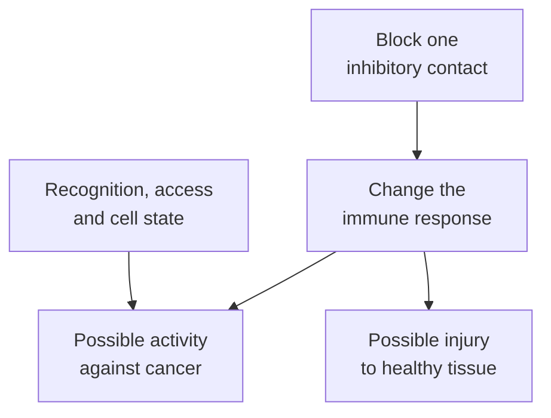

# Immune checkpoint inhibitor

## In one sentence

An immune checkpoint inhibitor is a drug that blocks a specific inhibitory immune pathway, which can strengthen responses against cancer and also harm healthy tissue.

## The intuition

Think of a workshop with several safety controls. Releasing one control may let work resume. It does not supply a missing tool, choose the right job or repair every obstacle. The familiar “release the brakes” analogy helps with [immune checkpoints](/wiki/education/concepts/immunology/immune-regulation/immune-checkpoint), but living cells have interacting signals rather than one brake pedal.

## How it works

Immune checkpoint inhibitors, often shortened to **ICIs**, include [antibodies](/wiki/education/concepts/immunology/antibodies-and-b-cells/antibody-structure) that interrupt particular [receptor–partner interactions](/wiki/education/concepts/biology-basics/signaling/ligand-and-receptor). The target matters:

| Target | What the pathway normally does | What blocking it changes |
|---|---|---|
| [Programmed cell death protein 1 (PD-1)](/wiki/education/concepts/immunology/immune-regulation/immune-checkpoint) | Receives inhibitory signals from [programmed death-ligand 1 (PD-L1) and programmed death-ligand 2 (PD-L2)](/wiki/education/concepts/immunology/immune-regulation/immune-checkpoint) | An anti-PD-1 antibody can interrupt signals from both partners |
| PD-L1 | Provides one partner for PD-1 signaling; cancer and non-cancer cells can express it | Blocking this ligand does not directly block the PD-1–PD-L2 interaction |
| [Cytotoxic T-lymphocyte-associated protein 4 (CTLA-4)](/wiki/education/concepts/immunology/immune-regulation/immune-checkpoint) | Limits access to supporting activation signals | Blocking it changes a different regulatory interaction |

CTLA-4 shares the partner proteins CD80 and CD86 with the supporting receptor CD28. It can compete for these partners and remove them from another cell's surface. PD-1 regulates signaling within the responding cell, including CD28 signaling. These examples explain why the drugs are not interchangeable. They are not a complete list of checkpoint targets. [Qureshi et al., 2011](https://pubmed.ncbi.nlm.nih.gov/21474713/), [Hui et al., 2017](https://pubmed.ncbi.nlm.nih.gov/28280247/).

CTLA-4 is often emphasized during [T-cell priming](/wiki/education/concepts/immunology/t-cells/t-cell-priming-three-signals); PD-1 is often emphasized during ongoing responses in tissues. Those are useful teaching emphases, not exclusive locations or rigid stages. The [checkpoint sites-of-action comparison](/wiki/education/concepts/immunology/immune-regulation/immune-checkpoint#checkpoint-sites-of-action) also distinguishes LAG-3, TIM-3 and TIGIT mechanisms. A target that regulates a model response does not thereby establish benefit from blocking it in another population.

*Blocking a pathway creates possibilities on both branches; it does not guarantee either outcome.*

## Why it matters in cancer

Blocking an inhibitory interaction does not install a new [T-cell receptor](/wiki/education/concepts/immunology/t-cells/t-cell-receptor) or rebuild a genetically lost [human leukocyte antigen (HLA)](/wiki/education/concepts/immunology/antigen-presentation/hla) display route. Recognition, tissue access and [T-cell state](/wiki/education/concepts/immunology/t-cells/t-cell-states) remain important.

Other immune treatments change other inputs. [Treatment vaccines](/wiki/education/guides/personalized-cancer-vaccine/index) supply antigen instructions or material to support target-directed responses. [Cell therapies](/wiki/education/guides/engineered-cell-therapy/index) supply or engineer living responders. [Cytokine therapies](/wiki/education/concepts/therapeutics/immunotherapy/cytokine-therapy) alter signaling that can affect growth and function. A combination rationale needs evidence for the actual regimen.

These pathways also protect normal tissues. Their interruption can cause an [immune-related adverse event](/wiki/education/concepts/therapeutics/toxicities-and-supportive-care/immune-related-adverse-event). Benefit and harm must each be assessed in the relevant population.

## A worked example

A fictional sample contains many PD-1-positive T cells. A reader concludes, “An anti-PD-1 drug will wake all of them up.” The marker does not identify every cell's target or its capacity to respond. It gives a biological question to investigate, not a result for that drug.

## Try it

 If a genetic loss prevents required HLA display, does checkpoint blockade rebuild that missing machinery?

**Answer:** No. Changing inhibition and restoring target display are different jobs.

## Explain it back

“Blocking a checkpoint changes ___; evidence for patient benefit requires ___.” One answer: “a specified regulatory pathway; a suitable clinical comparison in the relevant setting.”

## Takeaway

**Pathway blockade, tumor-directed function and clinical benefit are separate claims.**

## Common confusions

- A checkpoint protein is part of normal biology; a checkpoint inhibitor is an intervention.
- PD-1 and PD-L1 are different targets, even though their pathways overlap.
- A marker's presence does not establish benefit from blocking it.
- “More immune activity” does not mean only tumor-directed activity.

## Related concepts

- [Immune escape](/wiki/education/concepts/immunology/tumor-immunology/immune-escape)
- [Cancer-immunity cycle](/wiki/education/concepts/immunology/tumor-immunology/cancer-immunity-cycle)
- [Predictive and prognostic biomarkers](/wiki/education/concepts/evidence-and-statistics/biomarkers/prognostic-vs-predictive)

## Sources and scope

Source check: October 10, 2026. General mechanism, with a fictional exercise; no approval inventory or individual treatment prediction. Expert and learner review remain pending.

- [National Cancer Institute (NCI): immune checkpoint inhibitors](https://www.cancer.gov/about-cancer/treatment/types/immunotherapy/checkpoint-inhibitors).
- [NCI: different types of immunotherapy](https://www.cancer.gov/about-cancer/treatment/types/immunotherapy).
- [Qureshi et al., 2011: CTLA-4 captures supporting ligands](https://pubmed.ncbi.nlm.nih.gov/21474713/) — mechanistic experiments, not a comparison of clinical regimens.
- [Hui et al., 2017: PD-1 signaling can inhibit CD28](https://pubmed.ncbi.nlm.nih.gov/28280247/) — biochemical and cellular experiments.
- [Pembrolizumab prescribing information, revised July 2026, sections 12.1 and 5.1](https://dailymed.nlm.nih.gov/dailymed/fda/fdaDrugXsl.cfm?setid=9333c79b-d487-4538-a9f0-71b91a02b287) — an anti-PD-1 example, not evidence that all checkpoint antibodies act identically.

<!-- BEGIN GENERATED USED IN -->
## Used in

- [Understand how the immune system recognizes cancer](/wiki/education/guides/how-the-immune-system-fights-cancer/index)
- [Follow the route to immune recognition](/wiki/education/guides/start-here/02-follow-immune-recognition)
- [Connect treatment jobs with evidence](/wiki/education/guides/start-here/03-connect-treatment-and-evidence)
- [Read the jobs in the treatment plan](/wiki/education/guides/treating-early-tnbc/01-read-the-jobs-in-the-plan)
- [Understand how treatment is sequenced](/wiki/education/guides/treating-early-tnbc/index)
- [Separate local injury from immune learning](/wiki/education/local-treatment-modalities/01-mechanism)
- [Ask what a combination trial actually proved](/wiki/education/local-treatment-modalities/03-overlap-and-sequencing)
- [Read a proposal through five questions](/wiki/education/local-treatment-modalities/04-decision-questions)
- [Compare delivery and recognition separately](/wiki/education/local-treatment-modalities/06-comparisons)
- [Why a T-cell count does not tell the whole story](/wiki/education/oncology-101/3-t-cell-states)
- [Find the step an immune response can lose](/wiki/education/oncology-101/4-escape-mechanisms)
<!-- END GENERATED USED IN -->
