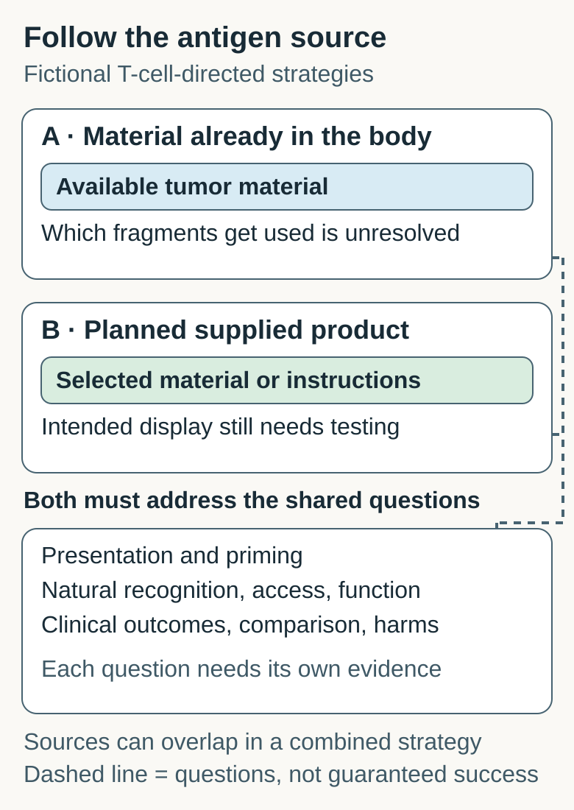

# In-situ versus designed vaccine

In-situ and designed cancer-vaccine strategies differ in where antigen material comes from and how its selection is controlled, while both need evidence of immune activity and clinical effect.

## What the strategies share

Both aim to support an immune response against cancer-associated **antigens**, material the immune system can recognize. Here we compare T-cell-directed therapeutic strategies. [Cancer vaccines](/wiki/education/concepts/therapeutics/immunotherapy/cancer-vaccines-overview) also differ in platform and personalization; prevention of an infection that can cause cancer is another goal.

Think of preparing a lesson from material already in the room versus bringing a planned teaching kit. The analogy concerns material source and selection. It does not mean the immune system learns everything available, or that either lesson succeeds.

## The axis is antigen source and selection control

An [in-situ vaccination strategy](/wiki/education/concepts/immunology/tumor-immunology/in-situ-vaccination) tries to make use of antigen material in tumor tissue within the body. Local procedures or immune stimuli may support antigen availability, presenting-cell activity and priming. **Priming** is the initial antigen-driven activation of suitable T cells. These functions must be established; injury or injection alone does not demonstrate vaccination.

A **designed, supplied vaccine product** brings planned antigen material or instructions for making it. A defined peptide or encoded-sequence product specifies selected targets before dosing. Other supplied products can use cells or broader antigen preparations; “manufactured” does not mean every presented peptide is known. Product selection is different from controlling which fragments the body actually displays.

*The source differs; the downstream questions still need evidence. Dashed connectors mean requirements to investigate, not guaranteed delivery, immune success or clinical benefit.*

## Compare the same questions

| Question | In-situ source strategy | Designed, supplied product |
|---|---|---|
| Where is the antigen material? | In available tumor tissue inside the body | In a supplied preparation or encoded instructions |
| What can be selected beforehand? | The site and intervention; usually less direct control over the full antigen mixture used | The product composition, with target-level control depending on platform |
| What is not guaranteed? | Which tumor fragments are taken up and presented | That supplied material becomes the intended naturally relevant display |
| What opportunity is needed? | Available tumor material; a lesion-based local method also needs a suitable accessible site | Material or information sufficient to make the specified product, plus its delivery requirements |
| What evidence is shared? | Appropriate presentation, priming, tumor access and useful function | Appropriate presentation, priming, tumor access and useful function |
| What outcome question remains? | What the complete strategy adds, including harms | What the complete strategy adds, including harms |

For T-cell-directed activity, [human leukocyte antigen (HLA)](/wiki/education/concepts/immunology/antigen-presentation/hla) presentation and suitable receptors matter. **Cross-presentation** lets a presenting cell display material taken up from another cell for certain T-cell responses. Priming on a presenting cell is different from later recognition of naturally presenting cancer cells. Even a primed population still needs access and capacity to function at relevant sites.

## Which research question fits each strategy?

If the question is whether tumor material at a local site can support priming, test the in-situ source and its immune support. If the question is whether a planned antigen set provokes a response, a defined supplied product makes that set explicit. Neither question chooses a treatment or establishes a category-wide winner.

An inaccessible or absent identifiable lesion removes the opportunity for a proposed lesion-based source intervention. It does not, by itself, establish that another strategy is feasible, beneficial or suitable. Read [the existing biological-opportunity and route lesson](/wiki/education/guides/local-therapy-and-the-immune-system/07-read-an-injected-treatment-study#ask-whether-the-biological-opportunity-exists).

## Common confusions

- **Injection is vaccination.** Injection describes a route; immune learning requires evidence.
- **In-situ means personalized product.** Using a person's tumor material differs from manufacturing a product selected for that person.
- **The categories exclude one another.** A study can supply selected antigen material and also use local tumor material. Source, platform, route and personalization are separate descriptors.
- **Local shrinkage means distant immune control.** Local, immune-assay, distant-site and clinical outcomes need separate measurements and attribution.

## Try it: compare two source cards

**Fictional workshop.** Both cards propose a T-cell-directed strategy and have no outcome data.

- **A:** A local intervention uses material in an identified accessible tumor and supplies an immune stimulus. It does not supply a selected antigen product.
- **B:** A manufactured product supplies instructions encoding selected peptide targets. The targets were selected using sample-derived information before dosing.

**What is supplied, what is available in the body, and what still needs testing?**

**Answer:** A supplies the intervention and stimulus; its antigen source is the tumor material in the body. B supplies the selected antigen instructions; tumor-derived information informed the selection. B controls its encoded target set, but does not guarantee processing, HLA display or natural cancer-cell recognition. A does not fix which fragments will be presented. Both still need evidence of presentation and priming, then natural tumor recognition, access and useful function. A matched clinical question also needs a defined population, comparator, endpoint, follow-up and harms assessment.

**Two changes to the cards:** If A has no identifiable accessible tumor, its specified local opportunity is missing; that does not make B the right care choice. If B is added to A, report both antigen sources rather than forcing the combined strategy into one exclusive box. Neither change supplies outcome evidence.

For a different task, [the injected-study exercise and answer](/wiki/education/guides/local-therapy-and-the-immune-system/07-read-an-injected-treatment-study#try-it) show how a comparator isolates an intervention's added effect.

## Explain it back

“The antigen source is ____. We control ____, but must still measure ____.”

For B: “the supplied encoded target set; product composition; appropriate display, response and clinical effect.”

## Takeaway

**Follow the antigen source first, then ask which immune and outcome claims were actually tested.**

## Related concepts

Use [the vaccine overview](/wiki/education/concepts/therapeutics/immunotherapy/cancer-vaccines-overview) for platform and personalization, and [in-situ vaccination](/wiki/education/concepts/immunology/tumor-immunology/in-situ-vaccination) for presenting-cell dependencies.

## Sources and scope

Source check: October 12, 2026. Brody and Hammerich primary abstracts were read; full-text attempts failed. Selected product-design and immune-assay passages in Ott's primary paper were read. These lymphoma and melanoma studies illustrate defined strategies in different settings; no efficacy ranking, breast-cancer benefit or eligibility is inferred. All workshop inputs are invented. Independent peer, expert and learner review pending.

- [Brody et al., 2010](https://pubmed.ncbi.nlm.nih.gov/20697067/): local radiation and an immune stimulus in low-grade B-cell lymphoma; in-body antigen-source example.
- [Hammerich et al., 2019](https://pubmed.ncbi.nlm.nih.gov/30962585/): a defined dendritic-cell recruitment/activation strategy in indolent lymphoma and mouse models. Mouse checkpoint-responsiveness findings are not human benefit estimates.
- [Ott et al., 2017](https://pubmed.ncbi.nlm.nih.gov/28678778/): selected manufactured long peptides in a phase I melanoma study; supplied-product example. Clinical observations do not compare the two categories.
