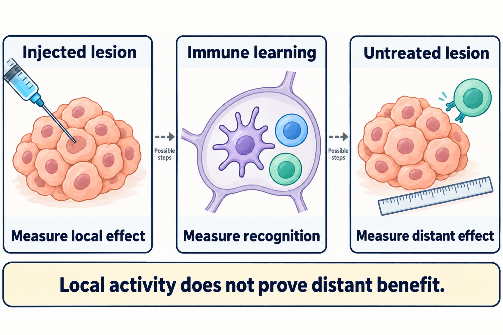

# Intratumoral immunotherapy

## In one sentence

Intratumoral immunotherapy places an immune-directed treatment inside a tumor, while local effects, immune recognition and effects elsewhere remain separate questions.

## The intuition

Think of bringing a lesson to the place where its material is found. A tumor contains potential [antigens](/wiki/education/concepts/immunology/antigen-presentation/antigen-and-epitope), but immune cells may need help collecting, presenting or responding to them. An injected treatment can try to support one of those steps. Delivering the lesson does not prove that useful learning happened, or that responders reached another tumor. The analogy also misses direct drug effects and procedural risks.

## How it works

**Intratumoral** means within a tumor. **Intralesional** describes delivery into a lesion. Neither word identifies the payload. An immune-directed payload might be an immune signal, an antibody or an [oncolytic virus](/wiki/education/concepts/therapeutics/immunotherapy/oncolytic-virus); a locally injected cytotoxic drug need not be immunotherapy. Read the substance and the route together. [NCI definition](https://www.cancer.gov/publications/dictionaries/cancer-terms/def/intratumoral).

The clinician needs a lesion that can be identified and safely accessed. Injection changes where exposure starts. It does not establish uniform distribution through the lesion, confinement there, or a safe systemic exposure. The accessible lesion may also differ from cancer at other sites.

An immune strategy might recruit or activate [dendritic cells](/wiki/education/concepts/immunology/innate-and-unconventional-cells/dendritic-cells), help them collect tumor material, or alter inhibitory signals. Presentation and [T-cell priming](/wiki/education/concepts/immunology/t-cells/t-cell-priming-three-signals) may involve the tumor and its [draining lymph nodes](/wiki/education/concepts/immunology/the-immune-system/lymph-nodes-and-lymphatics). Priming still leaves the problems of travel, tumor-cell recognition and sustained function. A primary lymphoma study tested a defined combination of dendritic-cell recruitment, radiation and an innate stimulus; its findings do not establish that every injection produces this chain. [Hammerich et al., 2019](https://pubmed.ncbi.nlm.nih.gov/30962585/).

## Keep three measurements separate

*Local activity, immune recognition and effects elsewhere require separate measurements; the dashed arrows show possible steps.*

| Question | Useful observation | Remaining gap |
|---|---|---|
| What happened locally? | Treated-lesion measurements and tissue changes | The response at another site |
| Was useful immune activity detected? | Antigen-reactive cells tested under stated assay conditions | Recognition and function inside other tumors |
| What happened elsewhere? | Measurements of lesions that were not injected | What the injection added to accompanying treatments, and longer-term patient benefit |

*These are questions to test. They are not guaranteed stages after an injection.*

## Why it matters in cancer

Local delivery offers a way to investigate a tumor's immune environment. It also creates an attribution problem when systemic drugs are given alongside it. A study should identify the route for each component and assess treated and untreated lesions separately.

The approved oncolytic product talimogene laherparepvec has a defined melanoma indication involving certain recurrent, unresectable lesions. Its prescribing information does not establish an overall-survival improvement or an effect on visceral metastases. This illustrates why a local-treatment indication does not settle a whole-body benefit claim or establish a breast-cancer indication. [FDA prescribing information, sections 1 and 2](https://www.fda.gov/media/94129/download).

## Worked example

In a fictional experiment, immune cells collected after an injection recognize tumor material in a laboratory assay. The injected lesion shrinks; a lesion elsewhere stays unchanged. What was demonstrated?

**Answer:** Local activity and an assay-defined immune response were observed. Distant control was not demonstrated by those measurements. The result can help locate a missing step without turning it into a clinical success claim.

## Common confusions

- [In-situ vaccination](/wiki/education/concepts/immunology/tumor-immunology/in-situ-vaccination) is an immune strategy; intratumoral delivery is a route that can support several strategies.
- For radiation, an [abscopal response](/wiki/education/concepts/immunology/tumor-immunology/abscopal-effect) occurs outside the irradiated field. After an injection, describe an uninjected-lesion response directly and keep attribution to the injection separate.
- Local administration does not eliminate inflammation, systemic immune effects, infection or injury at the injection site. Risks depend on the product and procedure.
- A named combination does not tell you which drug was injected. Check every component.

## Related concepts

- [Cross-presentation](/wiki/education/concepts/immunology/antigen-presentation/cross-presentation)
- [Immunogenic cell death](/wiki/education/concepts/cancer-biology/cell-death-and-survival/immunogenic-cell-death)
- [Pharmacokinetics and half-life](/wiki/education/concepts/therapeutics/how-drugs-work/pharmacokinetics-and-half-life)
- [Practice reading an injected-treatment study](/wiki/education/guides/local-therapy-and-the-immune-system/07-read-an-injected-treatment-study)

## Sources and scope

Source check: October 9, 2026. General route and evidence principles; a lymphoma experiment and an approved melanoma product retain their own settings. No individual eligibility, schedule or access conclusion. Expert and learner review pending.

- [NCI: intratumoral](https://www.cancer.gov/publications/dictionaries/cancer-terms/def/intratumoral).
- [Marabelle et al., 2018: reporting and development recommendations for human intratumoral immunotherapy](https://pubmed.ncbi.nlm.nih.gov/30295695/) — consistent route, lesion and outcome attribution.
- [Hammerich et al., 2019: a defined in-situ vaccination strategy in indolent lymphoma](https://pubmed.ncbi.nlm.nih.gov/30962585/) — immune-mechanism and disease boundaries.
- [FDA: talimogene laherparepvec prescribing information](https://www.fda.gov/media/94129/download) — a product-specific local indication, outcome limits and risks.

<!-- BEGIN GENERATED USED IN -->
## Used in

- [Read an injected-treatment study](/wiki/education/guides/local-therapy-and-the-immune-system/07-read-an-injected-treatment-study)
- [Understand local therapy and the immune system](/wiki/education/guides/local-therapy-and-the-immune-system/index)
- [Learn the biology and evidence](/wiki/education/index)
<!-- END GENERATED USED IN -->
