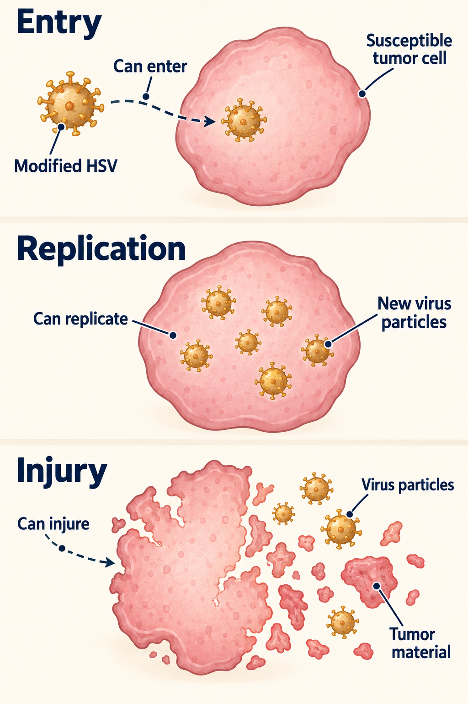
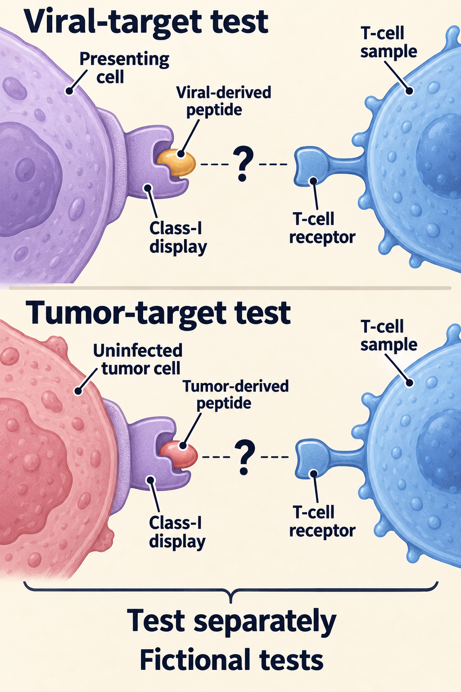

# Oncolytic viruses

## In one sentence

An oncolytic virus is a virus studied or used to infect and damage cancer cells, sometimes also helping the immune system respond to tumor material.

## The intuition

Think of a delivery vehicle that can reproduce inside certain cells. Its direct activity may damage those cells; the released material may also draw immune attention. The analogy has limits. A virus is a biological agent whose behavior depends on its design, the host and the tissue. It does not reliably seek out every cancer cell or leave every healthy cell untouched.

## How it works

**Oncolytic** refers to breaking down cancer cells. Some viruses have properties that favor activity in certain tumors. Others are modified to alter replication or carry a gene that changes local signals. Different viral platforms have different entry requirements, replication rules and immune interactions. They are not interchangeable products. [NCI: oncolytic virus therapy](https://www.cancer.gov/news-events/cancer-currents-blog/2018/oncolytic-viruses-to-treat-cancer).

Infection and viral replication can injure a susceptible tumor cell. Released [antigens](/wiki/education/concepts/immunology/antigen-presentation/antigen-and-epitope) and injury signals may support [antigen presentation](/wiki/education/concepts/immunology/antigen-presentation/cross-presentation) and a response to cancer. But an antiviral response and an antitumor response are different targets. Clearing the virus does not demonstrate recognition of uninfected cancer cells.

Delivery adds another question. A virus might be studied using [intratumoral injection](/wiki/education/concepts/therapeutics/immunotherapy/intratumoral-immunotherapy) or another route. Follow the actual product protocol. An injected lesion's response does not establish that a separate lesion received useful exposure or immune protection.

Talimogene laherparepvec, abbreviated **T-VEC**, is a modified herpes simplex virus product. Its FDA indication covers local treatment of specified recurrent, unresectable melanoma lesions. The label describes tumor-cell lysis and an immune rationale, while noting that the exact mechanism is unknown. It also states that improved overall survival and an effect on visceral metastases have not been established. Those limits belong to that product and indication. [FDA prescribing information, sections 1 and 12.1](https://www.fda.gov/media/94129/download).

## Why it matters in cancer

This approach joins direct tumor injury to a possible immune effect. A useful study therefore asks what happened in infected tissue, whether an antitumor response developed, and what happened to the patient over time. Accompanying systemic therapy makes attribution especially important.

Small melanoma studies have investigated viral treatment with checkpoint blockade. Their disease setting, intervention and design must travel with any claim. A plausible breast-cancer rationale still needs breast-cancer evidence; a melanoma product's approval does not supply it.

## Worked example

*An illustrative modified herpes simplex virus (HSV) can enter a susceptible cell; productive replication and cell injury are separate possibilities. Viral particles and released tumor material remain distinct. Cell interiors and boundary crossing are schematic, not an entry-route or genome-replication and particle-assembly location map; particle counts are not measured yields.*

The entry scene does not establish productive infection or universal tumor selectivity. Susceptibility, replication, injury and immune effects remain platform- and context-dependent. This pair does not demonstrate vaccination or a whole-body effect.

*Recognition of viral targets and recognition of uninfected tumor targets require separate tests of the same T-cell sample. Each small peptide sits in a separate class-I display holder, facing a symbolic T-cell receptor across an unanswered gap. These fictional questions show no measured immune response, killing or clinical benefit.*

In this fictional human test example, class-I display means class-I [human leukocyte antigen (HLA)](/wiki/education/concepts/immunology/antigen-presentation/hla). Compatible peptide presentation is stipulated as a condition to check, not established by the cartoon. The receptor symbol identifies a role, not atomic structure, a validated binding interaction or sample clonality. Released material in the first image is not automatically processed into the displayed peptides in the second.

These are unanswered fictional test questions. A measured comparison would need verified peptide presentation in a compatible restricting display context, an irrelevant-peptide or background control, an antigen-negative target control, and a positive assay control. A response to added peptide does not itself show recognition of naturally presenting, uninfected tumor cells, access to them, or killing. The same T-cell sample is shown in both questions; no response result is supplied.

In a fictional laboratory experiment, a virus enters tumor cells and causes cell death. The investigators also detect immune cells reacting to viral proteins. Have they shown an immune response to the cancer?

**Answer:** They have shown viral activity and an antiviral response. They would need separate tests of recognition of tumor targets, with suitable controls, to support the antitumor claim. Clinical benefit requires another level of evidence.

## Common confusions

- An oncolytic virus and a preventive vaccine are different interventions.
- Viral replication is not proof of effective [in-situ vaccination](/wiki/education/concepts/immunology/tumor-immunology/in-situ-vaccination).
- Injection does not guarantee confinement. Infection, local injury and systemic effects remain product-specific concerns.
- “Tumor-selective” is a design or experimental property; its conditions and limits must be stated.

## Related concepts

- [Immunogenic cell death](/wiki/education/concepts/cancer-biology/cell-death-and-survival/immunogenic-cell-death)
- [Immune checkpoints](/wiki/education/concepts/immunology/immune-regulation/immune-checkpoint)
- [Read an injected-treatment study](/wiki/education/guides/local-therapy-and-the-immune-system/07-read-an-injected-treatment-study)

## Sources and scope

Source check: October 9, 2026. General mechanism and evidence distinctions; the laboratory exercise is fictional. Product indications and risks retain their own scope. Expert and learner review pending.

- [NCI: oncolytic virus therapy](https://www.cancer.gov/news-events/cancer-currents-blog/2018/oncolytic-viruses-to-treat-cancer) — a historical explanation of the class; its 2018 trial statuses are not current access information.
- [FDA: talimogene laherparepvec prescribing information](https://www.fda.gov/media/94129/download) — product mechanism, indication, outcome limits and infection risk.
- [Chesney et al., 2018: randomized phase II combination study in advanced melanoma](https://ascopubs.org/doi/10.1200/JCO.2017.73.7379) — an example of studying an added component within a defined population.

<!-- BEGIN GENERATED USED IN -->
## Used in

- [Understand local therapy and the immune system](/wiki/education/guides/local-therapy-and-the-immune-system/index)
<!-- END GENERATED USED IN -->
