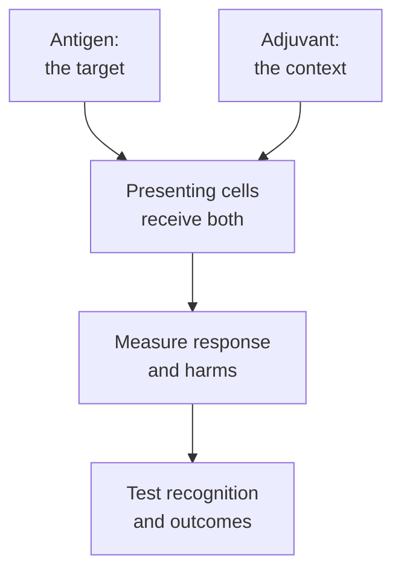

# Vaccine adjuvants

## In one sentence

A vaccine adjuvant is a component used to shape or strengthen the immune response to the vaccine's antigen.

## The intuition

A useful lesson needs both a topic and a teaching setting. The antigen supplies the topic; an adjuvant helps create conditions for immune learning. It may influence which cells arrive, how they handle material or which signals accompany recognition.

The analogy stops before “more encouragement is always better.” An adjuvant can add unwanted inflammation or favor a response that does not accomplish the vaccine's goal. Its value belongs to the complete formulation and setting.

**Before you start:** [T-cell priming](/wiki/education/concepts/immunology/t-cells/t-cell-priming-three-signals) separates recognition from supporting signals; [pattern recognition](/wiki/education/concepts/immunology/innate-and-unconventional-cells/pattern-recognition-damps-and-pamps) explains innate sensing.

## How it works

An antigen can be collected without producing the desired response. [Dendritic cells](/wiki/education/concepts/immunology/innate-and-unconventional-cells/dendritic-cells) and other presenting cells need an appropriate activation context. Adjuvants can affect recruitment, antigen availability, cell activation and supporting signals. Different ingredients act through different mechanisms; there is no single “adjuvant pathway.” [CDC's overview](https://www.cdc.gov/vaccine-safety/about/adjuvants.html) distinguishes these immune-supporting ingredients from the antigen itself.

Some adjuvants engage innate sensors. For example, monophosphoryl lipid A is a modified bacterial lipid studied for signaling through Toll-like receptor 4 (TLR4). Mouse experiments showed that modifying a microbial signal could change the balance between immune stimulation and inflammatory toxicity. That specific result does not supply a universal safety rule for all ingredients, routes or people. [Mata-Haro and colleagues](https://pubmed.ncbi.nlm.nih.gov/17569868/).

Other formulation features influence where antigen persists or which cells encounter it. **Delivery and adjuvant activity can overlap**, but they are different jobs: getting material into a cell does not establish helpful priming. A [lipid carrier](/wiki/education/concepts/engineering-and-manufacturing/delivery-vehicles/lipid-nanoparticle) may affect both delivery and innate sensing. Its composition, payload, route and exposure determine what happens; the name alone cannot establish the response.

An early personal cancer-vaccine study combined long peptides with poly-ICLC, a stabilized synthetic double-stranded RNA immune stimulus. Antigen-reactive responses in that melanoma study were measurements of the combined regimen, not a randomized estimate of what the adjuvant alone added. [Ott and colleagues](https://pubmed.ncbi.nlm.nih.gov/28678778/).

Duration also matters. In a defined mouse melanoma model, persistent short-peptide depots attracted vaccine-reactive T cells to the vaccination site and contributed to dysfunction. Altering the formulation changed their distribution and activity. Long-peptide conditions behaved differently even within that study. This illustrates why “longer persistence is better” is unreliable, rather than proving that all depot adjuvants fail. [Hailemichael and colleagues](https://pubmed.ncbi.nlm.nih.gov/23455713/).

*A simplified priming pathway. Adjuvants can also act on other cells; supportive signals and antigen specificity contribute different parts of the strategy.*

## Why it matters in cancer

A cancer vaccine needs useful responses against relevant targets, not just a strong reaction at the injection site. Tumor recognition, entry, function and safety remain separate requirements. An ingredient used in an infection-prevention vaccine cannot inherit cancer-treatment efficacy from that use.

## How it is measured

Early studies can measure presenting-cell activation, antigen-specific antibody or T-cell responses, persistence and adverse effects. Report the assay, cell population, units, background controls and time point. To isolate an adjuvant's contribution, compare suitable regimens with the same antigen and relevant conditions. A study changing antigen, carrier and adjuvant together measures a package, not one ingredient's causal effect.

## Common confusions

- **Vaccine adjuvant versus adjuvant therapy:** the first is an immune-supporting component; the second describes [treatment after the main treatment](/wiki/education/concepts/breast-cancer/treatment-setting/neoadjuvant-vs-adjuvant).
- Redness, fever or a large cytokine signal does not prove useful antigen-specific immunity.
- An adjuvant does not choose the antigen recognized by a receptor.
- A stronger measured response can come with different cells, shorter durability or greater harm.

## Try it

Two fictional formulations contain the same antigen. Formulation A causes more redness. Formulation B produces a larger antigen-specific response in a controlled assay. Which observation establishes better cancer control?

**Answer:** Neither establishes it. Redness measures a local reaction; the assay measures its specified immune response. Tumor recognition, clinical outcomes and harms still need evaluation. The formulation comparison also needs equivalent routes, sampling and suitable controls.

## Explain it back

“The antigen supplies ___; the adjuvant influences ___.” One answer is “the target material; the context of the immune response.”

## Takeaway

Ask what an adjuvant changes and how that change was measured. Immune stimulation becomes useful only in the context of the vaccine's goal.

## Related concepts

- [Cancer vaccines: an overview](/wiki/education/concepts/therapeutics/immunotherapy/cancer-vaccines-overview)
- [Cytokines and chemokines](/wiki/education/concepts/immunology/immune-regulation/cytokine-and-chemokine)
- [Immunodominance](/wiki/education/concepts/immunology/t-cells/immunodominance)

## Sources and scope

Source-checked October 10, 2026. General education and a fictional exercise; expert and learner review remain pending. Mouse mechanisms and a small human melanoma study are kept within their tested formulations and settings.

- [CDC: adjuvants and vaccines](https://www.cdc.gov/vaccine-safety/about/adjuvants.html) — ingredient purpose and formulation-specific evaluation.
- [Mata-Haro et al., 2007: monophosphoryl lipid A signaling](https://pubmed.ncbi.nlm.nih.gov/17569868/) — a defined mouse TLR4-adjuvant experiment.
- [Ott et al., 2017: personal peptides with poly-ICLC](https://pubmed.ncbi.nlm.nih.gov/28678778/) — a human melanoma vaccine regimen and immune measurements.
- [Hailemichael et al., 2013: persistent antigen at vaccination sites](https://pubmed.ncbi.nlm.nih.gov/23455713/) — formulation-dependent T-cell distribution and dysfunction in mouse models.

<!-- BEGIN GENERATED USED IN -->
## Used in

- [How a personalized cancer vaccine is designed](/wiki/education/guides/personalized-cancer-vaccine/index)
<!-- END GENERATED USED IN -->
