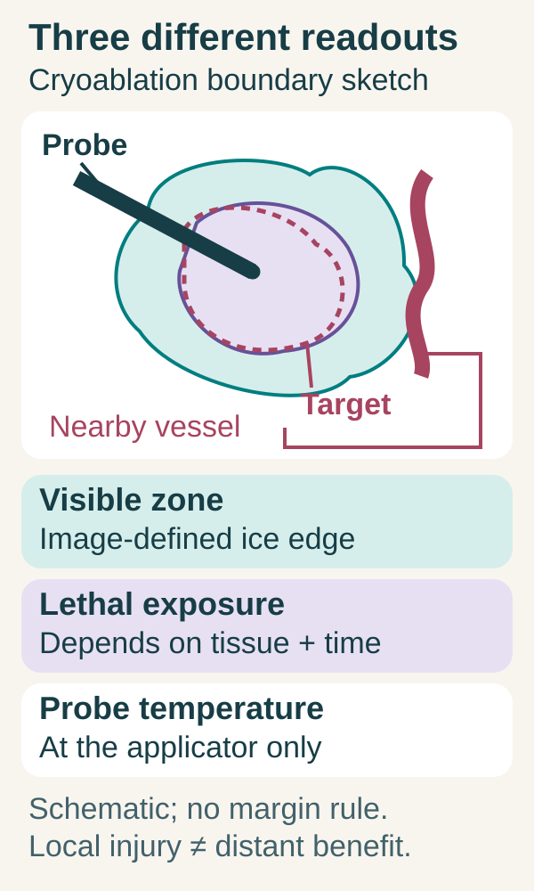
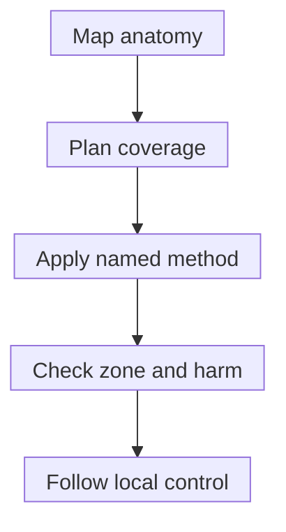

# Ablation

## In one sentence

Tumor ablation destroys tissue at a selected site using a defined physical or chemical method, with coverage and safety assessed for the target and nearby structures.

## The intuition

Ablation treats a place. Imagine a three-dimensional treatment zone surrounding a target, with vessels, nerves and other tissues nearby. Reaching the center is not the same as safely covering the whole target. The important questions are where the injury extends and how the result is checked. The zone is not a cookie cutter: temperature, tissue and geometry make its boundary uneven.

## How it works

*The visible ice edge, the probe reading and lethal tissue exposure answer different questions. Violet shading only sketches possible lethal exposure; it is not measured cell death. The dashed pink line outlines the target. This cryoablation sketch specifies no size, temperature or margin.*

**Read the illustration:** In the sketch, which readout comes from the applicator, and which edge comes from imaging?

**Answer:** Probe temperature is the applicator reading. The outer ice-zone boundary is visible on imaging. Neither directly maps lethal exposure everywhere in the target.

Most procedures place an applicator in or near a lesion under imaging guidance. The [international consensus](https://pubmed.ncbi.nlm.nih.gov/25442132/) distinguishes thermal, chemical and other methods; name the actual technique when comparing studies.

| Method | How injury is produced | What the name does not guarantee |
|---|---|---|
| **Radiofrequency ablation (RFA)** | Alternating electrical current passes through conductive tissue, producing resistive heating near the electrode; heat also spreads by conduction | Uniform temperature throughout the target |
| **Microwave ablation (MWA)** | An antenna produces an oscillating electromagnetic field; polar molecules, particularly water, respond and generate heat in tissue | Immunity to blood-flow cooling or a universal coverage advantage |
| **Cryoablation** | Cooling extracts heat. The classic technique is a fast freeze, a slow thaw, and a repeat of the cycle; ice crystals, osmotic swelling during thaw and loss of blood supply injure cells | That every visibly frozen point receives lethal exposure |

Chemical ablation uses a tissue-damaging substance; irreversible electroporation uses membrane-disrupting pulses. All differ from ionizing [radiation](/wiki/education/concepts/therapeutics/local-therapies/radiation-therapy-basics).

*Placing a device is a delivery step; coverage and later local control require their own assessment.*

Temperature varies across tissue and time. The probe is the coldest point, and tissue warms with distance from it. The visible edge of an ice ball is the 0 °C line where water freezes, but reliable cell death needs much colder tissue: reviews place the lethal range at roughly −20 to −40 °C, and Gage and Baust recommended reaching −50 °C in tumor tissue. So the outer rim of visible ice is frozen but not reliably killed. In an [experiment in normal swine kidney](https://pubmed.ncbi.nlm.nih.gov/22933102/), that nonlethal rim averaged 0.75 mm wide (maximum 1.15 ± 0.51 mm), widening next to large vessels; the authors extrapolated a 6 mm margin of visible ice beyond a kidney tumor. Those figures come from one animal tissue and do not define a universal human margin, but they show why the ice must extend past the target. With heating, nearby blood flow can carry heat away, as tested in [experimental liver models](https://pubmed.ncbi.nlm.nih.gov/25738477/).

A margin around visible tumor accounts for edge disease, the nonlethal rim of a freeze or heat zone, and imaging uncertainty. Feasibility depends on anatomy, geometry, equipment and nearby structures; a study's size threshold is not a universal physical limit.

## Why it matters in cancer

Ablation can support local control or symptom relief in selected settings. It does not treat microscopic disease elsewhere in the body. It can damage normal tissue, leave less tissue for later pathology, and cause bleeding, infection or injury to vessels, ducts or nerves.

Released material motivates [in-situ vaccination](/wiki/education/concepts/immunology/tumor-immunology/in-situ-vaccination) research. Physical destruction or experimental antigen preservation does not establish immune priming, distant benefit or a best technique.

## How it is measured

| Readout | Units or definition | Limit |
|---|---|---|
| Device exposure | Method, power in watts where relevant, duration and temperature in degrees Celsius where measured | Generator power or probe temperature is not exposure everywhere in tissue |
| Zone coverage | Three-dimensional lengths/margins in millimeters or centimeters, imaging method and time | An iceball or changed zone is not a direct viable-cell count |
| Initial technique efficacy | Defined follow-up evidence of complete ablation | Procedural completion alone does not establish it |
| Later local progression | Tumor appearing at the treated margin after initial adequate ablation by the stated criteria | New disease elsewhere is a separate outcome |

Keep retreatments and complications attached to the result.

## Worked example and practice

**Fictional procedure:** A probe reaches a lesion and the visible zone covers its center. One edge is near a sensitive structure. Is complete safe destruction established?

**Answer:** No. Access and central coverage are demonstrated. Coverage at the edge, protection of the nearby structure and subsequent local assessment still matter. A central image does not establish the full three-dimensional result.

## Common confusions

- Ablation destroys tissue in place; surgery usually removes tissue for examination.
- Probe temperature, image appearance and lethal tissue exposure are different measurements. In cryoablation, the ice edge is about 0 °C, while the lethal range is about −20 to −40 °C or colder.
- Repeatability depends on the organ, prior injury and new treatment zone; it is not unlimited.
- A local control result is not proof of systemic immune benefit.

## Explain it back

Why is “the probe got cold” different from “the target received lethal exposure”?

**One answer:** Probe temperature is local. Tissue temperature rises with distance, blood flow and time, so the edge of the visible ice is only about 0 °C, far warmer than the roughly −20 to −40 °C needed to kill cells reliably.

## Takeaway

Name the physics, assess the whole boundary and follow the local result. None of those steps alone establishes a distant immune benefit.

## Related concepts

- [Radiation therapy basics](/wiki/education/concepts/therapeutics/local-therapies/radiation-therapy-basics)
- [Stereotactic body radiation therapy (SBRT)](/wiki/education/concepts/therapeutics/local-therapies/sbrt)
- [Immunogenic cell death](/wiki/education/concepts/cancer-biology/cell-death-and-survival/immunogenic-cell-death)

## Sources and scope

Source check: November 7, 2026 for the freeze–thaw cycle, isotherms and rim width; October 10, 2026 for the rest. Local-ablation mechanisms, coverage and reporting vocabulary; no universal size threshold, technique ranking or systemic-benefit claim. Expert and learner review remain pending.

- [Ahmed et al., 2014: international consensus on ablation methods, terminology and reporting](https://pubmed.ncbi.nlm.nih.gov/25442132/) — complete abstract and selected author-manuscript measurement/reporting passages checked.
- [NCI: cryosurgery mechanisms, local targeting and normal-tissue risks](https://www.cancer.gov/about-cancer/treatment/types/surgery/cryosurgery).
- [Lubner et al., 2010: microwave and radiofrequency heating mechanisms](https://pmc.ncbi.nlm.nih.gov/articles/PMC3065977/) — selected author-manuscript mechanism passages checked; historical device or approval inventory not used.
- [Georgiades et al., 2013: the visible ice ball and nonlethal margin in normal swine kidney tissue](https://pubmed.ncbi.nlm.nih.gov/22933102/) — abstract checked for rim width and the extrapolated margin.
- [Gage and Baust, 1998: mechanisms of tissue injury in cryosurgery](https://pubmed.ncbi.nlm.nih.gov/9787063/) — abstract checked for rapid freeze, slow thaw, repeat cycles and the −50 °C tumor target.
- [Erinjeri and Clark, 2010: cryoablation mechanism of action and devices](https://pmc.ncbi.nlm.nih.gov/articles/PMC6661161/) — full text checked for the 0 °C ice edge, death below −40 °C and the four injury factors.
- [Fermanian et al., 2025: cryoablation for breast cancer](https://pmc.ncbi.nlm.nih.gov/articles/PMC12190262/) — full-text review checked for the −20 to −40 °C lethal range.
- [Pillai et al., 2015: the cooling effect of flow during radiofrequency and microwave ablation in an ex-vivo calf liver model](https://pubmed.ncbi.nlm.nih.gov/25738477/).

<!-- BEGIN GENERATED USED IN -->
## Used in

- [Separate local injury from immune learning](/wiki/education/guides/local-therapy-and-the-immune-system/01-mechanism)
- [Put the disease setting before the clock](/wiki/education/guides/local-therapy-and-the-immune-system/02-timing)
- [Ask what a combination trial actually proved](/wiki/education/guides/local-therapy-and-the-immune-system/03-overlap-and-sequencing)
- [Read a proposal through five questions](/wiki/education/guides/local-therapy-and-the-immune-system/04-decision-questions)
- [Compare delivery and recognition separately](/wiki/education/guides/local-therapy-and-the-immune-system/06-comparisons)
- [Understand local therapy and the immune system](/wiki/education/guides/local-therapy-and-the-immune-system/index)
- [Local-treatment reference shelf](/wiki/education/local-treatment-modalities/index)
<!-- END GENERATED USED IN -->
