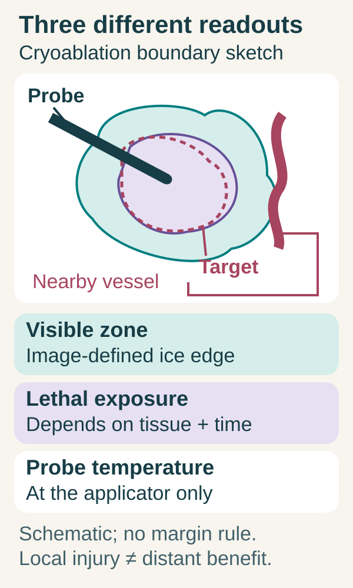
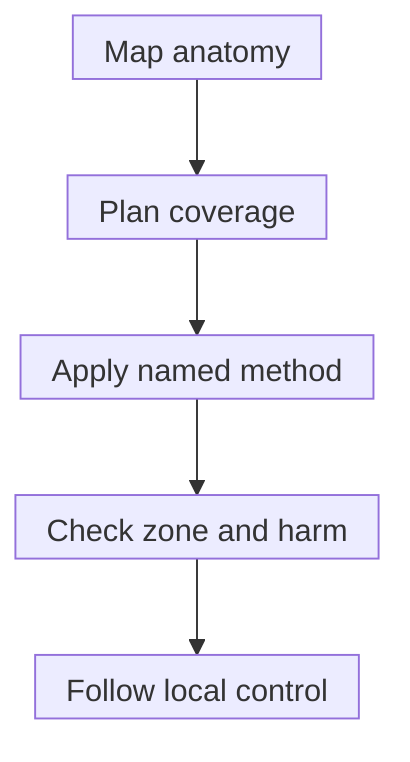

# Ablation

## In one sentence

Tumor ablation destroys tissue at a selected site using a defined physical or chemical method, with coverage and safety assessed for the target and nearby structures.

## The intuition

Ablation treats a place. Imagine a three-dimensional treatment zone surrounding a target, with vessels, nerves and other tissues nearby. Reaching the center is not the same as safely covering the whole target. The important questions are where the injury extends and how the result is checked. The zone is not a cookie cutter: temperature, tissue and geometry make its boundary uneven.

## How it works

*The visible ice edge, the probe reading and lethal tissue exposure answer different questions. Violet shading only sketches possible lethal exposure; it is not measured cell death. The dashed pink line outlines the target. This cryoablation sketch specifies no size, temperature or margin.*

**Read the illustration:** In the sketch, which readout comes from the applicator, and which edge comes from imaging?

**Answer:** Probe temperature is the applicator reading. The outer ice-zone boundary is visible on imaging. Neither directly maps lethal exposure everywhere in the target.

Many procedures place an applicator near or within a lesion under imaging guidance; others use focused ultrasound. The [international consensus](https://pubmed.ncbi.nlm.nih.gov/25442132/) distinguishes thermal, chemical and other methods. Name the actual technique when comparing studies.

| Method | How injury is produced | What the name does not guarantee |
|---|---|---|
| **Radiofrequency ablation (RFA)** | Alternating electrical current passes through conductive tissue, producing resistive heating near the electrode; heat also spreads by conduction | Uniform temperature throughout the target |
| **Microwave ablation (MWA)** | An antenna produces an oscillating electromagnetic field; polar molecules, particularly water, respond and generate heat in tissue | Immunity to blood-flow cooling or a universal coverage advantage |
| **Cryoablation** | Cooling extracts heat; freezing and thawing injure cells and local tissue | That every visibly frozen point receives lethal exposure |

Heat damages proteins and tissue structures. Chemical ablation uses a tissue-damaging substance; irreversible electroporation uses membrane-disrupting pulses. These mechanisms differ from ionizing [radiation](/wiki/education/concepts/therapeutics/local-therapies/radiation-therapy-basics). Name and test the method.

*Placing a device is a delivery step; coverage and later local control require their own assessment.*

Temperature varies across tissue and time. Probe temperature does not describe the whole zone. A visible ice ball guides cryoablation; it does not establish lethal exposure everywhere inside. An [animal experiment in normal kidney tissue](https://pubmed.ncbi.nlm.nih.gov/22933102/) measured a nonlethal margin inside the visible ice ball; its dimensions do not define a universal human treatment margin. With heating, nearby blood flow can carry heat away, as tested in [experimental liver models](https://pubmed.ncbi.nlm.nih.gov/25738477/). These observations explain why exposure must be assessed in context; they do not rank methods universally.

A margin around visible tumor accounts for edge disease and uncertainty. Feasibility depends on anatomy, geometry, equipment and nearby structures. A study's size threshold is not a universal physical limit; adding devices does not remove safety constraints.

## Why it matters in cancer

Ablation can support local control or symptom relief in selected settings, depending on organ, cancer, distribution, alternatives and evidence. It does not physically treat all microscopic disease throughout the body. It can also damage normal tissue and affect tissue available for later pathology or testing. Risks depend on the approach and nearby structures; bleeding, infection or injury to vessels, ducts or nerves remain possible.

Released material motivates [in-situ vaccination](/wiki/education/concepts/immunology/tumor-immunology/in-situ-vaccination) research. Physical destruction or experimental antigen preservation does not establish immune priming, distant benefit or a best technique.

## How it is measured

| Readout | Units or definition | Limit |
|---|---|---|
| Device exposure | Method, power in watts where relevant, duration and temperature in degrees Celsius where measured | Generator power or probe temperature is not exposure everywhere in tissue |
| Zone coverage | Three-dimensional lengths/margins in millimeters or centimeters, imaging method and time | An iceball or changed zone is not a direct viable-cell count |
| Initial technique efficacy | Defined follow-up evidence of complete ablation | Procedural completion alone does not establish it |
| Later local progression | Tumor appearing at the treated margin after initial adequate ablation by the stated criteria | New disease elsewhere is a separate outcome |

Keep retreatments and complications attached to the result. There is no universal safe size, temperature or margin for every method and organ.

## Worked example and practice

**Fictional procedure:** A probe reaches a lesion and the visible zone covers its center. One edge is near a sensitive structure. Is complete safe destruction established?

**Answer:** No. Access and central coverage are demonstrated. Coverage at the edge, protection of the nearby structure and subsequent local assessment still matter. A central image does not establish the full three-dimensional result.

## Common confusions

- Ablation destroys tissue in place; surgery usually removes tissue for examination.
- Probe temperature, image appearance and lethal tissue exposure are different measurements.
- Repeatability depends on the organ, prior injury and new treatment zone; it is not unlimited.
- A local control result is not proof of systemic immune benefit.

## Explain it back

Why is “the probe got cold” different from “the target received lethal exposure”?

**One answer:** Probe temperature is local. Tissue temperature varies with distance, time, blood flow and the freeze–thaw process; an image needs method-specific interpretation.

## Takeaway

Name the physics, assess the whole boundary and follow the local result. None of those steps alone establishes a distant immune benefit.

## Related concepts

- [Radiation therapy basics](/wiki/education/concepts/therapeutics/local-therapies/radiation-therapy-basics)
- [Stereotactic body radiation therapy (SBRT)](/wiki/education/concepts/therapeutics/local-therapies/sbrt)
- [Immunogenic cell death](/wiki/education/concepts/cancer-biology/cell-death-and-survival/immunogenic-cell-death)

## Sources and scope

Source check: October 10, 2026. Local-ablation mechanisms, coverage and reporting vocabulary; no universal size threshold, technique ranking or systemic-benefit claim. Expert and learner review remain pending.

- [Ahmed et al., 2014: international consensus on ablation methods, terminology and reporting](https://pubmed.ncbi.nlm.nih.gov/25442132/) — complete abstract and selected author-manuscript measurement/reporting passages checked.
- [NCI: cryosurgery mechanisms, local targeting and normal-tissue risks](https://www.cancer.gov/about-cancer/treatment/types/surgery/cryosurgery).
- [Lubner et al., 2010: microwave and radiofrequency heating mechanisms](https://pmc.ncbi.nlm.nih.gov/articles/PMC3065977/) — selected author-manuscript mechanism passages checked; historical device or approval inventory not used.
- [Georgiades et al., 2013: the visible ice ball and nonlethal margin in normal swine kidney tissue](https://pubmed.ncbi.nlm.nih.gov/22933102/).
- [Pillai et al., 2015: the cooling effect of flow during radiofrequency and microwave ablation in an ex-vivo calf liver model](https://pubmed.ncbi.nlm.nih.gov/25738477/).

<!-- BEGIN GENERATED USED IN -->
## Used in

- [Understand local therapy and the immune system](/wiki/education/guides/local-therapy-and-the-immune-system/index)
- [Separate local injury from immune learning](/wiki/education/local-treatment-modalities/01-mechanism)
- [Put the disease setting before the clock](/wiki/education/local-treatment-modalities/02-timing)
- [Ask what a combination trial actually proved](/wiki/education/local-treatment-modalities/03-overlap-and-sequencing)
- [Read a proposal through five questions](/wiki/education/local-treatment-modalities/04-decision-questions)
- [Compare delivery and recognition separately](/wiki/education/local-treatment-modalities/06-comparisons)
- [Local-treatment reference shelf](/wiki/education/local-treatment-modalities/index)
<!-- END GENERATED USED IN -->
