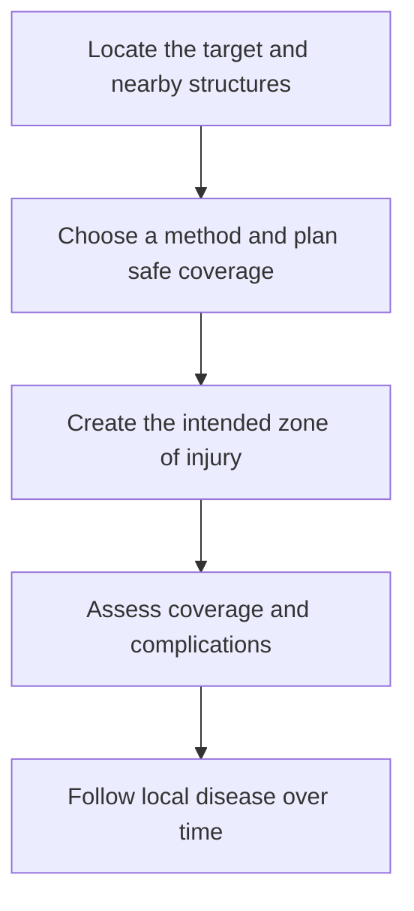

# Ablation

## In one sentence

Tumor ablation destroys tissue at a selected site using a defined physical or chemical method, with coverage and safety assessed for the target and nearby structures.

## The intuition

Ablation treats a place. Imagine a three-dimensional treatment zone surrounding a target, with vessels, nerves and other tissues nearby. Reaching the center is not the same as safely covering the whole target. The important questions are where the injury extends, whether the intended boundary was reached, and how the result is checked.

## How it works

Many tumor-ablation procedures place a probe or applicator within or beside a lesion under imaging guidance. Other methods deliver energy differently, such as focused ultrasound. The [international terminology consensus](https://pubmed.ncbi.nlm.nih.gov/25442132/) distinguishes thermal, chemical and other ablative methods. “Ablation” should therefore be followed by the actual technique when comparing studies.

**Radiofrequency ablation (RFA)** uses electrical energy to heat tissue. **Microwave ablation (MWA)** uses microwave energy to generate heat. Heating damages proteins and tissue structures. **Cryoablation** uses freezing and thawing to injure cells. Chemical ablation introduces a tissue-damaging substance, while irreversible electroporation uses electrical pulses to disrupt cell membranes. These are different physical mechanisms; evidence for one is not evidence for all.

*Placing a device is a delivery step; coverage and later local control require their own assessment.*

In thermal procedures, temperature changes across tissue and over time. The probe tip is not the edge of the treatment zone. A visible ice ball helps guide cryoablation, but freezing on an image does not establish lethal exposure everywhere within it. An [animal experiment in normal kidney tissue](https://pubmed.ncbi.nlm.nih.gov/22933102/) measured a nonlethal margin inside the visible ice ball; its dimensions do not define a universal human treatment margin. With heating, nearby blood flow can carry heat away, as tested in [experimental liver models](https://pubmed.ncbi.nlm.nih.gov/25738477/). The relevant issue is the tissue's actual exposure and the selected method's response to its environment.

Planning may include a treatment margin around the visible tumor, accounting for disease at its edge and uncertainty. Whether that coverage is possible depends on anatomy, lesion geometry, equipment and protection of nearby structures. A study's selection threshold is not a universal physical size limit. Several devices may alter coverage, but adding devices does not remove safety constraints.

## Why it matters in cancer

Ablation can be used for local tumor control or symptom relief in selected settings. Its role depends on the organ, cancer, disease distribution, alternatives and evidence for the stated goal. Local destruction does not treat all microscopic disease throughout the body. It can also damage normal tissue and affect tissue available for later pathology or testing.

Tumor injury can release antigens and signals that motivate [in-situ vaccination](/wiki/education/concepts/immunology/tumor-immunology/in-situ-vaccination) research. Physical destruction does not establish useful immune priming or distant clinical benefit. Preserving some antigen structure in an experiment does not determine which ablation technique provides the best systemic benefit in people.

## How it is measured

Reports should separate procedural completion, initial evidence of target coverage and control during follow-up. The method, imaging criteria, time point, retreatments and complications belong with the result. “Technically successful” and “no later local progression” answer different questions. Imaging findings need interpretation appropriate to the procedure; a changed treatment zone is not a direct count of living cancer cells.

## Worked example and practice

In a fictional procedure, the probe reaches the lesion and the visible treatment zone covers its center. One edge is close to a sensitive structure. Does the team now know the entire target was destroyed safely?

**Answer:** No. Access and central coverage are demonstrated. Coverage at the edge, protection of the nearby structure and subsequent local assessment still matter. A central image does not establish the full three-dimensional result.

## Common confusions

- Ablation destroys tissue in place; surgery usually removes tissue for examination.
- Probe temperature, image appearance and lethal tissue exposure are different measurements.
- Repeatability depends on the organ, prior injury and new treatment zone; it is not unlimited.
- A local control result is not proof of systemic immune benefit.

## Explain it back

“Ablation uses a named method to injure a selected tissue volume. The target boundary and nearby anatomy matter as much as reaching its center.”

## Related concepts

- [Radiation therapy basics](/wiki/education/concepts/therapeutics/local-therapies/radiation-therapy-basics)
- [Stereotactic body radiation therapy (SBRT)](/wiki/education/concepts/therapeutics/local-therapies/sbrt)
- [Immunogenic cell death](/wiki/education/concepts/cancer-biology/cell-death-and-survival/immunogenic-cell-death)

## Sources and scope

Source check: October 9, 2026. Local-ablation mechanisms, coverage and reporting vocabulary; no universal size threshold, technique ranking or systemic-benefit claim. Expert and learner review remain pending.

- [Ahmed et al., 2014: international consensus on ablation methods, terminology and reporting](https://pubmed.ncbi.nlm.nih.gov/25442132/).
- [NCI: cryosurgery mechanisms, local targeting and normal-tissue risks](https://www.cancer.gov/about-cancer/treatment/types/surgery/cryosurgery).
- [Galluzzi et al., 2020: requirements for interpreting immune effects of dying cells](https://pubmed.ncbi.nlm.nih.gov/32209603/).
- [Georgiades et al., 2013: the visible ice ball and nonlethal margin in normal swine kidney tissue](https://pubmed.ncbi.nlm.nih.gov/22933102/).
- [Pillai et al., 2015: the cooling effect of flow during radiofrequency and microwave ablation in an ex-vivo calf liver model](https://pubmed.ncbi.nlm.nih.gov/25738477/).

<!-- BEGIN GENERATED USED IN -->
## Used in

- [Understand local therapy and the immune system](/wiki/education/guides/local-therapy-and-the-immune-system/index)
- [Separate local injury from immune learning](/wiki/education/local-treatment-modalities/01-mechanism)
- [Put the disease setting before the clock](/wiki/education/local-treatment-modalities/02-timing)
- [Ask what a combination trial actually proved](/wiki/education/local-treatment-modalities/03-overlap-and-sequencing)
- [Read a proposal through five questions](/wiki/education/local-treatment-modalities/04-decision-questions)
- [Compare delivery and recognition separately](/wiki/education/local-treatment-modalities/06-comparisons)
- [Local-treatment reference shelf](/wiki/education/local-treatment-modalities/index)
<!-- END GENERATED USED IN -->
