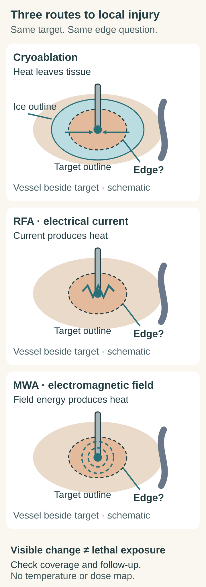

# Cryoablation vs RFA vs MWA

## In one sentence

Cryoablation removes heat to freeze tissue, radiofrequency ablation heats tissue with electrical current, and microwave ablation heats tissue with an oscillating electromagnetic field.

## The intuition

Picture the same small target beside a flowing vessel. You can take heat out or put heat in, but the tissue does not behave like an isolated laboratory block. Where the energy goes, how long the tissue experiences it, and what happens at the edge all matter. Start with the route to injury; then ask how that injury was checked.

## How they work

These are three forms of [local ablation](/wiki/education/concepts/therapeutics/local-therapies/ablation). In this comparison, each uses an applicator placed into or beside a selected target. They differ in how they change tissue temperature; all require attention to coverage and nearby structures.

| Same question | Cryoablation | Radiofrequency ablation (RFA) | Microwave ablation (MWA) |
|---|---|---|---|
| What is the applicator doing? | A cryoprobe draws heat from tissue. | An electrode delivers alternating electrical current through tissue. | An antenna couples an oscillating electromagnetic field into tissue. |
| How does injury develop? | Freezing and thawing can disrupt cells and tissue. | Electrical resistance generates heat near the electrode; heat also spreads by conduction. | Tissue absorbs field energy, including through the response of polar water molecules; heat also spreads by conduction. |
| What needs checking? | Exposure across the target, including near the frozen edge. | Exposure across the target, including regions affected by electrical properties and heat loss. | Exposure across the target, including regions affected by field distribution and heat loss. |

The mechanism distinction comes from an international ablation consensus and the technical description by Lubner and colleagues. It is a physics comparison, not a ranking of clinical outcomes. [Ahmed et al., 2014](https://pmc.ncbi.nlm.nih.gov/articles/PMC7660986/), [Lubner et al., 2010](https://pmc.ncbi.nlm.nih.gov/articles/PMC3065977/).

*Read the energy arrows first, then the question at the edge. This is a mechanism sketch, not a temperature map or a treatment plan. [Dark version](images/cryo-vs-rfa-vs-mwa-comparison-physics-and-boundaries-v1-dark.svg).*

## A visible zone is one clue

An ice ball can be followed with imaging during cryoablation. Its outer visible boundary is not a guarantee that every cell inside received lethal exposure. In a normal-kidney swine experiment, Georgiades and colleagues compared MR-visible ice with tissue viability staining and found a nonlethal region inside the ice boundary. That animal result supports the distinction; its measured distances are not a universal human treatment margin. [Georgiades et al., 2013, abstract](https://pubmed.ncbi.nlm.nih.gov/22933102/).

Blood flow can change heat distribution. In an experiment using perfused calf liver outside the body, flow affected both RF and microwave ablation measurements. The devices differed in operating conditions, and their relative performance depended on the measurement. This does not establish that MWA is immune to heat loss or that one method always wins. [Pillai et al., 2015, Methods and Results](https://pmc.ncbi.nlm.nih.gov/articles/PMC4553952/).

The three names therefore do not specify identical injury shapes. A visible frozen region, a tissue change, exposure evidence, and a later clinical outcome answer different questions.

## Try it: three matched coverage cards

These **fictional** records concern the same target and adjacent vessel:

| Record | What you are told | What is missing |
|---|---|---|
| Cold | The probe was positioned; an image shows ice surrounding the target outline. | Lethal exposure at the target edge; follow-up. |
| Current | The electrode was positioned; a central sensor recorded heating. | Exposure at the target edge; follow-up. |
| Field | The antenna was positioned; a central sensor recorded heating. | Exposure at the target edge; follow-up. |

**Question:** Which record proves complete target destruction? Which supports a universal technique winner? What evidence would address the coverage gap?

**Answer:** None proves either claim. Cold documents a visible frozen region, not a complete lethal boundary. Current and Field document central heating, not exposure everywhere. To investigate coverage, you would need spatially relevant exposure or validated assessment of the treated zone against the target, with the limitations of that method stated. Appropriate follow-up addresses residual viable tumor and local progression; it also needs to assess nearby tissue injury. No numeric margin can be inferred from these cards. The consensus distinguishes procedural coverage from efficacy demonstrated at a defined follow-up time. [Ahmed et al., 2014](https://pmc.ncbi.nlm.nih.gov/articles/PMC7660986/).

## Why it matters in cancer

These methods aim to injure tissue at a selected site. Local destruction, effects on nearby tissue, and disease elsewhere need separate evidence. None of the cards establishes distant cancer control or an immune response.

## Explain it back

For each method, name the route to temperature change. Then explain why “the target is inside the visible zone” and “the target was completely destroyed” are different claims.

**Takeaway:** Compare how energy reaches tissue, then check exposure, coverage, and outcome separately.

## Related

- [Ablation](/wiki/education/concepts/therapeutics/local-therapies/ablation)
- [Stereotactic body radiation therapy (SBRT) vs conventional radiation](/wiki/education/concepts/therapeutics/local-therapies/sbrt-vs-conventional-radiation)

## Sources and scope

*Sources checked 2026-10-12: Ahmed—abstract and selected terminology, cryoablation, technical-success and efficacy sections; Lubner—selected mechanism section; Georgiades—complete abstract only; Pillai—abstract, Methods and Results. Independent reviews remain pending.*
