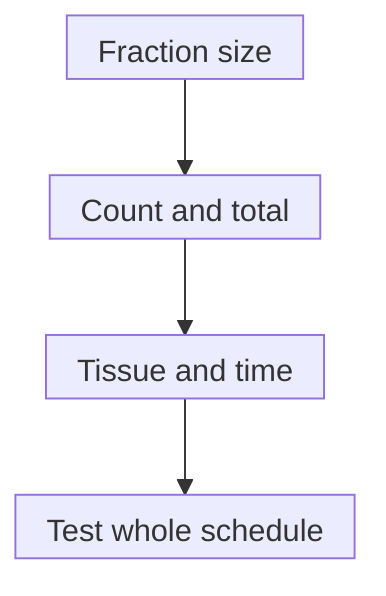

# Hypofractionation

## In one sentence

Hypofractionation gives radiation in larger doses per treatment than a conventional comparison schedule, usually reducing the number of treatments in a course.

## The intuition

Radiation can be divided into differently sized portions. Fewer portions do not automatically mean less treatment, and larger portions do not automatically mean a better result. Changing the portions changes how tumor and normal tissues experience the course. The schedule therefore needs evidence, not just arithmetic. Portions are an analogy for dividing physical dose; living tissue is not a container that simply adds equal biological effects.

## How it works

In [radiation therapy](/wiki/education/concepts/therapeutics/local-therapies/radiation-therapy-basics), a **fraction** is one treatment dose. Hypofractionation uses a larger dose per fraction than the conventional schedule used for comparison in that clinical setting. It commonly reduces the number of visits and may shorten the course. **Gray (Gy)** is the unit of absorbed radiation dose.

Total dose equals dose per fraction multiplied by the number of fractions when the fractions are equal. Biological effect does not follow that multiplication alone. Tumor cells and normal tissues differ in their responses to dose size and in their ability to repair damage between exposures. Overall treatment time, oxygen and changing cell populations matter too. Normal tissues and tumors need not respond in the same way, so a fraction-size change is evaluated for both control and harm. A lower physical total dose can therefore belong to an effective tested schedule; it is not automatically undertreatment.

*Changing fraction size requires assessment of the whole schedule; the diagram does not establish equivalence between regimens.*

**Moderate hypofractionation** and **ultrahypofractionation** distinguish degrees of increased fraction size in particular disease settings. Their exact boundaries should be stated when a study or guideline uses them. [Stereotactic body radiation therapy (SBRT)](/wiki/education/concepts/therapeutics/local-therapies/sbrt) combines high dose per fraction with specialized target localization and delivery. Hypofractionation is the broader scheduling concept; a shorter breast radiation course is not automatically SBRT.

Larger fraction size differs from accelerated treatment, which changes timing. A boost adds dose to a selected region and may alter visits. Compare actual schedules and volumes rather than “five visits.”

## Why it matters in cancer

Breast-cancer trials illustrate why direct testing matters. The [UK Standardisation of Breast Radiotherapy (START) trials](https://pubmed.ncbi.nlm.nih.gov/24055415/) studied defined postoperative schedules and followed local-regional relapse and late normal-tissue effects. The [FAST-Forward trial](https://pubmed.ncbi.nlm.nih.gov/32580883/) compared one-week and three-week schedules after primary surgery for early breast cancer. Their evidence remains attached to the tested regimens, populations and follow-up.

They do not show that any five-treatment schedule is equivalent to any longer course. Nor does evidence for local breast or chest-wall treatment automatically settle every nodal field, reirradiation context or other cancer. The treatment volume, population, dose and follow-up remain part of the evidence.

## How it is measured

| Field | What to record | Inference limit |
|---|---|---|
| Physical dose | Total Gy and Gy per fraction | Equal totals do not establish equal biological effects |
| Timing | Fraction count, intervals and elapsed days or weeks | Fewer visits and shorter overall duration are different changes |
| Spatial context | Target and normal-tissue volumes, including a boost | One course label can hide different exposed regions |
| Clinical comparison | Population, local outcome, normal-tissue effects and follow-up | A tested schedule cannot validate every dose with the same visit count |

No universal fraction-size boundary defines moderate or ultra schedules across all cancers. This page uses observed trial schedules rather than a model to calculate a replacement plan.

## Worked example and practice

**Fictional reader:** Rin compares two published START-B study cards. Their real schedules provide a numerical illustration: 50 Gy in 25 fractions gives 2 Gy per fraction; 40 Gy in 15 fractions gives about 2.67 Gy per fraction. These are trial schedules, not recommendations for an individual. The second has a lower total dose but a larger fraction size.

Can subtraction alone establish that the second delivers too little treatment?

**Answer:** No. Physical-dose arithmetic describes the schedule, while clinical comparisons test disease control and adverse effects. Larger fractions change biological effects, so total dose alone cannot establish adequacy or equivalence.

## Common confusions

- “Hypo” refers to fewer, larger fractions, not automatically weaker treatment.
- A session count does not specify the target volume or total dose.
- Convenience is a benefit of some shorter schedules, but it is not evidence of cancer control.
- Fractionation evidence does not establish an optimal dose for a systemic immune effect.

## Explain it back

Why might a lower total Gy still belong to an effective schedule?

**One answer:** Larger fractions change tissue response. Adequacy depends on the tested total, fraction size, timing, volumes and clinical results together.

## Takeaway

Count, dose size and biological effect are different quantities. Carry the complete regimen and its evidence into a comparison.

## Related concepts

- [Stereotactic body radiation therapy](/wiki/education/concepts/therapeutics/local-therapies/sbrt)
- [Treatment before or after surgery](/wiki/education/concepts/breast-cancer/treatment-setting/neoadjuvant-vs-adjuvant)
- [An abscopal effect](/wiki/education/concepts/immunology/tumor-immunology/abscopal-effect)

## Sources and scope

Source check: October 10, 2026. Fractionation vocabulary and disease-specific trial illustrations; no individual schedule selection. Expert and learner review remain pending.

- [NCI: external-beam radiation schedules](https://www.cancer.gov/about-cancer/treatment/types/radiation-therapy/external-beam) — patient-education fractionation and accelerated-treatment sections checked.
- [International Atomic Energy Agency, 2005: Radiation Oncology Physics, section 14.12](https://www-pub.iaea.org/MTCD/Publications/PDF/Pub1196_web.pdf) — selected fractionation and repair discussion checked; historical radiobiology teaching, not a current schedule recommendation.
- [Haviland et al., 2013: ten-year START trial results](https://pubmed.ncbi.nlm.nih.gov/24055415/) — complete primary abstract checked for postoperative population, exact START-B schedules and local-regional/late tissue endpoints.
- [Brunt et al., 2020: five-year FAST-Forward results](https://pubmed.ncbi.nlm.nih.gov/32580883/) — complete primary abstract checked for postoperative whole-breast/chest-wall population, specified schedules and endpoints; no broader indication inferred.

<!-- BEGIN GENERATED USED IN -->
## Used in

- [Understand local therapy and the immune system](/wiki/education/guides/local-therapy-and-the-immune-system/index)
- [Put the disease setting before the clock](/wiki/education/local-treatment-modalities/02-timing)
- [Compare delivery and recognition separately](/wiki/education/local-treatment-modalities/06-comparisons)
- [Local-treatment reference shelf](/wiki/education/local-treatment-modalities/index)
<!-- END GENERATED USED IN -->
