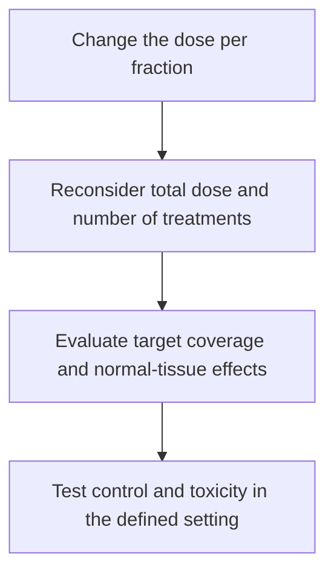

# Hypofractionation

## In one sentence

Hypofractionation gives radiation in larger doses per treatment than a conventional comparison schedule, usually reducing the number of treatments in a course.

## The intuition

Radiation can be divided into differently sized portions. Fewer portions do not automatically mean less treatment, and larger portions do not automatically mean a better result. Changing the portions changes how tumor and normal tissues experience the course. The schedule therefore needs evidence, not just arithmetic.

## How it works

In [radiation therapy](/wiki/education/concepts/therapeutics/local-therapies/radiation-therapy-basics), a **fraction** is one treatment dose. Hypofractionation uses a larger dose per fraction than the conventional schedule used for comparison in that clinical setting. It commonly reduces the number of visits and may shorten the course. **Gray (Gy)** is the unit of absorbed radiation dose.

Total dose equals dose per fraction multiplied by the number of fractions when the fractions are equal. Biological effect does not follow that multiplication alone. Tumor cells and normal tissues differ in their responses to dose size and in their ability to repair damage between exposures. Overall treatment time and dose distribution matter too. A lower physical total dose can therefore belong to an effective tested schedule; it is not automatically undertreatment.

*Changing fraction size requires assessment of the whole schedule; the diagram does not establish equivalence between regimens.*

**Moderate hypofractionation** and **ultrahypofractionation** distinguish degrees of increased fraction size in particular disease settings. Their exact boundaries should be stated when a study or guideline uses them. [Stereotactic body radiation therapy (SBRT)](/wiki/education/concepts/therapeutics/local-therapies/sbrt) combines high dose per fraction with specialized target localization and delivery. Hypofractionation is the broader scheduling concept; a shorter breast radiation course is not automatically SBRT.

Shorter duration and larger fraction size are also different variables. A course can be accelerated by changing the spacing of treatments. A boost adds dose to a selected region and may alter the visit count. Comparisons need the actual schedule and treated volumes, rather than a label such as “five visits.”

## Why it matters in cancer

Breast-cancer trials illustrate why direct testing matters. The [START trials](https://pubmed.ncbi.nlm.nih.gov/24055415/) studied defined postoperative schedules and followed local-regional relapse and late normal-tissue effects. The [FAST-Forward trial](https://pubmed.ncbi.nlm.nih.gov/32580883/) compared one-week and three-week schedules after primary surgery for early breast cancer. These studies support particular regimens in their tested settings, with their own endpoints and follow-up.

They do not show that any five-treatment schedule is equivalent to any longer course. Nor does evidence for local breast or chest-wall treatment automatically settle every nodal field, reirradiation context or other cancer. The treatment volume, population, dose and follow-up remain part of the evidence.

## Worked example and practice

Two schedules used in START-B provide a numerical illustration: 50 Gy in 25 fractions gives 2 Gy per fraction; 40 Gy in 15 fractions gives about 2.67 Gy per fraction. These are trial schedules, not recommendations for an individual. The second has a lower total dose but a larger fraction size.

Can subtraction alone establish that the second delivers too little treatment?

**Answer:** No. Physical-dose arithmetic describes the schedule, while clinical comparisons test disease control and adverse effects. Larger fractions change biological effects, so total dose alone cannot establish adequacy or equivalence.

## Common confusions

- “Hypo” refers to fewer, larger fractions, not automatically weaker treatment.
- A session count does not specify the target volume or total dose.
- Convenience is a benefit of some shorter schedules, but it is not evidence of cancer control.
- Fractionation evidence does not establish an optimal dose for a systemic immune effect.

## Explain it back

“Hypofractionation changes the size and number of radiation doses. The full schedule must be tested for control and normal-tissue effects.”

## Related concepts

- [Stereotactic body radiation therapy](/wiki/education/concepts/therapeutics/local-therapies/sbrt)
- [Treatment before or after surgery](/wiki/education/concepts/breast-cancer/treatment-setting/neoadjuvant-vs-adjuvant)
- [An abscopal effect](/wiki/education/concepts/immunology/tumor-immunology/abscopal-effect)

## Sources and scope

Source check: October 9, 2026. Fractionation vocabulary and disease-specific trial illustrations; no individual schedule selection. Expert and learner review remain pending.

- [NCI: definition of hypofractionated radiation therapy](https://www.cancer.gov/publications/dictionaries/cancer-terms/def/hypofractionated-radiation-therapy).
- [Haviland et al., 2013: ten-year START trial results for specified postoperative breast schedules](https://pubmed.ncbi.nlm.nih.gov/24055415/).
- [Brunt et al., 2020: five-year FAST-Forward results for specified local breast or chest-wall schedules](https://pubmed.ncbi.nlm.nih.gov/32580883/).

<!-- BEGIN GENERATED USED IN -->
## Used in

- [Understand local therapy and the immune system](/wiki/education/guides/local-therapy-and-the-immune-system/index)
- [Put the disease setting before the clock](/wiki/education/local-treatment-modalities/02-timing)
- [Compare delivery and recognition separately](/wiki/education/local-treatment-modalities/06-comparisons)
- [Local-treatment reference shelf](/wiki/education/local-treatment-modalities/index)
<!-- END GENERATED USED IN -->
