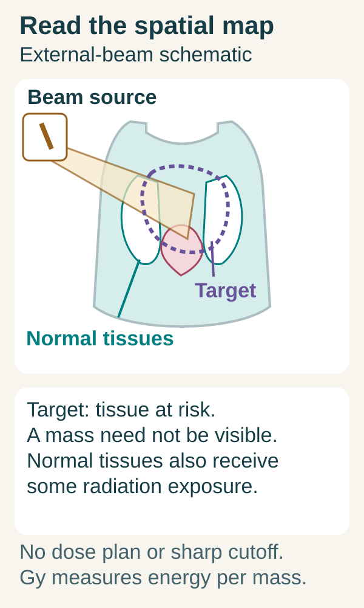
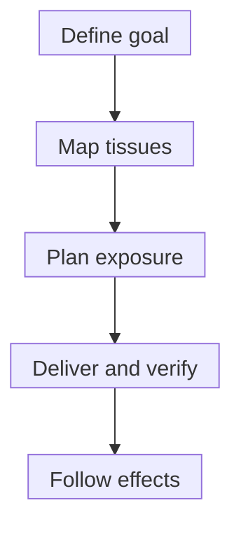

# Radiation therapy basics

## In one sentence

Radiation therapy uses ionizing radiation to damage cancer cells, with the treated volume and schedule chosen for a defined clinical goal.

## The intuition

A radiation plan is a three-dimensional map of where energy should go. It has a target, nearby structures to protect and a schedule. The treatment name alone does not tell you which tissues receive what dose or what outcome the team is trying to achieve. Start with the map and the goal. A map analogy helps with spatial coverage; tissue is living material whose response can change after exposure.

## How it works

*A target can be tissue at risk without a visible mass. Dashed target boundaries are planning concepts, not perfect dose cutoffs. The body and organs are schematic; no dose distribution, anatomy-specific prescription or cell-killing percentage is shown.*

**Read the illustration:** Does being outside the dashed target prove that a nearby normal tissue receives no radiation?

**Answer:** No. The target defines an intended treatment volume, while the beam path, scatter and actual dose distribution can expose normal tissues. Gray describes energy deposited per tissue mass; it is not the percentage of cells killed.

**Ionizing** radiation can remove electrons from atoms or molecules. Energy is deposited through physical interactions in tissue; photons transfer energy to charged particles that deposit energy along their paths. Radiation can damage [deoxyribonucleic acid (DNA)](/wiki/education/concepts/biology-basics/molecules/dna) directly or indirectly through reactive molecules formed mainly from water.

Cells can repair some damage. Unrepaired or incorrectly repaired damage can prevent sustained division or cause death; immediate death is not the only possible response. Oxygen, cell state and repair capacity affect the result. A completed session is therefore an exposure, not an immediate count of dead cells. The [International Atomic Energy Agency handbook](https://www-pub.iaea.org/MTCD/Publications/PDF/Pub1196_web.pdf) separates these physical, chemical and biological steps.

External-beam radiation comes from a machine outside the body. Photons, electrons or protons deposit energy along paths determined by their physical properties and the plan. **Brachytherapy** places a radiation source in or near a target. Radiopharmaceutical treatments distribute radioactive material within the body. These delivery methods should be named because their exposure patterns differ.

For external-beam treatment, planning images help identify the tumor or at-risk tissue, nearby organs and uncertainty from positioning or motion. A target may include regions where microscopic disease is a concern; it need not contain a currently visible mass. Beams are arranged to deliver the prescribed target dose while limiting exposure to normal tissues. Limiting exposure does not mean eliminating it.

*Planning and delivery establish an exposure; later assessment establishes its clinical effects.*

Absorbed dose is measured in **gray (Gy)**: one joule of deposited energy per kilogram of material equals one Gy. A **fraction** is one treatment dose within a course. Total dose, dose per fraction, intervals and exposed volume all matter. Equal total doses can have different biological effects when divided differently. [Hypofractionation](/wiki/education/concepts/therapeutics/local-therapies/hypofractionation) and [stereotactic body radiation therapy (SBRT)](/wiki/education/concepts/therapeutics/local-therapies/sbrt) describe aspects of scheduling and delivery, not interchangeable goals.

Normal tissues also respond to radiation. Effects depend on the organ, exposed volume, dose pattern, other treatments and prior exposure. Earlier radiation to an overlapping region must therefore be considered when evaluating a new plan. Precision improves control of exposure; it does not make tissue biologically immune to injury.

## Why it matters in cancer

Radiation can contribute to a curative plan, reduce the risk of local or regional recurrence, control selected disease sites, or relieve symptoms. **Local or regional control** concerns the treated tissues; **systemic control** concerns disease throughout the body. These goals can coexist in a broader treatment plan, but control at one target does not establish control everywhere.

## How it is measured

| Readout | What to carry with it | What it cannot establish alone |
|---|---|---|
| Planned absorbed dose, in Gy | Target and organ volumes, dose distribution and calculation method | That every cell receives the same exposure or dies |
| Fractionation | Dose per fraction, number, spacing and course duration | Biological equivalence from total dose alone |
| Delivery checks | Position, motion and equipment verification | Later tumor control |
| Follow-up | Treated-site outcome, assessment time and normal-tissue effects | Disease control throughout the body |

There is no universal effective or safe Gy threshold across tissues and settings. For radiation, an [abscopal effect](/wiki/education/concepts/immunology/tumor-immunology/abscopal-effect) concerns a separately assessed response outside the irradiated field.

## Worked example and practice

In a fictional postoperative plan, the removed tumor is no longer visible, yet radiation is proposed to a defined breast region. Is there no target because the scan shows no mass?

**Answer:** A radiation target can be tissue at risk of microscopic disease. Whether that plan provides benefit requires evidence for the disease setting and goal. A visible lesion is not the only basis for a target volume.

## Common confusions

- Radiation is energy delivery, not removal of tissue by an operation.
- A smaller number of visits does not specify the total dose or biological effect.
- A treatment field can include normal tissue and sites of possible microscopic disease.
- Local control, symptom relief and distant immune benefit are different outcomes.

## Explain it back

Why can two tissues receiving the same Gy respond differently?

**One answer:** Gy describes deposited energy per mass. Tissue type, oxygen, repair, fractionation and other exposures affect biological response.

## Takeaway

Read the goal, volume and schedule together. Physical exposure, cell injury and clinical outcome are connected questions with different measurements.

## Related concepts

- [Treatment before or after surgery](/wiki/education/concepts/breast-cancer/treatment-setting/neoadjuvant-vs-adjuvant)
- [Hypofractionation](/wiki/education/concepts/therapeutics/local-therapies/hypofractionation)
- [Ablation](/wiki/education/concepts/therapeutics/local-therapies/ablation)

## Sources and scope

Source check: October 10, 2026. General radiation principles and planning vocabulary; no disease-specific dose selection or personal treatment guidance. Expert and learner review remain pending.

- [NCI: radiation therapy mechanisms, delivery methods, purposes and normal-tissue effects](https://www.cancer.gov/about-cancer/treatment/types/radiation-therapy).
- [NCI: external-beam radiation, planning, positioning and treatment schedules](https://www.cancer.gov/about-cancer/treatment/types/radiation-therapy/external-beam).
- [International Atomic Energy Agency, 2005: Radiation Oncology Physics](https://www-pub.iaea.org/MTCD/Publications/PDF/Pub1196_web.pdf) — selected sections 2.5, 14.4–14.5 and 14.12 checked for absorbed dose, damage, repair and fractionation; not a current prescribing guide.

<!-- BEGIN GENERATED USED IN -->
## Used in

- [Understand local therapy and the immune system](/wiki/education/guides/local-therapy-and-the-immune-system/index)
- [Separate local injury from immune learning](/wiki/education/local-treatment-modalities/01-mechanism)
- [Put the disease setting before the clock](/wiki/education/local-treatment-modalities/02-timing)
- [Read a proposal through five questions](/wiki/education/local-treatment-modalities/04-decision-questions)
- [Compare delivery and recognition separately](/wiki/education/local-treatment-modalities/06-comparisons)
- [Local-treatment reference shelf](/wiki/education/local-treatment-modalities/index)
<!-- END GENERATED USED IN -->
