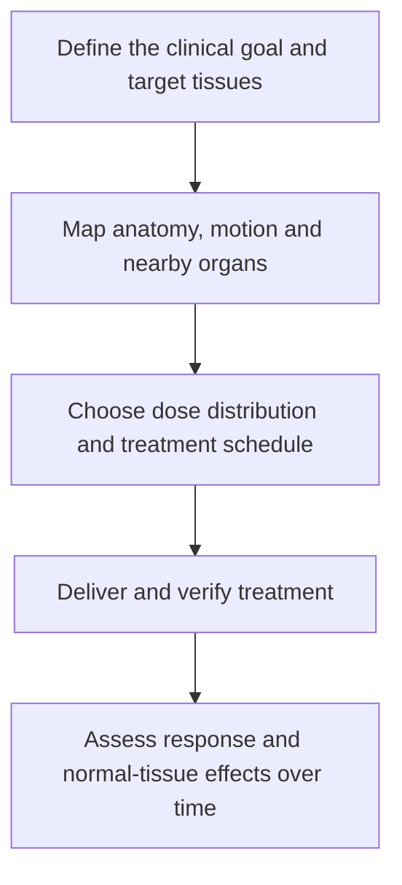

# Radiation therapy basics

## In one sentence

Radiation therapy uses ionizing radiation to damage cancer cells, with the treated volume and schedule chosen for a defined clinical goal.

## The intuition

A radiation plan is a three-dimensional map of where energy should go. It has a target, nearby structures to protect and a schedule. The treatment name alone does not tell you which tissues receive what dose or what outcome the team is trying to achieve. Start with the map and the goal.

## How it works

**Ionizing** radiation carries enough energy to remove electrons from molecules. Its interactions can damage [deoxyribonucleic acid (DNA)](/wiki/education/concepts/biology-basics/genetics/central-dogma) directly and through reactive molecules formed in tissue. Damage that cells cannot adequately repair can prevent further division or cause death. The biological effect can develop over time; a completed treatment session is not an immediate count of dead cells.

External-beam radiation comes from a machine outside the body. Photons, electrons or protons deposit energy along paths determined by their physical properties and the plan. **Brachytherapy** places a radiation source in or near a target. Radiopharmaceutical treatments distribute radioactive material within the body. These delivery methods should be named because their exposure patterns differ.

For external-beam treatment, planning images help identify the tumor or at-risk tissue, nearby organs and uncertainty from positioning or motion. A target may include regions where microscopic disease is a concern; it need not contain a currently visible mass. Beams are arranged to deliver the prescribed target dose while limiting exposure to normal tissues. Limiting exposure does not mean eliminating it.

*Planning and delivery establish an exposure; later assessment establishes its clinical effects.*

Absorbed dose is measured in **gray (Gy)**, meaning energy absorbed per mass of tissue. A **fraction** is one treatment dose within a course. Total dose, dose per fraction, intervals and exposed volume all matter. Equal total doses can have different biological effects when divided differently. [Hypofractionation](/wiki/education/concepts/therapeutics/local-therapies/hypofractionation) and [stereotactic body radiation therapy (SBRT)](/wiki/education/concepts/therapeutics/local-therapies/sbrt) describe aspects of scheduling and delivery, not interchangeable goals.

Normal tissues also respond to radiation. Effects depend on the organ, exposed volume, dose pattern, other treatments and prior exposure. Earlier radiation to an overlapping region must therefore be considered when evaluating a new plan. Precision improves control of exposure; it does not make tissue biologically immune to injury.

## Why it matters in cancer

Radiation can contribute to a curative plan, reduce the risk of local or regional recurrence, control selected disease sites, or relieve symptoms. **Local or regional control** concerns the treated tissues; **systemic control** concerns disease throughout the body. These goals can coexist in a broader treatment plan, but control at one target does not establish control everywhere.

## How it is measured

A treatment plan estimates the distribution of dose across targets and organs. Delivery checks assess whether positioning and treatment match the plan. Follow-up evaluates local disease and adverse effects. None of these measurements alone proves a systemic immune response; an [abscopal effect](/wiki/education/concepts/immunology/tumor-immunology/abscopal-effect) is a separate question.

## Worked example and practice

In a fictional postoperative plan, the removed tumor is no longer visible, yet radiation is proposed to a defined breast region. Is there no target because the scan shows no mass?

**Answer:** A radiation target can be tissue at risk of microscopic disease. Whether that plan provides benefit requires evidence for the disease setting and goal. A visible lesion is not the only basis for a target volume.

## Common confusions

- Radiation is energy delivery, not removal of tissue by an operation.
- A smaller number of visits does not specify the total dose or biological effect.
- A treatment field can include normal tissue and sites of possible microscopic disease.
- Local control, symptom relief and distant immune benefit are different outcomes.

## Explain it back

“A radiation plan specifies a goal, a target volume, a dose pattern and protection for nearby tissues.”

## Related concepts

- [Treatment before or after surgery](/wiki/education/concepts/breast-cancer/treatment-setting/neoadjuvant-vs-adjuvant)
- [Hypofractionation](/wiki/education/concepts/therapeutics/local-therapies/hypofractionation)
- [Ablation](/wiki/education/concepts/therapeutics/local-therapies/ablation)

## Sources and scope

Source check: October 9, 2026. General radiation principles and planning vocabulary; no disease-specific dose selection or personal treatment guidance. Expert and learner review remain pending.

- [NCI: radiation therapy mechanisms, delivery methods, purposes and normal-tissue effects](https://www.cancer.gov/about-cancer/treatment/types/radiation-therapy).
- [NCI: external-beam radiation, planning, positioning and treatment schedules](https://www.cancer.gov/about-cancer/treatment/types/radiation-therapy/external-beam).
- [ASTRO, 2022: quality and safety requirements for stereotactic radiation delivery](https://pubmed.ncbi.nlm.nih.gov/35283342/).

<!-- BEGIN GENERATED USED IN -->
## Used in

- [Understand local therapy and the immune system](/wiki/education/guides/local-therapy-and-the-immune-system/index)
- [Separate local injury from immune learning](/wiki/education/local-treatment-modalities/01-mechanism)
- [Put the disease setting before the clock](/wiki/education/local-treatment-modalities/02-timing)
- [Read a proposal through five questions](/wiki/education/local-treatment-modalities/04-decision-questions)
- [Compare delivery and recognition separately](/wiki/education/local-treatment-modalities/06-comparisons)
- [Local-treatment reference shelf](/wiki/education/local-treatment-modalities/index)
<!-- END GENERATED USED IN -->
