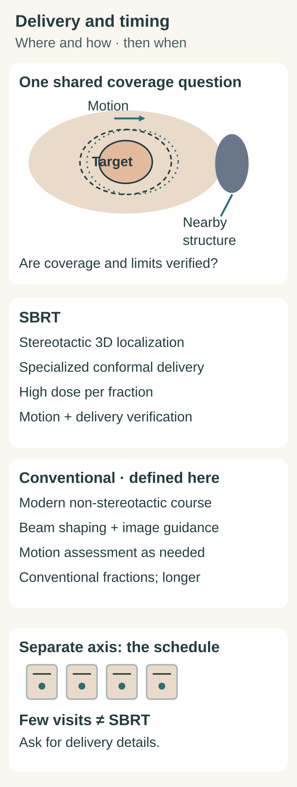

# SBRT vs conventional radiation

## In one sentence

Stereotactic body radiation therapy (SBRT) uses specialized stereotactic localization and delivery for a high dose per fraction to a body target; conventional radiation describes a comparator whose delivery and schedule must be specified.

## The intuition

A calendar tells you when treatment happens. A spatial plan tells you where exposure is intended to go and how the target will be located during delivery. You need both, but one cannot stand in for the other. A short calendar alone does not identify SBRT.

## Define the comparison first

Here, **conventional radiation** means a fictional modern, non-stereotactic external-beam course using conventional fractionation: smaller daily fractions spread over a longer course. This is the comparator for this lesson, not a definition covering every paper that uses “conventional.” It includes beam shaping, imaging, positioning checks, and motion assessment when needed.

[SBRT](/wiki/education/concepts/therapeutics/local-therapies/sbrt), also called stereotactic ablative radiotherapy, treats a target outside the brain using specialized, precise localization and delivery with a high dose per fraction. The main comparison below concerns **delivery and geometry**. Schedule is a separate, secondary axis. ASTRO's white paper describes stereotactic localization, specialized technology, quality assurance, and the demands of highly conformal delivery. [ASTRO white paper, 2022](https://pubmed.ncbi.nlm.nih.gov/35283342/).

## Compare the same questions

| Same question | SBRT | Conventional comparator defined here |
|---|---|---|
| How is the target located? | A stereotactic three-dimensional reference and verification support reproducible target localization. | Modern planning images, positioning and treatment imaging support target localization; the course is specified as non-stereotactic. |
| How is exposure shaped? | Specialized delivery concentrates high dose per fraction around a defined target with rapid dose falloff outside it. | Conformal beams or intensity modulation shape the prescribed exposure around the intended treatment volume. |
| What about movement? | Motion assessment and an appropriate management method support the precision required for the target. | Motion assessment and management can also be part of modern non-SBRT treatment. |
| What is the schedule? | Commonly a short course with a high dose per fraction; count alone is insufficient to identify it. | In this fictional comparator, conventional fractions over a longer course. Other non-SBRT courses can use fewer, larger fractions. |

Image guidance and conformal beam shaping are not exclusive to SBRT. The NCI describes them among external-beam techniques. Neither column promises zero exposure to normal tissue. [NCI: External Beam Radiation Therapy](https://www.cancer.gov/about-cancer/treatment/types/radiation-therapy/external-beam).

*The shared scene keeps the coverage question in view. The cards describe delivery; the calendar describes timing. Shapes are schematic and do not represent a dose map. [Dark version](images/sbrt-vs-conventional-radiation-comparison-geometry-and-schedule-v1-dark.svg).*

## Why the calendar can mislead

**Hypofractionation** means using fewer, larger fractions relative to a specified comparison schedule. SBRT is one setting in which this occurs; hypofractionation also occurs outside SBRT. For example, FAST-Forward studied a short postoperative whole-breast or chest-wall radiation course after surgery for early breast cancer. That particular treatment setting illustrates why a small number of fractions does not, by itself, establish SBRT. It is not a basis for choosing a schedule for another setting. [Brunt et al., 2020, abstract](https://pubmed.ncbi.nlm.nih.gov/32580883/).

Likewise, a biologically effective dose (BED) calculation compares modeled biological effect under stated assumptions. A BED value does not tell you whether stereotactic localization, motion management, or delivery verification occurred. Schedule and a model result cannot replace a description of the delivered technique.

## Try it: delivery identity and coverage

Three **fictional** cards describe the same moving body target beside a normal structure:

- **A:** Declared SBRT. Stereotactic localization, specialized conformal delivery, high dose per fraction, motion management and delivery verification are documented.
- **B:** The conventional comparator defined above. Modern beam shaping, image guidance, motion assessment and conventional fractionation are documented; delivery is non-stereotactic.
- **C:** “Only a few visits.” No delivery or localization details are supplied.

**Question:** Which card identifies SBRT? Does either named technique prove that exposure covered the moving target while meeting the nearby structure's limits? Can C be classified from its calendar?

**Answer:** A identifies SBRT through its declared delivery package. B identifies the defined conventional comparator; its modern imaging does not turn it into SBRT. C is insufficient to classify. For either A or B, coverage and nearby-tissue exposure require the actual spatial plan, motion information, verification and delivered-exposure assessment. The label alone proves neither adequate coverage nor safety. Local cancer control and toxicity then require follow-up evidence. No winner can be selected from these cards.

## Why it matters in cancer

The intended treatment volume, its motion and nearby tissues shape the coverage problem. Comparisons of outcomes also depend on cancer setting and measured endpoints. Neither a short course nor a high modeled effect establishes a distant immune benefit or an immunity threshold.

## Explain it back

Explain the difference between “How was the target located and treated?” and “How was treatment divided over time?” Give one reason that modern image guidance does not uniquely identify SBRT.

**Takeaway:** Identify the delivery technique from its spatial and verification requirements, then describe the schedule separately.

## Related

- [Radiation therapy basics](/wiki/education/concepts/therapeutics/local-therapies/radiation-therapy-basics)
- [Hypofractionation](/wiki/education/concepts/therapeutics/local-therapies/hypofractionation)
- [SBRT](/wiki/education/concepts/therapeutics/local-therapies/sbrt)

## Sources and scope

*Sources checked 2026-10-12: ASTRO—abstract and selected scope, nomenclature, localization, planning and quality-assurance passages; NCI—selected external-beam technique, positioning and schedule sections; FAST-Forward—complete abstract only. Independent reviews remain pending.*
