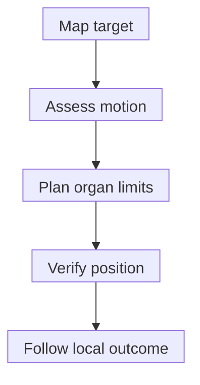

# Stereotactic body radiation therapy (SBRT)

## In one sentence

Stereotactic body radiation therapy (SBRT) delivers a high dose per fraction to a defined target outside the brain using precise positioning, imaging and a small number of treatments.

## The intuition

Think of concentrating a treatment into a tightly planned volume. That concentration creates two linked demands: reach the intended target reliably and control the dose to nearby tissues. A short course depends on extensive preparation. The number of treatment visits is only the visible part of the work. Unlike an ideal spotlight, radiation does not stop exactly at a drawn border.

## How it works

Stereotactic body radiation therapy (SBRT) is a form of [external-beam radiation](/wiki/education/concepts/therapeutics/local-therapies/radiation-therapy-basics). “Stereotactic” refers to locating the target in three-dimensional space and reproducing the treatment geometry. The related name **stereotactic ablative radiotherapy (SABR)** emphasizes the intended destructive dose. Neither name means a probe is inserted or tissue is removed.

Planning defines the target and nearby organs, models the dose, and accounts for uncertainty. During treatment, immobilization and imaging help reproduce the planned position. For moving targets, such as a lesion affected by breathing, motion assessment and a chosen management method are important parts of the plan. A small positioning error can matter when the dose changes rapidly near a critical structure.

*Precision describes how exposure is controlled; follow-up is still needed to establish control and safety.*

A **fraction** is one radiation treatment dose. Dose uses **gray (Gy)**, or energy absorbed per mass of tissue. SBRT usually concentrates treatment into a few fractions with a higher dose per fraction than a conventional course. Exact numbers, spacing and total dose depend on the treated organ, target location, disease setting and protocol. There is no single SBRT dose or universal lesion-size cutoff.

The plan aims to cover the target with the intended high dose, but nearby tissues receive some exposure too. A steep falloff is useful only if the target is correctly located and organ limits are respected. Prior radiation, overlapping dose, lesion motion and closeness to sensitive structures can change feasibility. The [American Society for Radiation Oncology (ASTRO) safety guidance](https://pubmed.ncbi.nlm.nih.gov/35283342/) treats specialized planning, delivery and quality checks as central requirements.

## Why it matters in cancer

SBRT can provide local control in selected clinical settings. A [prospective early lung-cancer study](https://pubmed.ncbi.nlm.nih.gov/20233825/) evaluated medically inoperable patients with defined peripheral tumors and measured both control and toxicity. That population and target geometry are part of its evidence. Results cannot be transferred automatically to a central lung lesion, another organ or a different cancer.

Other studies test SBRT in more limited metastatic patterns or alongside systemic treatment. Those are separate evidence questions. A strong local effect does not establish longer survival or an [abscopal response](/wiki/education/concepts/immunology/tumor-immunology/abscopal-effect). An “ablative” label does not establish a clinically optimal immune-priming schedule.

## How it is measured

| Measurement | Units or definition | Limit to keep in view |
|---|---|---|
| Target and organ geometry | Lengths in millimeters or centimeters; volumes in cubic centimeters | One diameter does not describe shape, motion or a sensitive neighbor |
| Planned dose | Gy, Gy per fraction and distribution across volumes | A planned dose is not a measured cell-killing percentage |
| Position and motion | Imaging-based displacement and the protocol's tolerances | Imaging reduces uncertainty; it does not eliminate it |
| Local outcome and harms | Defined follow-up time and assessment rules | Local control does not establish distant response or longer survival |

There is no universal target-size, dose or safe-distance threshold. Record the organ, disease setting and protocol before borrowing a result.

## Worked example and practice

**Fictional report:** At a defined follow-up visit, a liver lesion remains controlled after SBRT, while an untreated lesion has grown. This illustrates how local control and disease elsewhere can diverge. Can the conclusion be “the treatment controlled the cancer throughout the body”?

**Answer:** The report supports treated-site control for the observed period and documents progression elsewhere. Neither finding cancels the other. An added systemic benefit would need a suitable comparison and patient-level outcomes; a local result should retain its local scope.

## Common confusions

- SBRT uses hypofractionation, but a hypofractionated course does not automatically use stereotactic positioning and delivery.
- Stereotactic radiosurgery is the related term commonly used for brain targets; despite its name, it is radiation rather than an operation.
- “Precise” does not mean zero normal-tissue dose or zero toxicity.
- “Ablative” intent does not guarantee that every cancer cell is destroyed.

## Explain it back

What does a five-visit label leave out?

**One answer:** Target localization, motion management, dose distribution, organ constraints, delivery verification and evidence for that setting.

## Takeaway

A short schedule is only one part of SBRT. Concentrated exposure makes geometry, quality checks and separately measured outcomes essential.

## Related concepts

- [Hypofractionation](/wiki/education/concepts/therapeutics/local-therapies/hypofractionation)
- [Ablation](/wiki/education/concepts/therapeutics/local-therapies/ablation)
- [Immunogenic cell death](/wiki/education/concepts/cancer-biology/cell-death-and-survival/immunogenic-cell-death)

## Sources and scope

Source check: October 10, 2026. Delivery principles and evidence interpretation; doses, indications and safety depend on the actual setting. Expert and learner review remain pending.

- [NCI: external-beam radiation and SBRT](https://www.cancer.gov/about-cancer/treatment/types/radiation-therapy/external-beam) — patient-education sections on positioning, imaging, stereotactic delivery and fractionation checked.
- [American Society for Radiation Oncology, 2022: stereotactic radiation quality and safety white paper](https://pubmed.ncbi.nlm.nih.gov/35283342/) — complete primary abstract and selected publicly indexed program requirements checked; full paper not checked.
- [Timmerman et al., 2010: a prospective study in adults with medically inoperable, peripheral early-stage non-small-cell lung cancer](https://pubmed.ncbi.nlm.nih.gov/20233825/) — complete primary abstract checked for population, local endpoints, distant failure and toxicity; no numerical outcome is transferred here.

<!-- BEGIN GENERATED USED IN -->
## Used in

- [Understand local therapy and the immune system](/wiki/education/guides/local-therapy-and-the-immune-system/index)
- [Put the disease setting before the clock](/wiki/education/local-treatment-modalities/02-timing)
- [Ask what a combination trial actually proved](/wiki/education/local-treatment-modalities/03-overlap-and-sequencing)
- [Read a proposal through five questions](/wiki/education/local-treatment-modalities/04-decision-questions)
- [Compare delivery and recognition separately](/wiki/education/local-treatment-modalities/06-comparisons)
- [Local-treatment reference shelf](/wiki/education/local-treatment-modalities/index)
<!-- END GENERATED USED IN -->
