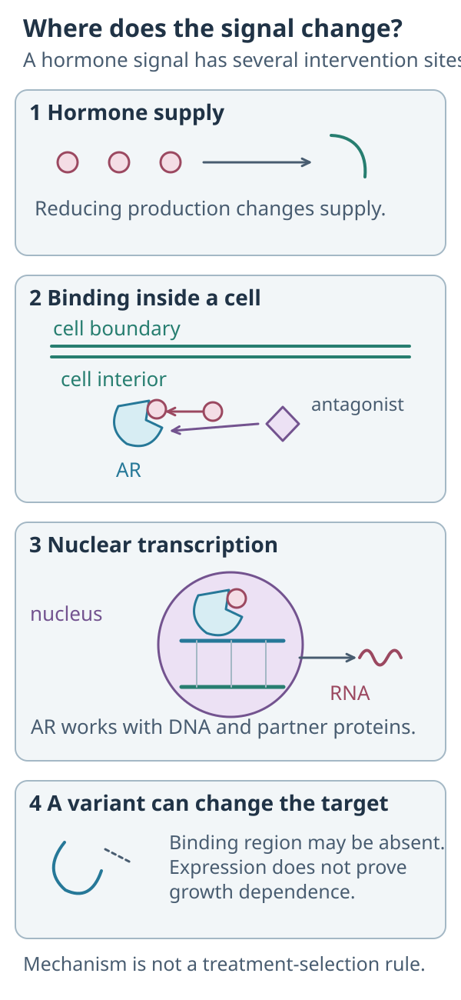

# AR antagonists: interrupting androgen receptor function

## In one sentence

Androgen receptor antagonists bind the androgen receptor to interfere with its signaling, but receptor expression alone does not establish drug sensitivity.

## The intuition

A message reader can be present even when the cell does not depend on its messages. Blocking that reader tests a specific hypothesis. It does not guarantee that work stops. The analogy has limits: different drugs interact with the receptor differently, and the receptor's partners and variants can change the result.

## How it works

*Hormone supply, receptor engagement and nuclear gene regulation are different intervention locations.*

**Follow the signal:** Would reducing hormone production and blocking receptor function be the same action? **Answer:** No. They act at different locations. A variant can change the available binding region, and AR expression alone does not establish dependence or benefit in breast cancer.

The [androgen receptor (AR)](/wiki/education/concepts/cancer-biology/signaling-pathways/androgen-receptor-signaling) is a hormone-responsive transcription factor. **Androgens**, including testosterone and dihydrotestosterone, are hormones that can bind it. AR can then regulate RNA instructions from DNA, as explained in the [central dogma](/wiki/education/concepts/biology-basics/genetics/central-dogma). RNA means ribonucleic acid; DNA means deoxyribonucleic acid.

An **antagonist** interferes with receptor signaling; [ligands and receptors](/wiki/education/concepts/biology-basics/signaling/ligand-and-receptor) distinguishes antagonists from activating partners. AR antagonists such as bicalutamide and enzalutamide interact with its ligand-binding region. Primary development work showed that enzalutamide's precursor designation, MDV3100, affected nuclear movement, DNA binding, and recruitment of partner proteins in the tested prostate-cancer systems.

The details matter. An antagonist need not work identically in every receptor state. Receptor sequence changes, increased receptor expression, altered partners, and splice variants can affect behavior. Splice variants are differently assembled RNA messages that may encode altered proteins. A receptor lacking the relevant binding region presents a different intervention problem.

Reducing androgen production is another strategy. For example, androgen-synthesis inhibition changes hormone supply; it is not the same molecular action as binding AR. Nor is blocking AR equivalent to blocking estrogen receptors.

## Why it matters in cancer

AR-directed clinical evidence is strongly disease-specific. Studies in [triple-negative breast cancer (TNBC)](/wiki/education/concepts/breast-cancer/receptors-and-subtypes/tnbc) tested particular assays and settings rather than “all AR-positive cancers.” The single-arm phase II enzalutamide trial enrolled locally advanced or metastatic TNBC using an optimized staining assay. Its primary endpoint was **clinical benefit rate (CBR)** at 16 weeks, a definition that included qualifying disease stability as well as responses. CBR is not simply tumor shrinkage and is not a randomized survival comparison.

TBCRC 032 tested enzalutamide with the PI3K inhibitor taselisib, with differing phase Ib and phase II populations. Correlative findings suggested that AR protein expression alone was insufficient to identify AR-dependent tumors. A luminal androgen receptor (LAR) RNA subtype remains distinct from a staining threshold and from a validated treatment rule.

A drug combination tests both interventions together. It cannot establish that every PI3K inhibitor can substitute for taselisib, or that a product studied in advanced disease benefits someone after surgery.

## How it is measured

**Immunohistochemistry (IHC)** stains proteins in tissue; studies can report the percentage of tumor-cell nuclei staining for AR. Specify the antibody, threshold, specimen, and scoring procedure. Trial enrollment and evaluable-analysis thresholds can differ. An RNA classifier reports a transcription pattern rather than receptor occupancy.

In models, connect receptor engagement and downstream transcription with growth or death at a stated exposure. Clinical endpoints need their population, denominator, and time horizon. A percentage of stained cells is not a response probability.

## Common confusions

- **Antagonism versus hormone depletion:** these change different steps.
- **AR-positive versus LAR:** protein staining and RNA classification differ.
- **CBR versus objective response:** durable stability can contribute to CBR.
- **Prostate evidence versus breast benefit:** preserve the actual disease setting.

## Try it

A fictional trial summary reports CBR at 16 weeks. A reader calls that the “shrinkage rate.” Is that a safe translation?

**Answer:** No. Read the endpoint definition. Qualifying stable disease may be included alongside complete or partial responses. The summary also needs its assay, enrolled population, and analysis denominator before comparison with another trial.

## Explain it back

“An AR antagonist changes ___; staining establishes ___; clinical benefit requires ___.”

One answer: “a receptor function; protein expression under an assay; evidence for the actual product, population, and outcome.”

## Takeaway

**AR expression opens a biological question; it does not answer the treatment question.**

## Related concepts

- [Androgen receptor signaling](/wiki/education/concepts/cancer-biology/signaling-pathways/androgen-receptor-signaling).
- [PI3K and AKT inhibitors](/wiki/education/concepts/therapeutics/targeted-small-molecules/pi3k-akt-inhibitors).

## Sources

Source check: October 9, 2026. Mechanism and historical trial examples; practice is fictional. Expert and learner review pending.

- [NCI: enzalutamide mechanism](https://www.cancer.gov/publications/dictionaries/cancer-drug/def/enzalutamide).
- [Tran et al., 2009: second-generation antiandrogen development](https://pubmed.ncbi.nlm.nih.gov/19359544/).
- [Traina et al., 2018: enzalutamide in advanced AR-expressing TNBC](https://pubmed.ncbi.nlm.nih.gov/29373071/).
- [Lehmann et al., 2020: TBCRC 032, enzalutamide and taselisib](https://pubmed.ncbi.nlm.nih.gov/31822498/).

<!-- BEGIN GENERATED USED IN -->
## Used in

Browse the [concept index](/wiki/education/concepts/index) for related learning paths.
<!-- END GENERATED USED IN -->
