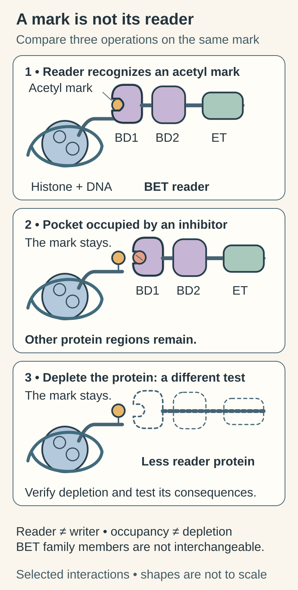

# BET inhibitors: blocking a chromatin-reading interaction

## In one sentence

BET bromodomain inhibitors interfere with acetyl-mark recognition by BET proteins, potentially changing transcription without removing every function of those proteins.

## The intuition

Imagine covering a reader's bookmark sensor. The reader may find fewer passages through that route, yet still reach some through other interactions. That distinction explains why blocking a pocket differs from removing a protein. The analogy stops at bookmarks: chemical marks and protein interactions change with time and cellular context.

## How it works

*Reading an acetyl mark, occupying a bromodomain pocket and depleting the protein are different tests. The mark remains in all three scenes. Remaining domains and separately verified depletion prevent a pocket-blockade result from becoming a claim of complete protein loss or benefit.*

**Read the picture:** In the middle scene, which parts remain after the pocket is occupied?

**Answer:** The acetyl mark and the rest of the BET protein remain. A separate depletion experiment and measurement address protein loss.

**Visual source scope:** [Filippakopoulos et al.](https://pubmed.ncbi.nlm.nih.gov/20871596/) establish pocket competition by the experimental probe JQ1; [Shu et al.](https://pubmed.ncbi.nlm.nih.gov/26735014/) distinguish inhibitor response from BRD4 dependence in tested TNBC models.

[Bromodomain and extra-terminal (BET) proteins](/wiki/education/concepts/cancer-biology/signaling-pathways/bet-bromodomain-proteins) include BRD2, BRD3, BRD4, and BRDT. A **bromodomain** is a protein region that recognizes acetylated lysines, chemical marks on certain amino acids. BET proteins help coordinate transcription, the production of RNA instructions from DNA described in the [central dogma](/wiki/education/concepts/biology-basics/genetics/central-dogma). RNA means ribonucleic acid; DNA means deoxyribonucleic acid.

A bromodomain inhibitor can occupy the recognition pocket and compete with an acetylated binding partner. The experimental compound **JQ1** established that this interaction could be disrupted. It is a [chemical probe](/wiki/education/concepts/therapeutics/how-drugs-work/chemical-probe-vs-drug-and-target-engagement), a tool for studying a mechanism, rather than evidence for a personal treatment regimen.

BET proteins have two bromodomains, commonly called **BD1** and **BD2**, plus other interaction regions. Compounds can differ in family-member and domain selectivity. A BD2-focused design states which binding interactions the compound preferentially targets. It does not prove greater safety or better anticancer activity in people.

An inhibitor of a recognition pocket also differs from a protein degrader, which recruits machinery that removes the protein. Neither intervention can be assumed to reproduce the other. A transcriptional change after treatment does not identify which affected protein or gene caused a growth effect.

## Why it matters in cancer

Selected [triple-negative breast cancer (TNBC)](/wiki/education/concepts/breast-cancer/receptors-and-subtypes/tnbc) models responded to BET inhibition in primary preclinical work. Resistant cultures in the same study still depended on BRD4 through bromodomain-independent regulation. That distinction separates dependence on a protein from sensitivity to one way of blocking it.

[MYC](/wiki/education/concepts/cancer-biology/signaling-pathways/myc) is a transcriptional regulator examined in BET research. BET inhibition is not synonymous with direct MYC inhibition, and decreased MYC RNA is not proof that MYC caused the resulting death. A BRD3 variant does not establish BRD4 dependence or clinical sensitivity to a broad BET compound.

Early clinical studies also have narrow scope. A phase I molibresib report studied NUT carcinoma and other solid tumors; it evaluated exposure, pharmacodynamic effects, safety, and preliminary activity. Thrombocytopenia, a low platelet count, and gastrointestinal adverse events occurred under that product and study. Those observations do not establish a universal toxicity ranking across BET drugs, nor benefit in postoperative TNBC.

## How it is measured

Binding and displacement assays test a pocket interaction. Chromatin occupancy and RNA measurements test later effects; growth, death, and regrowth test cell behavior. Use genetic perturbations and an independent compound to check attribution, while monitoring general transcription and comparison cells.

Report the exact protein or domain, concentration, exposure duration, and comparator. Binding constants and inhibitory concentrations may be expressed in nanomoles per liter (nM); RNA output may be counts or normalized changes. None is a universal “BET-sensitive” clinical score. Pharmacodynamic change means a measured biological effect after exposure, not a demonstrated patient benefit.

## Common confusions

- **BET inhibition versus direct MYC inhibition:** these interrupt different molecular functions.
- **Pocket blockade versus protein loss:** remaining domains can still work.
- **BD2 selectivity versus safer medicine:** a design property is not comparative clinical evidence.
- **RNA change versus causal dependence:** test which change explains the outcome.

## Try it

A fictional BET inhibitor lowers MYC RNA, but the culture keeps growing. Has the experiment shown a MYC-driven vulnerability?

**Answer:** No. It supports a transcriptional change under the tested exposure. Check protein and functional effects, target attribution, and growth or death controls. Even selective killing in a model would leave clinical benefit unresolved.

## Explain it back

“BET inhibition blocks ___; protein dependence requires ___; domain selectivity does not prove ___.”

One answer: “a reading interaction; an attributed functional experiment; comparative safety or benefit.”

## Takeaway

**A blocked bromodomain pocket is a measured mechanism, not a complete treatment prediction.**

## Related concepts

- [BET protein biology](/wiki/education/concepts/cancer-biology/signaling-pathways/bet-bromodomain-proteins).
- [Chemical probes and target engagement](/wiki/education/concepts/therapeutics/how-drugs-work/chemical-probe-vs-drug-and-target-engagement).

## Sources

Source check: October 9, 2026. Chemical-probe, TNBC-model, and phase I observations retain their distinct scope. Practice is fictional; expert and learner review pending.

- [Filippakopoulos et al., 2010: JQ1 and BET-pocket recognition](https://pubmed.ncbi.nlm.nih.gov/20871596/).
- [Shu et al., 2016: response and resistance in TNBC models](https://pubmed.ncbi.nlm.nih.gov/26735014/).
- [Piha-Paul et al., 2019: phase I molibresib in NUT carcinoma and other solid tumors](https://pmc.ncbi.nlm.nih.gov/articles/PMC7165800/).

<!-- BEGIN GENERATED USED IN -->
## Used in

Browse the [concept index](/wiki/education/concepts/index) for related learning paths.
<!-- END GENERATED USED IN -->
