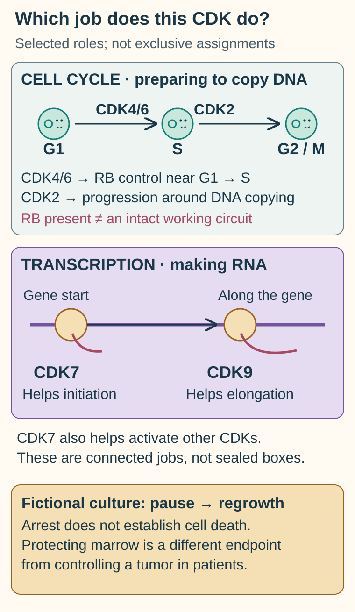

# CDK inhibitors: cell-cycle control and transcription

## In one sentence

Cyclin-dependent kinase inhibitors reduce the activity of selected cyclin-dependent kinases, whose roles in cell division and gene transcription are not interchangeable.

## The intuition

A workshop has both a timetable for moving work between stations and a team that issues instructions. “Workshop inhibitor” would be too vague to identify the affected job. The same is true of a **cyclin-dependent kinase (CDK)** inhibitor. The analogy has limits: a kinase can serve several jobs, and its partners change with the cell's state.

## How it works

The family name does not identify the job. This selected-role map separates preparation for DNA copying from initiation and continuation of RNA production; CDK7 has roles across those categories. RB protein presence does not establish an intact arrest circuit. A fictional pause followed by regrowth supports arrest, while death and clinical endpoints need separate evidence.

The [shared concept map](/wiki/education/concepts/biology-basics/cells/cell-cycle) supplies the background for this closer comparison.

The transcription comparison also draws on [primary work on the initiation-to-elongation handoff](https://pubmed.ncbi.nlm.nih.gov/23064645/) and the [NCI CDK9 entry](https://www.cancer.gov/publications/dictionaries/cancer-drug/def/cdk9-inhibitor-gfh009).

A [kinase](/wiki/education/concepts/biology-basics/signaling/signal-transduction-and-kinases) transfers phosphate groups to other molecules. **Cyclins** are protein partners that help regulate particular CDKs. These partnerships influence the [cell cycle](/wiki/education/concepts/biology-basics/cells/cell-cycle) and RNA production. DNA means deoxyribonucleic acid; RNA means ribonucleic acid, as explained in the [central dogma](/wiki/education/concepts/biology-basics/genetics/central-dogma).

| Group | A central role | Mechanism boundary |
|---|---|---|
| CDK4/6 | Helps cells move from the first growth phase toward DNA copying | Usually depends on functional retinoblastoma protein (RB), encoded by RB1, for this arrest mechanism |
| CDK2 | Works with cyclins E and A in cell-cycle progression | More cyclin E does not prove a response to every CDK2 inhibitor |
| CDK7 | Contributes to transcription initiation and activation of other CDKs | A transcription effect and a cell-cycle effect must be distinguished |
| CDK9 | Supports transcription elongation, continuation of RNA production along a gene | Effects on short-lived transcripts can differ from CDK4/6-mediated arrest |

RB helps restrain a set of transcription factors needed for cell-cycle progression. CDK4/6-mediated [phosphorylation](/wiki/education/concepts/biology-basics/signaling/phosphorylation) can release that restraint. Inhibiting CDK4/6 can preserve it when the necessary machinery works. Loss of RB1 can remove this route, but RB protein presence alone does not prove the circuit is intact or the tumor will respond.

A drug's target profile matters: compounds can inhibit several CDKs at achieved exposures. [Target engagement](/wiki/education/concepts/therapeutics/how-drugs-work/chemical-probe-vs-drug-and-target-engagement) and the resulting cellular effect are separate observations.

## Why it matters in cancer

Selected breast-cancer models with high [MYC activity](/wiki/education/concepts/cancer-biology/signaling-pathways/myc) responded to CDK inhibition in a 2012 study. That preclinical result cannot select a modern CDK drug from MYC expression alone.

Clinical evidence also has distinct purposes. NATALEE studied ribociclib with endocrine therapy in hormone receptor-positive, human epidermal growth factor receptor 2 (HER2)-negative stage II or III early breast cancer. That population differs from [triple-negative breast cancer (TNBC)](/wiki/education/concepts/breast-cancer/receptors-and-subtypes/tnbc).

Trilaciclib is another important contrast. Short exposure before chemotherapy can temporarily arrest susceptible marrow cells to reduce myelosuppression, damage to blood-cell production. The Chinese TRACES study tested this in extensive-stage small-cell lung cancer. Its randomized part's primary endpoint was the duration of severe neutropenia in the first cycle. Protecting blood-cell production does not itself establish tumor shrinkage or longer survival in another disease.

## How it is measured

Research measures phosphorylation of named substrates, DNA copying, distribution across cell-cycle phases, RNA output, growth, and death. Report the exposure, time, and control. The percentage of cells in a phase is a measurement of sampled cells, not a percentage of patients helped. Clinical blood-cell counts and severe-neutropenia duration in days answer different questions from tumor-response assessments.

## Common confusions

- **CDK4/6 versus every CDK:** family membership does not make functions interchangeable.
- **RB present versus functional:** staining is not a complete pathway test.
- **Arrest versus death:** paused growth can be reversible.
- **Myeloprotection versus anticancer benefit:** identify which endpoint the trial tested.

## Try it

A fictional culture stops copying DNA after a CDK4/6 inhibitor. It resumes growth after washout. Has selective tumor killing been shown?

**Answer:** No. The observation supports reversible growth arrest under the tested conditions. Establish target attribution, death or durable regrowth effects, and effects in comparison cells before making a killing claim. It says nothing yet about patient benefit.

## Explain it back

“CDK inhibitors differ by ___; RB staining tells me ___; a trial endpoint tells me ___.”

One answer: “which kinase functions they affect; protein presence under an assay; the outcome actually tested.”

## Takeaway

**Match the CDK, the cellular job, and the clinical endpoint before comparing drugs.**

## Related concepts

- [MYC](/wiki/education/concepts/cancer-biology/signaling-pathways/myc).
- [Therapeutic index](/wiki/education/concepts/therapeutics/how-drugs-work/therapeutic-index).

## Sources

Source check: October 9, 2026. Examples retain their model or disease setting; practice is fictional. Expert and learner review pending.

- [NCI: palbociclib and CDK4/6–RB control](https://www.cancer.gov/publications/dictionaries/cancer-drug/def/palbociclib).
- [NCI: samuraciclib and CDK7 functions](https://www.cancer.gov/publications/dictionaries/cancer-drug/def/samuraciclib).
- [Horiuchi et al., 2012: MYC and CDK inhibition in breast-cancer models](https://pubmed.ncbi.nlm.nih.gov/22430491/).
- [Slamon et al., 2024: NATALEE's hormone receptor-positive population](https://pubmed.ncbi.nlm.nih.gov/38507751/).
- [TRACES primary report: myeloprotection in Chinese small-cell lung cancer](https://pubmed.ncbi.nlm.nih.gov/38224653/).

<!-- BEGIN GENERATED USED IN -->
## Used in

Browse the [concept index](/wiki/education/concepts/index) for related learning paths.
<!-- END GENERATED USED IN -->
