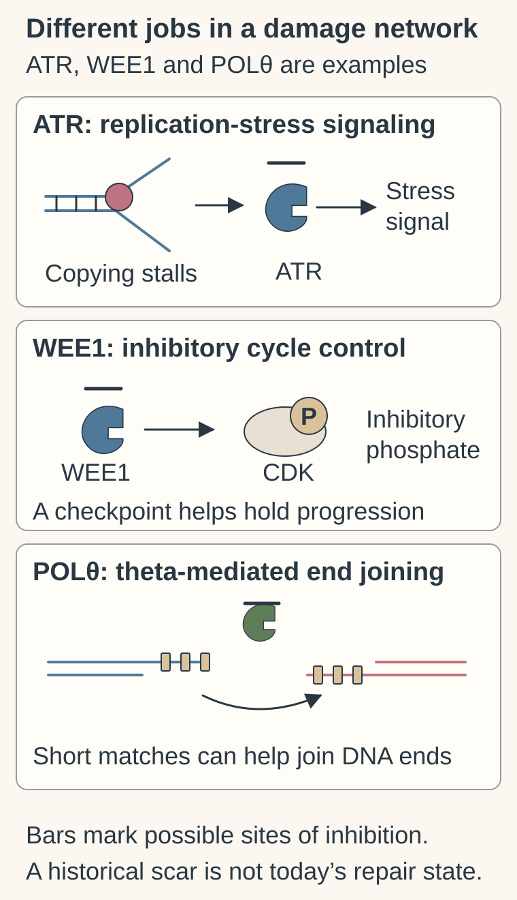
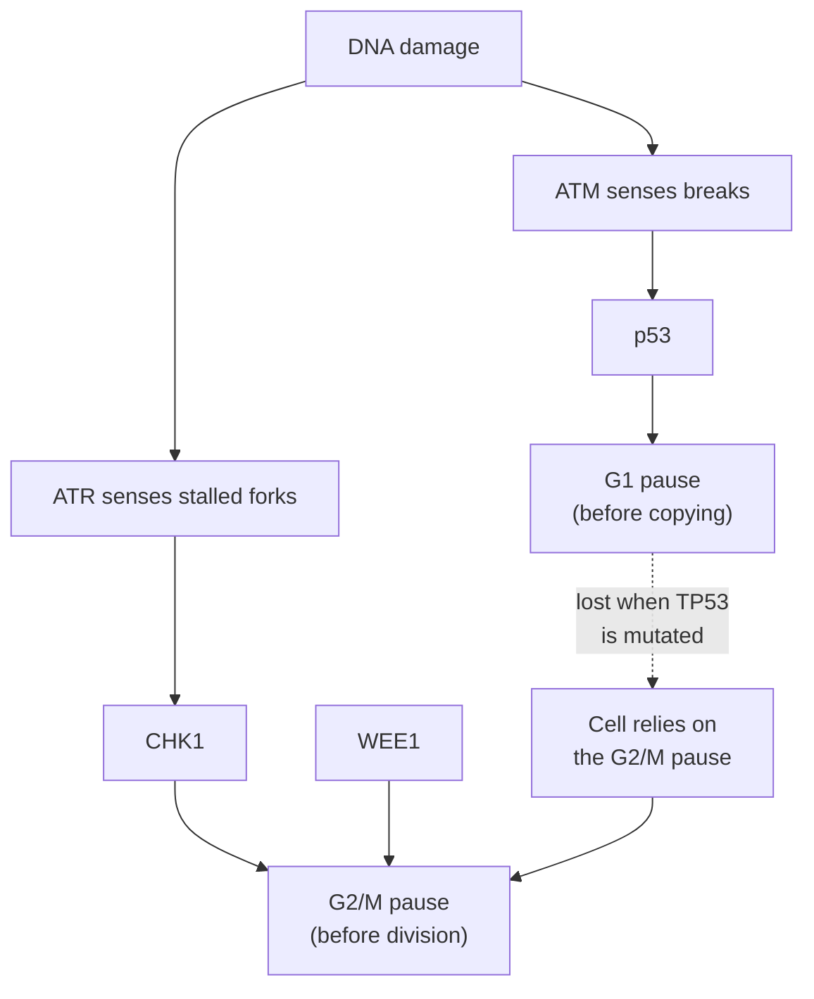

# DNA damage response inhibitors: which repair dependency?

## In one sentence

DNA damage response inhibitors interfere with proteins that detect, signal, tolerate, or repair DNA damage, and their effects depend on the particular target and repair state.

## The intuition

A workshop can pause a damaged production line, stabilize unfinished work, or repair a broken part. Removing one of those services matters most when the workshop relies on it. Cells have several such services. The analogy stops at the idea of a single repair crew: DNA repair and damage signaling are overlapping, dynamic networks.

## How it works

Three parallel sketches locate different DDR jobs: ATR-associated signaling at replication stress, WEE1 delivery of an inhibitory phosphate to a cyclin-dependent kinase, and POLθ-supported joining of exposed DNA ends through short matching sequences. DNA strokes and matches are schematic, not literal bases or a complete network. Bars mark possible target-blocking sites, not clinical doses or guaranteed effects. Current repair function needs testing; a historical scar or PARP resistance alone does not establish POLθ sensitivity.

**DNA damage response (DDR)** includes more than repair enzymes. DNA means deoxyribonucleic acid, the information-bearing molecule described in the [central dogma](/wiki/education/concepts/biology-basics/genetics/central-dogma). Replication stress means difficulty copying DNA; the moving copying machinery can slow or stall.

Different inhibitors interrupt different jobs. Two of them sense damage, two enforce a pause, and two repair:

| Target | Job being interrupted | Why a tumor might depend on it | What the name alone cannot tell you |
|---|---|---|---|
| Ataxia telangiectasia mutated kinase (ATM) | Senses double-strand breaks and activates p53 to stop the cell before DNA copying (the G1 checkpoint) | Rarely targeted itself; ATM *loss* makes cells lean on ATR, and ATR inhibitors selectively killed ATM- or p53-deficient cells in models [1] | Whether a tumor's ATM change removes function |
| Ataxia telangiectasia and Rad3-related kinase (ATR) | Senses stalled copying forks ([replication stress](/wiki/education/concepts/cancer-biology/genome-instability-and-repair/replication-stress)) and activates CHK1 [4] | Tumors under heavy replication stress or lacking ATM | Whether that tumor depends on ATR at a tolerable exposure |
| Checkpoint kinase 1 (CHK1) | Carries ATR's signal to stop the cycle before division (the G2/M checkpoint) | The same G2/M reliance as WEE1 | Whether blood-count toxicity leaves room for benefit; in a nine-patient triple-negative breast cancer pilot of the CHK1 inhibitor prexasertib, one partial response occurred and eight had grade 3–4 neutropenia [2] |
| WEE1 kinase | Adds an inhibitory phosphate to the cyclin-dependent kinase CDK1, holding cells at G2/M [5] | Cells with broken p53 lose the G1 checkpoint and rely on G2/M; WEE1 inhibition sensitized p53-deficient cells to DNA-damaging drugs in models [3] | Whether an alteration in TP53, the gene for p53, predicts benefit in patients |
| DNA-dependent protein kinase (DNA-PK) | Starts nonhomologous end joining, the fast route that rejoins broken ends; see [NHEJ and MMEJ](/wiki/education/concepts/cancer-biology/genome-instability-and-repair/nhej-and-mmej) | Combined with radiation or other break-inducing treatment | Whether blocking it harms normal tissue as much as tumor |
| DNA polymerase theta (POLθ), encoded by POLQ | Supports theta-mediated end joining, a backup route that joins ends using short matching sequences | Homologous-recombination-deficient tumors | Whether every resistant tumor still needs this route |

*Why TP53 is the usual rationale for ATR, CHK1 and WEE1 inhibitors: without the first pause, removing the second can push damaged cells into division and death. A rationale, not a validated selection rule.*

A kinase is an enzyme that transfers phosphate groups. Inhibiting a checkpoint lets cells proceed with unresolved damage; inhibiting an end-joining enzyme removes a repair route. These are distinct mechanisms, even when both reduce survival in an experiment.

[Homologous recombination (HR)](/wiki/education/concepts/cancer-biology/genome-instability-and-repair/homologous-recombination-and-hrd) uses a matching template for repair. Loss of HR can make another repair function more important. That is a possible [synthetic-lethal relationship](/wiki/education/concepts/therapeutics/how-drugs-work/synthetic-lethality), which requires evidence about the paired losses. A historical genomic scar does not prove today's repair dependency.

## Why it matters in cancer

Primary POLθ studies found activity in selected HR-deficient models [6, 7] and some models resistant to poly(ADP-ribose) polymerase (PARP) inhibitors. PARP enzymes help organize responses to DNA damage. Resistance mechanisms were decisive: models with losses of the repair-regulating 53BP1/Shieldin machinery differed from models with BRCA2 reversions that restored gene function. In the novobiocin study, the tested BRCA2-reverted models resisted both PARP inhibition and novobiocin [7].

This is a useful boundary, not a universal sequencing rule. Different POLθ compounds target different parts of the protein. Neither a preclinical rescue experiment nor a mutation in TP53 establishes that a person should receive a DDR drug. Combinations can affect normal dividing cells as well as tumors; different targets do not guarantee nonoverlapping toxicity.

## How it is measured

Researchers distinguish target engagement, damage, repair capacity, and survival. Readouts can include phosphorylation at a named site, repair-protein foci per nucleus, and regrowth after drug removal. Foci are visible clusters of a protein; their presence alone does not prove successful repair. Compare matched repair states and genetic controls at specified times and concentrations, often reported in nanomoles per liter (nM) or micromoles per liter (µM). A culture concentration is not a clinical dose.

## Common confusions

- **DDR versus one repair pathway:** the label covers several jobs.
- **Scar versus function:** past damage patterns can persist after repair changes.
- **PARP resistance versus POLθ sensitivity:** the resistance mechanism matters.
- **TP53 mutation versus drug selection:** the G2/M-reliance rationale is mechanistic; it is not a validated response rule.
- **ATR versus ATM:** ATR is a drug target; ATM is more often the *loss* that makes a tumor depend on ATR.

## Try it

Two fictional cultures resist a PARP inhibitor. One retains a BRCA defect with 53BP1 loss; the other has a BRCA2 reversion. Can one POLθ result predict both?

**Answer:** No. Test each repair state and the actual compound. The primary model work shows why “PARP-resistant” is too broad a biomarker. Even a positive model result would leave clinical benefit and safety unresolved.

## Explain it back

“A DDR target does ___; sensitivity requires ___; resistance must be described by ___.”

One answer: “a particular damage-response job; an attributed dependency; its mechanism.”

## Takeaway

**Name the repair state and the interrupted job before interpreting a DDR drug result.**

## Related concepts

- [Chemical probes and target engagement](/wiki/education/concepts/therapeutics/how-drugs-work/chemical-probe-vs-drug-and-target-engagement).
- [Preclinical evidence](/wiki/education/concepts/evidence-and-statistics/study-design/preclinical-evidence).
- [Topoisomerase I inhibitors](/wiki/education/concepts/therapeutics/chemotherapy/topoisomerase-i-inhibitors), whose replication damage ATR and WEE1 inhibitors are studied alongside.
- [ADC payload classes](/wiki/education/concepts/therapeutics/antibody-based/adc-payload-classes), including early DNA-damage-response payloads on antibody-drug conjugates (ADCs).
- [Replication stress](/wiki/education/concepts/cancer-biology/genome-instability-and-repair/replication-stress) and [NHEJ and MMEJ](/wiki/education/concepts/cancer-biology/genome-instability-and-repair/nhej-and-mmej).

## Sources

Source check: November 7, 2026. Mechanism education and selected model evidence; the exercise is fictional. Expert and learner review pending.

1. [Reaper et al., 2011](https://pubmed.ncbi.nlm.nih.gov/21490603/) — ATR inhibition selectively kills ATM- or p53-deficient cancer cells in models.
2. [Gatti-Mays et al., 2020](https://pubmed.ncbi.nlm.nih.gov/32510664/) — prexasertib pilot in nine people with BRCA-wild-type advanced triple-negative breast cancer.
3. [Hirai et al., 2009](https://pubmed.ncbi.nlm.nih.gov/19887545/) — WEE1 inhibition abrogates the G2 checkpoint and sensitizes p53-deficient cells.
4. [NCI: ceralasertib and ATR signaling](https://www.cancer.gov/publications/dictionaries/cancer-drug/def/ceralasertib).
5. [NCI: adavosertib and WEE1 checkpoint control](https://www.cancer.gov/publications/dictionaries/cancer-drug/def/adavosertib).
6. [Zatreanu et al., 2021: POLθ polymerase inhibition and defined resistance models](https://pubmed.ncbi.nlm.nih.gov/34140467/).
7. [Zhou et al., 2021: novobiocin, POLθ, and the BRCA2-reversion boundary](https://pmc.ncbi.nlm.nih.gov/articles/PMC8224818/).

<!-- BEGIN GENERATED USED IN -->
## Used in

Browse the [concept index](/wiki/education/concepts/index) for related learning paths.
<!-- END GENERATED USED IN -->
