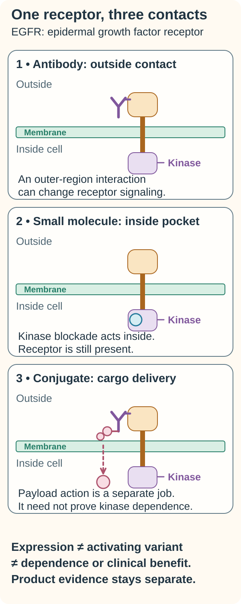

# EGFR inhibitors: interrupting a receptor signal

## In one sentence

EGFR inhibitors aim to reduce signaling through the epidermal growth factor receptor, using drug mechanisms whose effects depend on the receptor alteration and cellular context.

## The intuition

A cell-surface receiver can pass an outside message into the cell. A medicine might block the outside receiver or interfere with the machinery inside. These approaches share a target name but perform different jobs. The analogy stops at a simple on/off switch: receptors interact with partners and send signals through several branches.

## How it works

*EGFR-directed formats make different contacts: outside antibody binding, inside kinase blockade or payload delivery. The drawing simplifies receptor arrangement and cargo processing. Protein staining does not establish an activating variant, kinase dependence or benefit, and one format cannot inherit another format’s evidence.*

The companion [receptor-tyrosine-kinase explanation](/wiki/education/concepts/cancer-biology/signaling-pathways/receptor-tyrosine-kinases) covers the related shared concept.

**Read the picture:** Which scene could deliver a payload without proving that growth depends on EGFR kinase signaling?

**Answer:** The conjugate scene. Target recognition can provide an address for cargo without proving dependence on the receptor’s kinase activity.

**Visual source scope:** [Zhang et al.](https://pubmed.ncbi.nlm.nih.gov/16777603/) address intracellular EGFR kinase machinery; [NCI: targeted therapies](https://www.cancer.gov/about-cancer/treatment/types/targeted-therapies) distinguishes inside small-molecule and outside antibody actions, including payload delivery.

**Epidermal growth factor receptor (EGFR)**, also called HER1 or ERBB1, belongs to the [receptor tyrosine kinase family](/wiki/education/concepts/cancer-biology/signaling-pathways/receptor-tyrosine-kinases). A **kinase** transfers phosphate groups. A [ligand](/wiki/education/concepts/biology-basics/signaling/ligand-and-receptor) binding outside the cell can change receptor arrangement and activate intracellular kinase machinery.

EGFR can feed into the [RAS–RAF–MEK–ERK relay](/wiki/education/concepts/cancer-biology/signaling-pathways/mapk-ras-raf), a mitogen-activated protein kinase (MAPK) pathway, and the [PI3K–AKT–mTOR network](/wiki/education/concepts/cancer-biology/signaling-pathways/pi3k-akt-mtor). These routes influence cell behavior, but an active downstream signal does not uniquely identify its source.

**Tyrosine kinase inhibitors (TKIs)** are small molecules acting on the receptor's intracellular kinase machinery. Individual drugs differ in receptor coverage, mutation sensitivity, reversibility, and exposure. Antibodies such as cetuximab instead bind an extracellular region; this can interfere with receptor signaling and can involve other antibody effects. A result from an antibody is not automatically evidence for a TKI.

An [antibody–drug conjugate](/wiki/education/concepts/therapeutics/antibody-based/antibody-drug-conjugate) uses an antibody to help deliver a payload. If an EGFR-directed conjugate works, receptor recognition and payload delivery may matter even without dependence on EGFR kinase signaling. Check which mechanism the actual product tests.

## Why it matters in cancer

Certain activating EGFR kinase-domain mutations in non-small-cell lung cancer were linked to gefitinib response and tested functionally in early primary work. That is a specific alteration–drug–disease relationship. More EGFR protein in a different cancer does not reproduce it.

Two studies illustrate this boundary in [triple-negative breast cancer (TNBC)](/wiki/education/concepts/breast-cancer/receptors-and-subtypes/tnbc). TBCRC 001 studied cetuximab and carboplatin in metastatic TNBC; pathway suppression occurred in only a subset of paired biopsies. BALI-1 studied cetuximab plus cisplatin versus cisplatin alone in metastatic TNBC and did not meet its primary response endpoint. Neither study establishes a general benefit from every EGFR-targeted medicine or a postoperative treatment rule.

## How it is measured

Protein staining can report receptor amount and location. Sequencing can identify a specified alteration. Neither assay alone establishes signaling dependence. Researchers can measure receptor phosphorylation, downstream signals, and [target engagement](/wiki/education/concepts/therapeutics/how-drugs-work/chemical-probe-vs-drug-and-target-engagement) before measuring growth or death.

State the specimen, antibody or sequencing method, variant, and timing. Outputs can include a staining score, variant allele fraction, or normalized phosphoprotein signal. Drug experiments need stated concentrations and controls. There is no universal “EGFR-high” unit or cutoff that selects all EGFR drugs.

## Common confusions

- **Expression versus activating mutation:** protein abundance and changed kinase behavior are different findings.
- **Activity versus dependence:** a cell can retain growth after the signal falls.
- **TKI versus antibody versus conjugate:** the intervention's mechanism matters.
- **Response versus clinical benefit rate:** a benefit-rate definition may include stable disease as well as shrinkage.

## Try it

A fictional culture has strong EGFR staining. A TKI lowers receptor phosphorylation but leaves growth unchanged. Does the staining establish drug sensitivity?

**Answer:** No. The drug may have engaged the receptor while another route supports growth. Test the functional effect and its attribution. Neither result establishes a patient's benefit.

## Explain it back

“EGFR amount shows ___; an activating alteration may change ___; a drug result requires ___.”

One answer: “what is present; receptor behavior; the actual mechanism, exposure, and outcome.”

## Takeaway

**Match the receptor alteration to the drug mechanism rather than treating EGFR expression as a prescription.**

## Related concepts

- [Antibody–drug conjugates](/wiki/education/concepts/therapeutics/antibody-based/antibody-drug-conjugate).
- [Receptor tyrosine kinases](/wiki/education/concepts/cancer-biology/signaling-pathways/receptor-tyrosine-kinases).

## Sources

Source check: October 9, 2026. Structural, lung-cancer, and metastatic breast-cancer evidence are kept distinct. Practice is fictional; expert and learner review pending.

- [Zhang et al., 2006: EGFR kinase activation](https://pubmed.ncbi.nlm.nih.gov/16777603/).
- [Lynch et al., 2004: activating EGFR mutations and gefitinib in lung cancer](https://pubmed.ncbi.nlm.nih.gov/15118073/).
- [Carey et al., 2012: TBCRC 001](https://pubmed.ncbi.nlm.nih.gov/22665533/).
- [Baselga et al., 2013: BALI-1](https://pubmed.ncbi.nlm.nih.gov/23733761/).

<!-- BEGIN GENERATED USED IN -->
## Used in

Browse the [concept index](/wiki/education/concepts/index) for related learning paths.
<!-- END GENERATED USED IN -->
