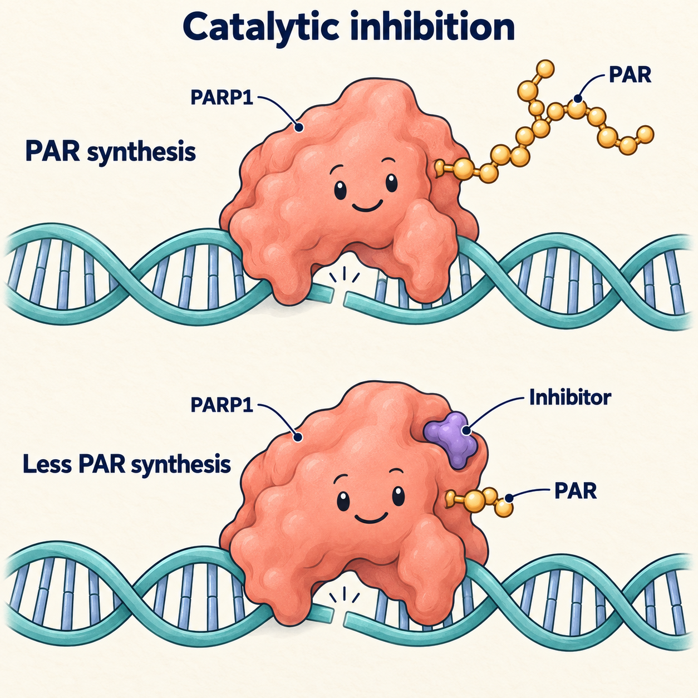
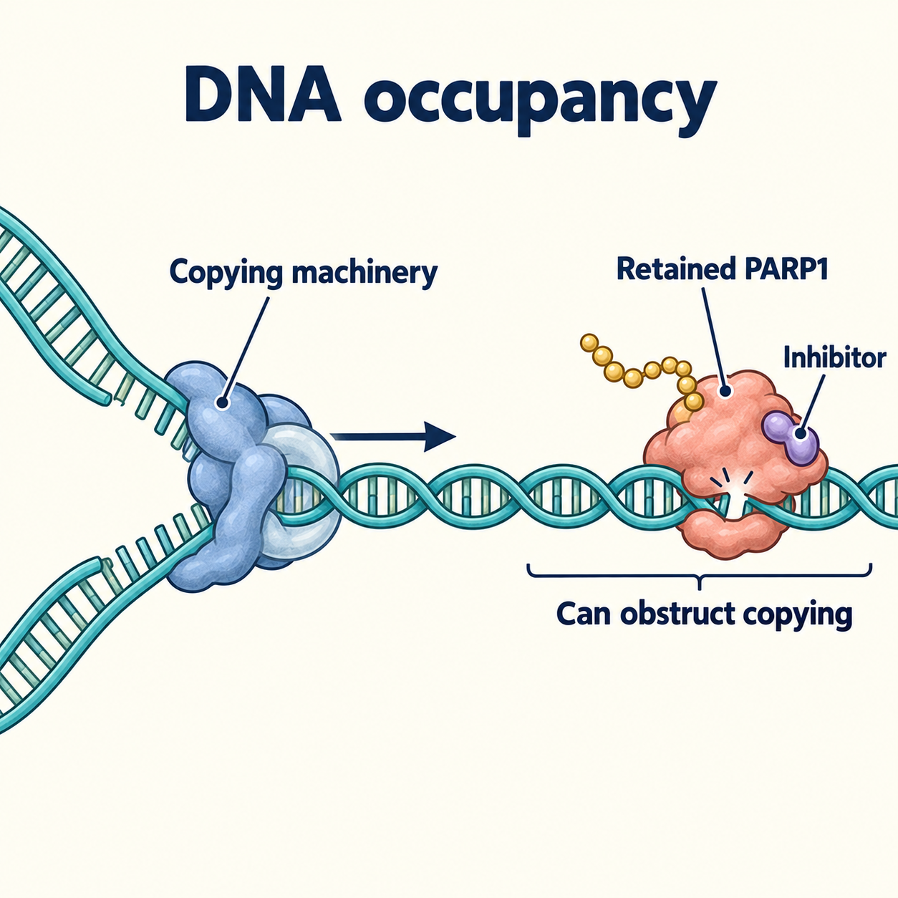
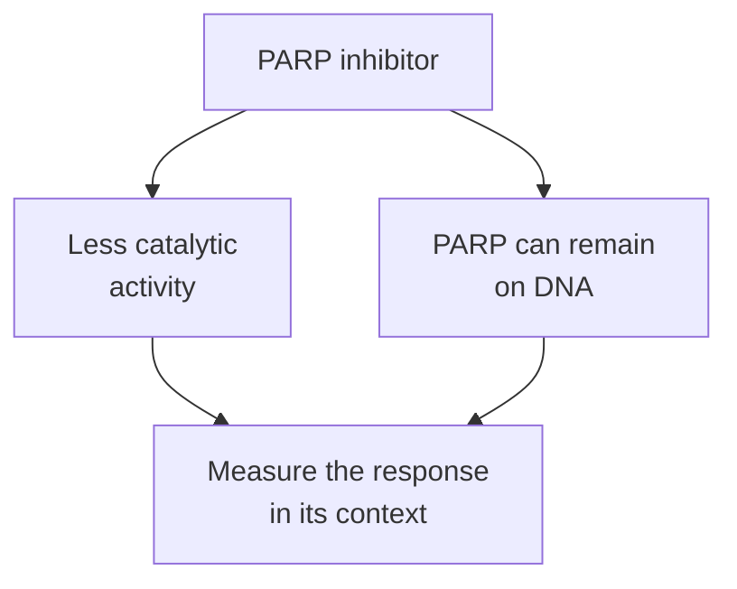

# PARP inhibitors and trapping

## In one sentence

PARP inhibitors block damage-response enzyme activity and can hold PARP proteins on DNA, creating obstacles that cells must tolerate or resolve.

## The intuition

A repair worker normally notices damage, calls for help, and moves on. A drug can silence the call and leave the worker stuck in the doorway. Those are two different problems. The analogy helps explain why blocking an enzyme and trapping a protein are related but distinct effects. A real cell has several damage-response routes, and a drug does not trap every repair worker equally.

## How it works

**Poly(ADP-ribose) polymerase (PARP)** proteins participate in responses to damage in [deoxyribonucleic acid (DNA)](/wiki/education/concepts/biology-basics/genetics/central-dogma). ADP-ribose is a chemical unit used to build signals. **Catalytic inhibition** reduces this enzyme activity. **Trapping** stabilizes a PARP–DNA complex, leaving a protein obstacle on the DNA.

DNA-copying machinery can encounter that obstacle. The resulting [replication stress](/wiki/education/concepts/cancer-biology/genome-instability-and-repair/replication-stress) and damage challenge the cell's repair and survival responses. [Homologous recombination (HR)](/wiki/education/concepts/cancer-biology/genome-instability-and-repair/homologous-recombination-and-hrd) helps resolve certain lesions. Some HR-deficient cells are especially vulnerable to PARP inhibition, an example of [synthetic lethality](/wiki/education/concepts/therapeutics/how-drugs-work/synthetic-lethality). A variant in a repair gene does not automatically establish that vulnerability. [Farmer 2005](https://www.nature.com/articles/nature03445).

Compounds can differ in trapping despite inhibiting PARP activity. In Murai's experimental comparisons, niraparib and olaparib trapped PARP more strongly than veliparib. That finding belongs to the tested systems and exposures. It does not rank the best medicine for a person or equate stronger trapping with greater clinical benefit. [Murai 2012](https://pubmed.ncbi.nlm.nih.gov/23118055/).

### Two questions at the same damaged DNA site

*Catalytic inhibition reduces synthesis of poly(ADP-ribose) (PAR), an ADP-ribose signal polymer. Both snapshots show DNA-bound PARP1; the activity comparison does not measure how long it remains bound.*

*DNA occupancy asks what remains in the copying machinery's path. A retained PARP1–DNA complex can obstruct replication; this conceptual fork sketch does not show a measured collision or guarantee its outcome.*

These related effects can occur together. PAR-level assays investigate catalytic output; DNA-associated PARP measurements investigate occupancy under specified conditions. Exposure, present repair function and other cell responses matter. A genomic scar records damage history, rather than establishing a repair defect today. Neither picture ranks medicines or predicts patient benefit. The scenes use PARP1 as one representative PARP protein. [Murai 2012](https://pubmed.ncbi.nlm.nih.gov/23118055/), [NCI PAR assay](https://dctd.cancer.gov/drug-discovery-development/assays/pharmacodynamic-biomarker-assays/additional), [NCI mechanism description](https://dctd.cancer.gov/drug-discovery-development/reagents-materials/formulary/about/agents/olaparib).

Artwork source check: 2026-10-11. Primary research sections and caption text support the activity/association distinction; the fork is an original explanatory model. No source figure was copied. Expert and learner review remain pending.

*Two drug effects can contribute to a response; the drawing cannot predict its size or clinical value.*

## Why it matters in cancer

Repair weakness can supply a drug hypothesis. Present function, exposure, other resistance routes, and normal-tissue effects shape whether it holds. A [genomic scar](/wiki/education/concepts/cancer-biology/genome-instability-and-repair/genomic-scars) records accumulated damage; it does not measure today's repair capacity. Selected resistant metastatic breast cancers have shown BRCA reversions that restore repair while historical genomic scars can remain. [Waks 2020](https://pubmed.ncbi.nlm.nih.gov/32245699/).

A mechanism also differs from an indication. The cited U.S. Food and Drug Administration (FDA) olaparib label requires a qualifying germline BRCA alteration and other disease-setting criteria for its early breast cancer use. A tumor-only BRCA finding or a high scar result does not substitute for the germline requirement. [FDA label, section 1.4](https://www.accessdata.fda.gov/drugsatfda_docs/label/2025/208558s031lbl.pdf).

## How it is measured

Enzyme assays measure catalytic activity. Chromatin-associated PARP measurements can investigate trapping under specified conditions. Repair readouts and cell-survival experiments ask further questions. A lower metabolic signal alone cannot establish irreversible cell death or identify the mechanism that caused it. [The functional-experiment lesson](/wiki/education/guides/from-variant-to-drug/07-reading-a-functional-experiment) connects these measurements to their controls.

## Common confusions

- **Inhibition versus trapping:** less enzyme activity does not specify how much protein remains bound.
- **Trapping potency versus clinical benefit:** a laboratory comparison cannot rank personal treatment choices.
- **Scar versus current weakness:** damage history can persist after repair changes.
- **Biology versus access:** a plausible vulnerability does not establish an approved indication or a trial slot.

## Try it

Two fictional compounds inhibit PARP activity similarly. Compound A traps more PARP in a culture. Does that establish superior patient benefit?

Show the answer

It establishes a difference in that trapping assay. Relevant exposure, survival, safety, resistance, and clinical outcomes still need evidence.

## Related concepts

- [BRCA1 and BRCA2](/wiki/education/concepts/cancer-biology/genome-instability-and-repair/brca1-and-brca2).
- [DNA-damage-response inhibitors](/wiki/education/concepts/therapeutics/targeted-small-molecules/ddr-inhibitors).
- [Drug labels and off-label use](/wiki/education/concepts/access-and-regulation/approval/drug-label-and-off-label-use).

## Sources

Source check: 2026-10-09. General mechanism education; the practice case is fictional. Expert and learner review pending. The indication example refers to the dated label, not an individual treatment decision.

- [Farmer 2005: repair deficiency and PARP inhibition in experimental models](https://www.nature.com/articles/nature03445).
- [Murai 2012: catalytic inhibition and differential trapping](https://pubmed.ncbi.nlm.nih.gov/23118055/).
- [Waks 2020: repair restoration in selected resistant metastatic breast cancers](https://pubmed.ncbi.nlm.nih.gov/32245699/).
- [FDA olaparib prescribing information, 2025 label](https://www.accessdata.fda.gov/drugsatfda_docs/label/2025/208558s031lbl.pdf).

<!-- BEGIN GENERATED USED IN -->
## Used in

- [Connect repair biology to PARP sensitivity](/wiki/education/guides/from-variant-to-drug/02-connect-repair-biology-to-parp-sensitivity)
- [PARP trapping and recycling](/wiki/education/guides/from-variant-to-drug/04-parp-trapping-and-recycling)
- [Reading a functional experiment](/wiki/education/guides/from-variant-to-drug/07-reading-a-functional-experiment)
- [From a variant to a drug claim](/wiki/education/guides/from-variant-to-drug/index)
<!-- END GENERATED USED IN -->
