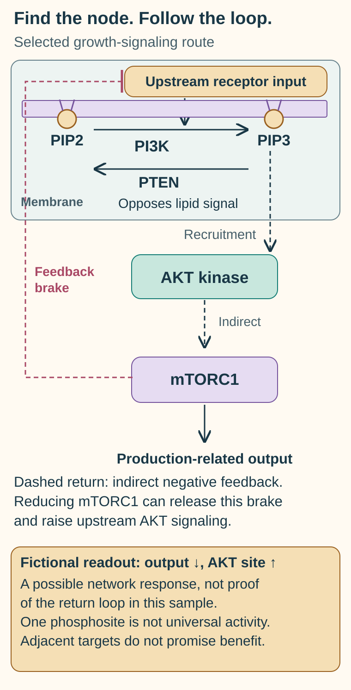

# PI3K and AKT inhibitors: choose the actual signaling step

## In one sentence

PI3K and AKT inhibitors act at different points in a growth-signaling network, so their target profiles, feedback effects, and clinical evidence cannot be exchanged.

## The intuition

Turning down a receiver differs from turning down the relay after it. Both can reduce an output, but neighboring signals may compensate. This network has feedback rather than one straight wire. The analogy stops at separate boxes: cellular proteins interact, move, and change chemical state over time.

## How it works

Read lipid conversion at the membrane separately from protein-kinase nodes below it. The dashed returning brake summarizes an indirect feedback relation, not a direct phosphorylation arrow or every network branch. Feedback release is a possible response, not a universal rebound. A named phosphosite, target engagement, growth dependence and patient benefit are different claims; neighboring inhibitors are not interchangeable.

The [shared concept map](/wiki/education/concepts/cancer-biology/signaling-pathways/pi3k-akt-mtor) supplies the background for this closer comparison.

The [PI3K–AKT–mTOR network](/wiki/education/concepts/cancer-biology/signaling-pathways/pi3k-akt-mtor) links growth signals to survival and resource use. **Phosphoinositide 3-kinase (PI3K)** modifies membrane lipids that help recruit signaling machinery. **AKT**, also called protein kinase B, transfers phosphate groups to proteins. **Mechanistic target of rapamycin (mTOR)** works in distinct downstream complexes.

**PTEN**, phosphatase and tensin homolog, can remove a phosphate from a lipid signal made by PI3K. Loss of this brake is one possible pathway change. A DNA alteration, lower RNA, absent protein staining, and loss of enzymatic function are different observations. DNA and RNA mean deoxyribonucleic acid and ribonucleic acid; the [central dogma](/wiki/education/concepts/biology-basics/genetics/central-dogma) separates these layers.

| Intervention | Example | Important distinction |
|---|---|---|
| PI3K inhibition | Alpelisib, directed at the PI3K-alpha isoform | Reduces an upstream lipid-signal step |
| AKT inhibition | Capivasertib, inhibiting AKT isoforms | Acts on a downstream protein kinase |
| mTOR-directed inhibition | A rapamycin-related drug | Targets another node and may affect particular mTOR-complex functions |

An **isoform** is a member or form within a related protein group. Individual drugs differ in which isoforms they inhibit, how they bind, and what exposure is achieved. A PI3K drug cannot substitute for an AKT drug merely because both names occur in one pathway drawing.

Feedback can make measurements move in opposite directions. In a primary study, mTOR inhibition relieved feedback and increased upstream AKT signaling in studied models and tumor samples. Falling downstream output with rising upstream phosphorylation need not mean the drug missed its target. It also does not establish the net survival effect.

## Why it matters in cancer

Clinical evidence must match the disease and intervention. The FDA's 2023 breast-cancer approval of capivasertib with fulvestrant concerned adults with hormone receptor-positive, human epidermal growth factor receptor 2 (HER2)-negative advanced disease, specified PIK3CA/AKT1/PTEN alterations, and defined prior endocrine-treatment conditions. It is not a TNBC indication inferred from a pathway mutation.

CAPItello-290 separately tested capivasertib plus paclitaxel as first-line treatment for metastatic [triple-negative breast cancer (TNBC)](/wiki/education/concepts/breast-cancer/receptors-and-subtypes/tnbc). It did not meet its overall-survival primary endpoints in either the overall or alteration-defined population. Secondary progression-free findings do not turn the negative primary result into proven survival benefit.

Preclinical repair or immune effects are research hypotheses. They cannot establish that every PI3K or AKT inhibitor improves a PARP-inhibitor or immune-therapy regimen.

## How it is measured

Sequencing identifies specified variants; protein assays and [phosphoproteomics](/wiki/education/concepts/measurement/proteins-and-spatial/phosphoproteomics) examine other layers. Specify which site, substrate, specimen, comparator, and time were measured. Different drug mechanisms can change AKT phosphorylation differently, so one phosphorylation site is not a universal activity meter.

Research experiments report concentrations, often in nanomoles per liter (nM), and normalized signaling, growth, or death. [Target engagement](/wiki/education/concepts/therapeutics/how-drugs-work/chemical-probe-vs-drug-and-target-engagement) must be distinguished from functional dependence. Clinical interpretation also needs the defined assay and endpoint; a pathway-associated variant is not a general access ticket.

## Common confusions

- **PI3K versus AKT versus mTOR:** neighboring nodes are not interchangeable targets.
- **PTEN mutation versus protein loss:** the assay and alteration matter.
- **Pathway output versus dependence:** biochemical inhibition can coexist with continued growth.
- **Secondary endpoint versus primary conclusion:** identify what a trial was designed to establish.

## Try it

A fictional tumor carries a PIK3CA variant. A reader concludes that any AKT inhibitor must work. What is missing?

**Answer:** The variant's function, the actual drug and exposure, disease setting, assay definition, and clinical evidence. A network connection provides a hypothesis; it does not prove sensitivity or eligibility.

## Explain it back

“A pathway variant suggests ___; an inhibitor acts at ___; benefit must be tested in ___.”

One answer: “a mechanism to investigate; a particular node; the relevant treatment and disease setting.”

## Takeaway

**Follow the actual drug target and the actual trial population, rather than treating a pathway name as a treatment rule.**

## Related concepts

- [PI3K–AKT–mTOR biology](/wiki/education/concepts/cancer-biology/signaling-pathways/pi3k-akt-mtor).
- [Phosphoproteomics](/wiki/education/concepts/measurement/proteins-and-spatial/phosphoproteomics).

## Sources

Source check: October 9, 2026. Durable mechanism education with explicitly scoped clinical examples; practice is fictional. Expert and learner review pending.

- [PIQRAY prescribing information, section 12.1: predominantly PI3K-alpha inhibition](https://dailymed.nlm.nih.gov/dailymed/drugInfo.cfm?setid=b20b4e18-7a4b-4500-a08f-06c6dab0ee5b).
- [NCI: capivasertib](https://www.cancer.gov/publications/dictionaries/cancer-drug/def/capivasertib).
- [O'Reilly et al., 2006: feedback after mTOR inhibition](https://pmc.ncbi.nlm.nih.gov/articles/PMC3193604/).
- [FDA, November 2023: capivasertib–fulvestrant breast-cancer population](https://www.fda.gov/drugs/resources-information-approved-drugs/fda-approves-capivasertib-fulvestrant-breast-cancer).
- [Schmid et al., 2026: CAPItello-290 phase III report](https://pubmed.ncbi.nlm.nih.gov/41422862/).

<!-- BEGIN GENERATED USED IN -->
## Used in

- [PI3K, AKT, and mTOR: competing effects on repair and recycling](/wiki/education/guides/from-variant-to-drug/06-pi3k-akt-mtor-and-repair)
<!-- END GENERATED USED IN -->
