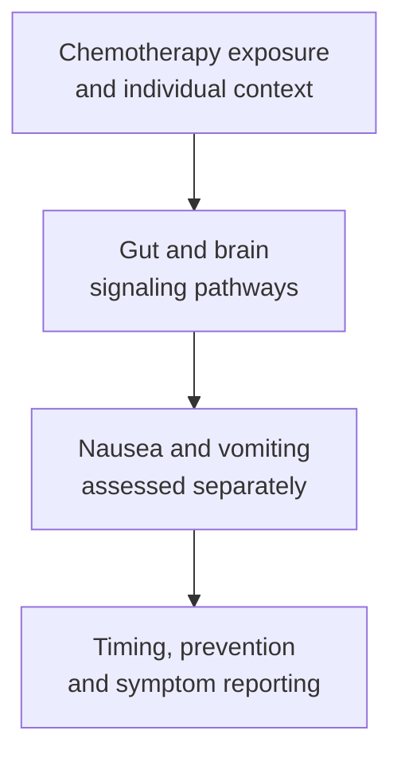

# Chemotherapy-induced nausea

## In one sentence

Chemotherapy-induced nausea is the unpleasant feeling of needing to vomit triggered by chemotherapy, with timing and pathways that can differ from vomiting itself.

## The intuition

Imagine several routes feeding into an alarm system: signals from the gut, the bloodstream and learned associations can all contribute. Blocking one route may help without silencing every route. The analogy is only a map of interacting signals. Nausea is a real, subjective experience, and the brain's responses are more complex than an on/off alarm.

## How it works

[Chemotherapy](/wiki/education/concepts/therapeutics/chemotherapy/chemotherapy) can activate signaling between the gut and brain. **Nausea** is the unpleasant sensation; **vomiting** is the physical expulsion of stomach contents. They often occur together, but one can occur without the other. **Chemotherapy-induced nausea and vomiting (CINV)** is the combined term used in many studies.

Serotonin released in the gut can stimulate nerves through **5-hydroxytryptamine type 3 (5-HT₃) receptors**. **Substance P** acts through **neurokinin-1 receptors** in relevant neural pathways. Other transmitters and brain regions contribute. Medicines that block different receptors can therefore have complementary roles. [NCI's professional summary](https://www.cancer.gov/about-cancer/treatment/side-effects/nausea/nausea-hp-pdq).

The acute and delayed periods are reporting windows, not two sealed biological compartments. Analysis of cisplatin studies supports a larger serotonin contribution to early vomiting and substance P involvement later, while pathways overlap. This does not assign every kind of nausea to one transmitter. [Hesketh et al., 2003](https://pubmed.ncbi.nlm.nih.gov/12736106/). “Delayed” does not mean imaginary, unrelated to treatment or necessarily mild. A multiday regimen can overlap early and later responses to different administrations.

| Pattern | What the term helps you notice |
|---|---|
| Acute | Starts within the first 24 hours after chemotherapy in standard reporting |
| Delayed | Starts or persists beyond 24 hours; check the study's observation window |
| Anticipatory | Occurs before an administration, sometimes through learned associations after earlier nausea |
| Breakthrough | Occurs despite preventive antiemetic treatment |

The table organizes observations, not a choice of medicines. **Antiemetic** means a medicine used to prevent or reduce nausea or vomiting. Prevention and treatment of symptoms that have already appeared are different study questions. [MASCC–ESMO guideline update](https://pmc.ncbi.nlm.nih.gov/articles/PMC10937211/).

*Several pathways can contribute; preventing vomiting does not guarantee freedom from nausea.*

## Why it matters in cancer

Nausea can interfere with eating, drinking and daily life even without vomiting. The clinical team considers the actual chemotherapy combination, schedule, prior symptoms and other risk factors. A supportive-care plan borrowed from another regimen may leave important gaps.

New nausea also needs a cause assessment. Other medicines, constipation, metabolic changes or disease-related problems can contribute. Occurrence during chemotherapy does not establish that chemotherapy is the only cause.

Primary antiemetic studies show why the endpoint matters. In Navari and colleagues' randomized trial in previously untreated patients receiving highly emetogenic cisplatin or cyclophosphamide–doxorubicin, **no nausea** was assessed separately from **complete response**, defined as no vomiting and no rescue medication. The latter endpoint did not mean “no nausea.” That definition is study-specific evidence to read, not a personal prescription. [Navari et al., 2016](https://pubmed.ncbi.nlm.nih.gov/27410922/).

## How it is measured

Read patient-reported nausea severity, vomiting episodes, use of rescue medication and the observation window. Keep the preventive regimen and adherence visible. “No vomiting” is incomplete if nausea was not measured. A trial's complete-response definition should be written beside its result rather than assumed from the phrase.

For a patient, ongoing symptoms that limit drinking or eating deserve prompt communication with the care team. The team's plan explains which symptoms require urgent assessment. The concept cannot supply a substitute medication schedule. [NCI: nausea and vomiting](https://www.cancer.gov/about-cancer/treatment/side-effects/nausea).

## Common confusions

- **Nausea versus vomiting:** related symptoms with different measurements.
- **Acute versus delayed:** different timing and pathway contributions, with biological overlap.
- **Anticipatory versus imagined:** learned associations can produce real symptoms.
- **Supportive care versus tumor treatment:** relief does not measure tumor response.
- **Emetic risk versus certainty:** a regimen's classification does not predict one person's exact experience.

## Try it

Fictional participant Sam has no vomiting during a trial but reports persistent nausea. The report says he met its endpoint of no vomiting and no rescue medication. Is “Sam had no symptoms” an accurate translation?

**Answer:** No. He met that defined endpoint while still having nausea. Report the two findings separately and check the time window.

## Related concepts

- [Chemotherapy](/wiki/education/concepts/therapeutics/chemotherapy/chemotherapy)
- [Ligands and receptors](/wiki/education/concepts/biology-basics/signaling/ligand-and-receptor)

## Sources and scope

Source-checked October 9, 2026; expert and learner review pending. Adult learning about mechanisms and reporting, with a fictional exercise. No drug doses or self-management sequence is supplied.

- [NCI: Nausea and vomiting related to cancer treatment, professional PDQ summary](https://www.cancer.gov/about-cancer/treatment/side-effects/nausea/nausea-hp-pdq) — signaling, timing, conditioning and alternative causes.
- [2023 MASCC–ESMO guideline update, published 2024](https://pmc.ncbi.nlm.nih.gov/articles/PMC10937211/) — regimen-specific prevention and defined outcomes; PMID 38458657.
- [Hesketh et al., 2003](https://pubmed.ncbi.nlm.nih.gov/12736106/) — primary analysis of two phase II cisplatin studies comparing antagonist effects over time.
- [Navari et al., 2016](https://pubmed.ncbi.nlm.nih.gov/27410922/) — primary randomized study distinguishing nausea prevention from no emesis/no rescue.
- [NCI: Nausea and vomiting](https://www.cancer.gov/about-cancer/treatment/side-effects/nausea) — symptom reporting and clinical communication.

<!-- BEGIN GENERATED USED IN -->
## Used in

- [Read the jobs in the treatment plan](/wiki/education/guides/treating-early-tnbc/01-read-the-jobs-in-the-plan)
<!-- END GENERATED USED IN -->
