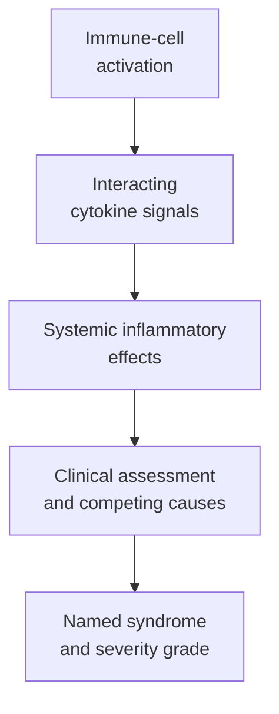

# Cytokine release syndrome (CRS)

## In one sentence

Cytokine release syndrome is a systemic inflammatory response that can follow immune activation and cause fever, low blood pressure or low oxygen.

## The intuition

An immune response uses chemical messages to coordinate cells. In cytokine release syndrome (CRS), that conversation can become a harmful body-wide response. Think of several microphones feeding back into one another, rather than one cell dumping a single chemical. The analogy has limits: blood vessels, immune cells and organs respond through different biological pathways.

## How it works

[Chimeric antigen receptor (CAR)](/wiki/education/concepts/therapeutics/cell-therapies/car-anatomy) cells and some [T-cell engagers](/wiki/education/concepts/therapeutics/antibody-based/t-cell-engager) can activate immune cells strongly. [Cytokines](/wiki/education/concepts/immunology/immune-regulation/cytokine-and-chemokine) carry signals among the activated cells and other cells in the body. The treatment need not contain a cytokine payload to set this response in motion.

Myeloid cells, including macrophages, can amplify the response. Giavridis and colleagues demonstrated a causal role for recipient macrophage signals in a mouse model of CAR T-cell-induced CRS. That supports a multicell mechanism; it does not prove identical sources or contributions in every human product. [Giavridis et al., 2018](https://pubmed.ncbi.nlm.nih.gov/29808005/).

The resulting syndrome is assessed through clinical findings, rather than one cytokine concentration. Fever, falling blood pressure and impaired oxygenation can reflect different consequences of inflammation. Infection and other conditions can cause similar findings or coexist with CRS. A fever after treatment cannot be assigned a cause by a timing chart alone.

*Biological activation, clinical attribution and severity are different pieces of evidence.*

## How it is assessed and reported

The American Society for Transplantation and Cellular Therapy (ASTCT) published a widely used consensus in 2019 and updated it in 2026. Its CRS definition requires fever at onset; severity grading centers on attributable low blood pressure and hypoxia, including the support they require. Fever need not persist after fever-reducing or CRS-directed treatment for ongoing grading. This is a reporting framework, not a home diagnosis rule. [ASTCT 2019](https://pubmed.ncbi.nlm.nih.gov/30592986/), [ASTCT 2026](https://pubmed.ncbi.nlm.nih.gov/42711241/).

A clinical report should name its grading version, observation window and treated-patient denominator. Read onset, maximum grade, interventions, resolution and other organ effects. A cytokine plot provides biological information; a clinician must interpret the syndrome and competing explanations. Reports using different definitions may not be directly comparable.

Clinical teams can use supportive measures and medicines that interrupt particular inflammatory pathways or suppress inflammation more broadly. The actual choice follows the product, findings and management protocol. A grading scale alone does not prescribe management or establish a universal dose-limiting event.

## Why it matters in cancer

Safety belongs to the actual product, disease, tumor burden, preparatory treatment and follow-up. An experience with a particular blood-cancer product cannot supply a solid-tumor product's incidence. An early study may describe no severe CRS without ruling out uncommon harms.

Benefit and toxicity also need separate evidence. A strong tumor response does not establish acceptable inflammatory risk; mild CRS does not establish lack of anticancer activity. Removing a treatment input or engineered cells may not immediately reverse signals already released or tissue injury already present.

## Common confusions

- **CRS versus infection:** similar clinical findings require attribution; they can coexist.
- **CRS versus [on-target, off-tumor toxicity](/wiki/education/concepts/therapeutics/toxicities-and-supportive-care/on-target-off-tumor-toxicity):** systemic inflammation and direct recognition of healthy tissue are distinct mechanisms.
- **CRS versus [immune effector cell-associated neurotoxicity syndrome (ICANS)](/wiki/education/concepts/therapeutics/toxicities-and-supportive-care/icans):** blood pressure and oxygenation do not replace neurologic assessment.
- **No added cytokine versus no cytokine response:** activating cells can still stimulate endogenous signaling.
- **No observed severe events versus proven absence:** cohort size and observation matter.

## Try it

A fictional early trial reports no severe CRS and shows a modest cytokine rise. A learner concludes that every participant's fever was harmless CRS. What is missing?

**Answer:** Attribution, clinical findings and the grading framework. Fever may have another cause; cytokine levels do not assign a grade. The study also needs a treated denominator and adequate follow-up before its reassuring observation can be interpreted.

## Explain it back

“CRS severity comes from ___, while a cytokine plot shows ___.” One answer: “attributed clinical effects under a named framework; selected biological signals.”

## Related concepts

- [Cytokines and chemokines](/wiki/education/concepts/immunology/immune-regulation/cytokine-and-chemokine)
- [T-cell states](/wiki/education/concepts/immunology/t-cells/t-cell-states)

## Sources and scope

Source-checked October 9, 2026; expert and learner review pending. The practice example is fictional. This explains mechanisms and evidence reading without incidence forecasts, medication doses or a treatment algorithm.

- [Lee et al., 2019: ASTCT consensus definitions and grading](https://pubmed.ncbi.nlm.nih.gov/30592986/) — identify the actual version used by an older study.
- [Perales et al., 2026: ASTCT consensus grading for toxicities after immune effector cell therapy](https://pubmed.ncbi.nlm.nih.gov/42711241/) — current reporting update, not a substitute for a clinical management protocol.
- [Giavridis et al., 2018](https://pubmed.ncbi.nlm.nih.gov/29808005/) — macrophage-mediated amplification in a primary mouse model.
- [NCI: definition of CRS](https://www.cancer.gov/publications/dictionaries/cancer-terms/def/cytokine-release-syndrome).
- [NCI: CAR T-cell treatment and toxicity overview](https://www.cancer.gov/about-cancer/treatment/research/car-t-cells).

<!-- BEGIN GENERATED USED IN -->
## Used in

- [The journey through a solid tumor](/wiki/education/cellular-therapies/08-solid-tumor-barriers)
- [Reading cell-therapy evidence](/wiki/education/cellular-therapies/09-reading-cell-therapy-evidence)
- [Read the safety plan for engineered cells](/wiki/education/guides/engineered-cell-therapy/07-reading-the-safety-plan)
- [How engineered immune cells can attack a solid tumor](/wiki/education/guides/engineered-cell-therapy/index)
- [Compare formats with evidence and normal-tissue risk](/wiki/education/targeted-therapy-modalities/06-comparisons)
<!-- END GENERATED USED IN -->
