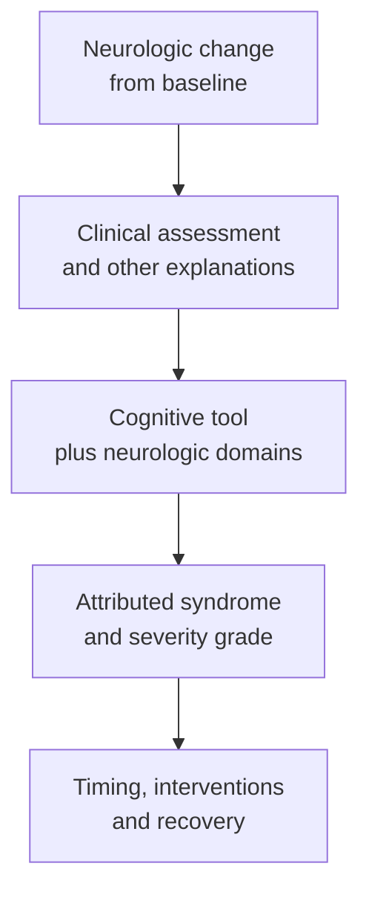

# Immune effector cell-associated neurotoxicity syndrome (ICANS)

## In one sentence

ICANS is a neurologic syndrome associated with immune-effector-cell therapy that is assessed through clinical changes in brain function.

## The intuition

A safety report needs a separate account of what happened to brain function. Inflammation and neurologic changes are related, but they do not move in lockstep. Knowing that blood pressure recovered does not tell you whether speech or awareness recovered too. Think of several instruments on a dashboard: one improving reading cannot stand in for the whole system. The analogy does not explain the underlying biology.

## How it works

Immune effector cell-associated neurotoxicity syndrome (ICANS) can include changes in language, attention, handwriting or awareness. Severe events can include seizures and other major neurologic findings. These are clinical observations, not a conclusion a reader can make from an immune-marker plot. [NCI's cellular-therapy overview](https://www.cancer.gov/about-cancer/treatment/research/car-t-cells).

Inflammatory signals, changes in the cells lining blood vessels and blood–brain barrier disruption are implicated. The barrier normally helps regulate movement between blood and the brain. In Gust and colleagues' study of adults receiving [chimeric antigen receptor (CAR) T cells](/wiki/education/concepts/therapeutics/cell-therapies/car-anatomy) directed at CD19, a B-cell surface target, for refractory B-cell malignancies, severe neurotoxicity was associated with vascular dysfunction and increased barrier permeability. That is a defined population and product setting; it does not establish one complete causal mechanism for every patient. [Gust et al., 2017](https://pubmed.ncbi.nlm.nih.gov/29025771/).

ICANS can accompany [cytokine release syndrome (CRS)](/wiki/education/concepts/therapeutics/toxicities-and-supportive-care/cytokine-release-syndrome) or follow a different timetable. Clinical teams examine neurologic function and evaluate other explanations. Sedating medicines, infection, metabolic changes and underlying neurologic disease can complicate attribution.

*The cognitive score is one input; the clinical assessment establishes the syndrome.*

## How it is assessed and reported

The **immune effector cell-associated encephalopathy (ICE) score** samples cognitive function with tasks involving orientation, naming, commands, writing and attention. It is neither the entire neurologic examination nor a stand-alone diagnosis. The American Society for Transplantation and Cellular Therapy (ASTCT) 2026 update explicitly separates the monitoring tool from diagnosing ICANS. Baseline function matters when interpreting a change. [ASTCT 2026](https://pubmed.ncbi.nlm.nih.gov/42711241/).

ICANS grading also considers consciousness, seizures, motor findings and signs of brain swelling. A report should name its grading version and record which domains were assessed. A low cognitive score can have another explanation; a preserved score cannot replace assessment of the other domains. [ASTCT 2019](https://pubmed.ncbi.nlm.nih.gov/30592986/), [ASTCT 2026](https://pubmed.ncbi.nlm.nih.gov/42711241/).

Not every neurologic toxicity after immune-effector treatment is ICANS. The 2026 consensus distinguishes other neurologic syndromes with their own definitions. A headache, focal problem or later movement disorder should not simply be relabeled ICANS because the patient received cell therapy. The protocol and clinical findings need to identify what is being reported.

## Why it matters in cancer

Safety studies of [chimeric antigen receptor (CAR)](/wiki/education/concepts/therapeutics/cell-therapies/car-anatomy) cells and related treatments should report neurologic events separately from CRS. The risk belongs to the actual product and treated population. It cannot be copied from another receptor, cell type or disease because both are called immunotherapy.

Read onset, severity, attributed cause, interventions, duration, recovery and the number adequately observed. A report of no severe CRS does not answer these neurologic questions. Preclinical tests and early trials can reveal hazards without settling every uncommon or delayed risk; product development needs context-appropriate follow-up. [FDA development guidance](https://www.fda.gov/media/156896/download).

Clinical management depends on the findings and the care team's protocol. This page supplies no treatment algorithm. A reversible engineering input does not guarantee immediate reversal of an established neurologic injury.

## Common confusions

- **ICE score versus diagnosis:** a structured cognitive observation cannot establish ICANS alone.
- **ICANS grade versus ICE score:** grading considers additional clinical domains.
- **CRS recovery versus neurologic recovery:** these need separate timelines.
- **Neurologic event versus ICANS:** attribution and other syndrome definitions matter.
- **No event recorded versus no risk:** missed examinations and short follow-up can leave uncertainty.

## Try it

A fictional participant becomes confused while receiving a sedating medicine after cell therapy. Her ICE score falls. Does that result prove ICANS?

**Answer:** No. It documents a change that needs clinical assessment, including medication effects and other explanations. The examination, baseline and other neurologic findings inform attribution and grading. Neither ignoring the change nor diagnosing from the score alone is justified.

## Related concepts

- [Cytokines and chemokines](/wiki/education/concepts/immunology/immune-regulation/cytokine-and-chemokine)
- [On-target, off-tumor toxicity](/wiki/education/concepts/therapeutics/toxicities-and-supportive-care/on-target-off-tumor-toxicity)

## Sources and scope

Source-checked October 9, 2026; expert and learner review pending. The exercise is fictional. This teaches evidence interpretation, without medication doses or individual clinical recommendations.

- [Lee et al., 2019: ASTCT consensus definitions and grading](https://pubmed.ncbi.nlm.nih.gov/30592986/) — version-specific interpretation of older reports.
- [Perales et al., 2026: ASTCT consensus grading](https://pubmed.ncbi.nlm.nih.gov/42711241/) — cognitive-tool limits and distinct neurologic toxicity categories.
- [Gust et al., 2017](https://pubmed.ncbi.nlm.nih.gov/29025771/) — primary vascular and blood–brain barrier investigation in adults receiving CD19 CAR T cells for refractory B-cell cancers.
- [NCI: CAR T-cell toxicity overview](https://www.cancer.gov/about-cancer/treatment/research/car-t-cells).
- [FDA: CAR T-cell clinical-development guidance](https://www.fda.gov/media/156896/download).

<!-- BEGIN GENERATED USED IN -->
## Used in

- [The journey through a solid tumor](/wiki/education/cellular-therapies/08-solid-tumor-barriers)
- [Reading cell-therapy evidence](/wiki/education/cellular-therapies/09-reading-cell-therapy-evidence)
- [Read the safety plan for engineered cells](/wiki/education/guides/engineered-cell-therapy/07-reading-the-safety-plan)
- [How engineered immune cells can attack a solid tumor](/wiki/education/guides/engineered-cell-therapy/index)
- [Questions for a targeted-therapy proposal](/wiki/education/targeted-therapy-modalities/04-decision-questions)
<!-- END GENERATED USED IN -->
