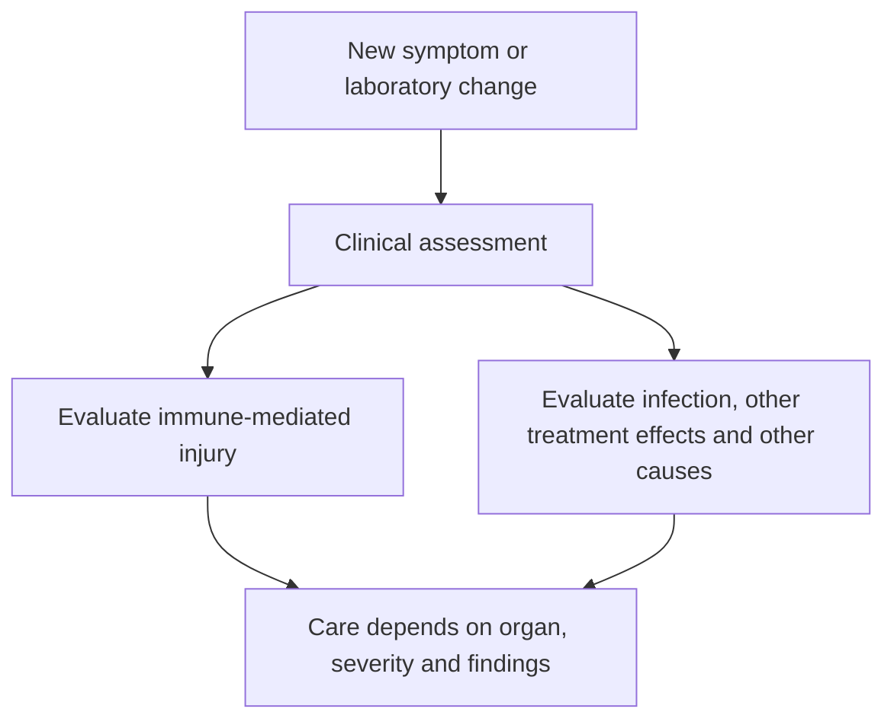

# Immune-related adverse event (irAE)

## In one sentence

An immune-related adverse event is harm to healthy tissue attributed to treatment-related immune activity.

## The intuition

The immune system needs permission to act and limits on where it acts. A treatment that changes those limits can affect healthy organs as well as a tumor. The abbreviation **irAE** tells you the suspected mechanism of harm. It does not tell you the affected organ, severity or treatment needed.

## How it works

The term is commonly used with [immune checkpoint inhibitors](/wiki/education/concepts/therapeutics/immunotherapy/immune-checkpoint-inhibitor). These drugs interrupt regulation that helps protect healthy tissue. Immune-mediated injury can involve several interacting processes; there is no single mechanism that explains every event. [The Society for Immunotherapy of Cancer (SITC) 2021 guideline](https://pmc.ncbi.nlm.nih.gov/articles/PMC8237720/) distinguishes events of likely immune origin from other adverse events.

Examples include inflammation of the bowel, called **colitis**; the lung, called **pneumonitis**; or hormone-producing glands. Liver, skin, heart, kidney and nervous-system injury are also possible. Some events appear through symptoms; others first appear through laboratory changes. The suffix “-itis” means inflammation, but a symptom alone does not establish its cause. [The National Cancer Institute (NCI) organ-inflammation explanation](https://www.cancer.gov/about-cancer/treatment/side-effects/organ-inflammation).

Onset can occur during treatment or after it ends. Resolution also varies. Some hormone-gland injuries leave lasting loss of function even after inflammation settles. An infusion calendar therefore cannot define the entire safety-observation window. [Pembrolizumab prescribing information, section 5.1](https://dailymed.nlm.nih.gov/dailymed/fda/fdaDrugXsl.cfm?setid=9333c79b-d487-4538-a9f0-71b91a02b287), [SITC 2021](https://pmc.ncbi.nlm.nih.gov/articles/PMC8237720/).

*These are assessment questions, not a home diagnostic or treatment algorithm.*

## Why it matters in cancer

“Side effect” is a broad everyday phrase. **Adverse event** means an unwanted medical occurrence reported during treatment or follow-up; it does not by itself establish that treatment caused it. An irAE is a more specific attribution. In a combination regimen, a symptom can have several plausible explanations. [NCI's adverse-event reporting framework](https://dctd.cancer.gov/research/ctep-trials/for-sites/adverse-events) keeps occurrence, severity and attribution separate.

Clinical teams assess the organ involved, timing, severity and competing causes. The SITC guideline uses organ-specific management. Reports should also name their severity-grading framework and version. A treatment hold, medicines that suppress immune activity or replacement of a missing hormone address different problems. The care team chooses among them; readers cannot choose from the symptom name alone.

For a patient, the practical task is to use the team's reporting and urgent-care plan, and tell evaluating clinicians about current **and previous** immunotherapy. New or worsening breathing difficulty, chest pain or confusion warrants urgent medical assessment. Do not wait for the next infusion to report a concerning change or start immune-suppressing medicines on your own. [NCI](https://www.cancer.gov/about-cancer/treatment/side-effects/organ-inflammation).

## A worked example

Fictional patient Mina develops a new cough after finishing checkpoint treatment. “Treatment ended, so it cannot be related” closes the question too early. “It must be pneumonitis” also skips the assessment: infection and other causes remain possible. Mina reports the change using her care team's plan and shares the treatment history.

**Check your understanding:** Does an irAE prove that the cancer treatment is working?

**Answer:** No. A harm assessment does not measure tumor response or clinical benefit. Those need their own evidence.

## Common confusions

- An irAE is not every symptom that occurs during immunotherapy.
- [Cytokine release syndrome (CRS)](/wiki/education/concepts/therapeutics/toxicities-and-supportive-care/cytokine-release-syndrome) is a systemic inflammatory syndrome associated with immune activation.
- [Immune effector cell-associated neurotoxicity syndrome (ICANS)](/wiki/education/concepts/therapeutics/toxicities-and-supportive-care/icans) is a separately assessed neurologic syndrome associated with immune-effector treatments. CRS and ICANS are distinct reporting frameworks, not substitute labels for checkpoint-related organ injury.
- Stopping a treatment input does not guarantee that an immune effect has stopped.

## Related concepts

- [Immune checkpoints](/wiki/education/concepts/immunology/immune-regulation/immune-checkpoint)
- [Read the safety plan for engineered cells](/wiki/education/guides/engineered-cell-therapy/07-reading-the-safety-plan)

## Sources and scope

Source check: October 9, 2026. General vocabulary, timing and reporting; the case is fictional. Individual evaluation and management follow the treating team's current guidance. Expert and learner review remain pending.

- [NCI: organ-related inflammation and immunotherapy](https://www.cancer.gov/about-cancer/treatment/side-effects/organ-inflammation).
- [Brahmer et al., 2021: Society for Immunotherapy of Cancer (SITC) guideline](https://pmc.ncbi.nlm.nih.gov/articles/PMC8237720/) — checkpoint-related adverse-event definitions, timing and assessment.
- [NCI: adverse-event definitions, grading and attribution](https://dctd.cancer.gov/research/ctep-trials/for-sites/adverse-events) — reporting an event does not establish its cause.
- [Pembrolizumab prescribing information, revised July 2026, sections 5.1 and 17](https://dailymed.nlm.nih.gov/dailymed/fda/fdaDrugXsl.cfm?setid=9333c79b-d487-4538-a9f0-71b91a02b287) — delayed immune-mediated reactions and symptom reporting.
- [Lee et al., 2019: immune-effector-cell toxicity consensus](https://pubmed.ncbi.nlm.nih.gov/30592986/) — separate definitions and grading for CRS and ICANS.

<!-- BEGIN GENERATED USED IN -->
## Used in

- [Understand how the immune system recognizes cancer](/wiki/education/guides/how-the-immune-system-fights-cancer/index)
- [Connect treatment jobs with evidence](/wiki/education/guides/start-here/03-connect-treatment-and-evidence)
- [Use the findings in the next conversation](/wiki/education/guides/treating-early-tnbc/03-use-the-findings-in-the-next-conversation)
- [Understand how treatment is sequenced](/wiki/education/guides/treating-early-tnbc/index)
- [Find the step an immune response can lose](/wiki/education/oncology-101/4-escape-mechanisms)
<!-- END GENERATED USED IN -->
