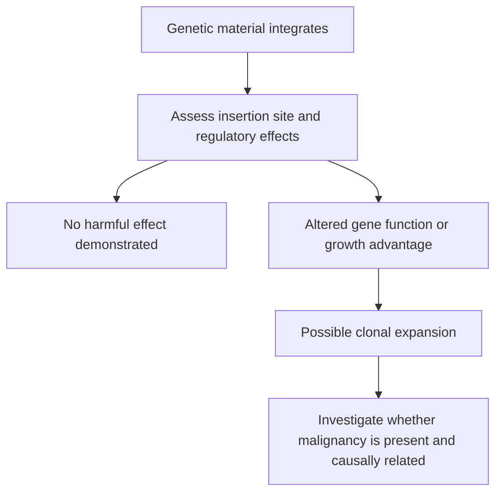

# Insertional mutagenesis

## In one sentence

Insertional mutagenesis occurs when added genetic material changes a cell by inserting into its genome and disrupting a gene or its regulation.

## The intuition

Adding an instruction to a book can affect more than the new sentence. Its position may interrupt existing text or change which nearby instructions get read. In a cell, the consequences depend on where the insertion lands, what it contains and which cell receives it.

## How it works

Some delivery systems insert an instruction cassette into cellular [DNA](/wiki/education/concepts/biology-basics/genetics/central-dogma). The cassette can include the therapeutic coding sequence and regulatory elements that influence its expression. An insertion can interrupt a gene or alter nearby gene activity. Integration is an event; insertional mutagenesis describes a consequential change caused by that event.

Most insertions do not automatically produce a cancer. A change may be neutral, impair survival or give one cell a growth advantage. If descendants of that cell accumulate, a **clone** expands. Clonal expansion is not itself a diagnosis of malignancy: useful immune responses can also expand clones.

The cell population and vector design matter. An early stem-cell gene-therapy study found retroviral integrations near the growth-regulating gene LMO2 with abnormal expression and clonal T-cell proliferation. [That primary investigation](https://pubmed.ncbi.nlm.nih.gov/14564000/) demonstrated a mechanism in a specific inherited immune-disorder treatment. It is not a risk estimate for every modern vector or mature-cell product.

When a malignancy follows engineered-cell therapy, investigators must establish its relationship to the product. Is the therapeutic sequence present in the malignant cells? Where are integrations? Do they alter relevant genes? Were related clones detectable earlier? Prior therapies, underlying disease and pre-existing genetic changes can also matter.

A post-treatment cancer is therefore a safety signal, not automatic proof of insertional causation. One deeply investigated secondary T-cell lymphoma after [chimeric antigen receptor T-cell (CAR-T) therapy](/wiki/education/concepts/therapeutics/cell-therapies/car-anatomy) lacked evidence of oncogenic vector integration. [The investigation](https://pubmed.ncbi.nlm.nih.gov/38865660/) illustrates the value of molecular attribution alongside clinical reporting.

*Integration, clonal expansion and malignancy are distinct observations; causation needs more than temporal order.*

## Why it matters in cancer

Durable expression can be useful, while persistent genetic changes create long-term safety questions. The Food and Drug Administration requires T-cell-malignancy warnings for specified autologous blood-cancer CAR-T products and lifelong monitoring for secondary malignancies. That warning does not assign one mechanism to every event or provide an incidence for experimental solid-tumor products.

Nonintegrating messenger RNA delivery does not use intentional genomic insertion as its expression route. That distinction does not remove recognition, inflammation or delivery risks. Gene-editing errors are another mechanism and should not all be called insertional mutagenesis.

## Worked example and practice

A fictional follow-up test finds one engineered-cell clone becoming more common. The person has no established new malignancy.

**Try it:** Does the result prove insertional cancer?

**Answer:** No. It prompts investigation of the clone, insertion sites, gene effects and clinical findings. A growth pattern, a malignant diagnosis and an insertion-driven mechanism are separate claims.

## Common confusions

- Integration is not synonymous with cancer-causing insertion.
- An abundant clone is not automatically malignant.
- A CAR-positive tumor can show product ancestry without proving which change drove cancer.
- A late safety signal cannot be excluded by a short reassuring study.

## Explain it back

“To attribute this event to an insertion, I need ___.” One answer: “evidence connecting the insertion, its biological effect and the abnormal cell population.”

## Related concepts

- [Central dogma](/wiki/education/concepts/biology-basics/genetics/central-dogma)
- [Lentiviral vector](/wiki/education/concepts/engineering-and-manufacturing/delivery-vehicles/lentiviral-vector)

## Sources and scope

Source check: October 9, 2026; expert and learner review pending. This is foundational teaching, not a treatment recommendation. Worked examples are fictional.

- [Hacein-Bey-Abina et al., 2003](https://pubmed.ncbi.nlm.nih.gov/14564000/) — insertion-associated LMO2 deregulation after a specific stem-cell gene-therapy regimen.
- [Hamilton et al., 2024](https://pubmed.ncbi.nlm.nih.gov/38865660/) — molecular investigation of second tumors after CAR-T therapy.
- [FDA T-cell-malignancy safety communication](https://www.fda.gov/vaccines-blood-biologics/safety-availability-biologics/fda-requires-boxed-warning-t-cell-malignancies-following-treatment-bcma-directed-or-cd19-directed) — defined product class and lifelong monitoring.
- [FDA gene-therapy long-term follow-up guidance](https://www.fda.gov/regulatory-information/search-fda-guidance-documents/long-term-follow-after-administration-human-gene-therapy-products) — persistence and delayed-event assessment.

<!-- BEGIN GENERATED USED IN -->
## Used in

- [Read the safety plan for engineered cells](/wiki/education/guides/engineered-cell-therapy/07-reading-the-safety-plan)
- [How engineered immune cells can attack a solid tumor](/wiki/education/guides/engineered-cell-therapy/index)
<!-- END GENERATED USED IN -->
