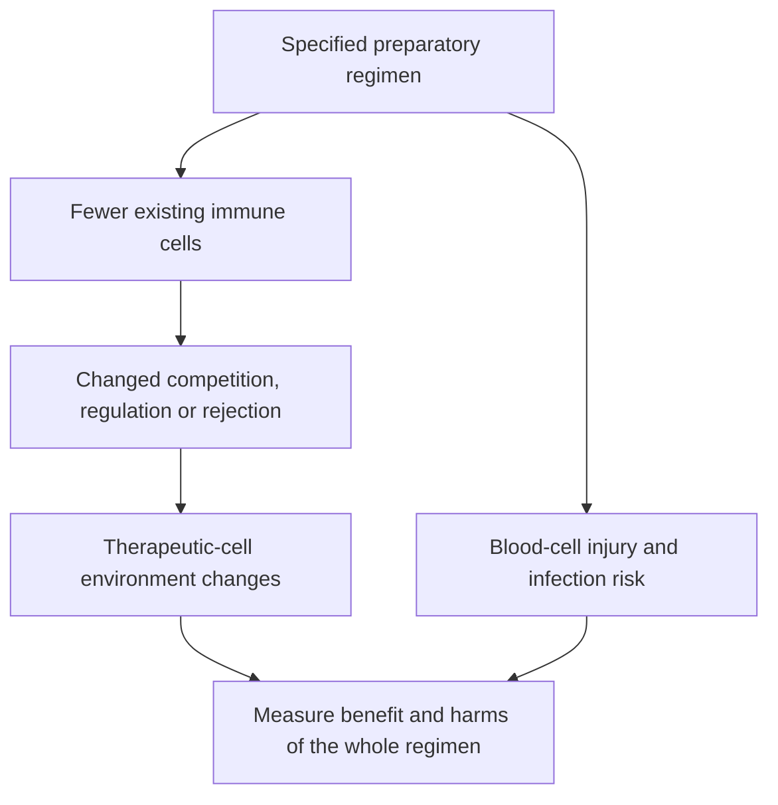

# Lymphodepletion before cell therapy

## In one sentence

Lymphodepletion reduces existing lymphocytes before some cell therapies to change the immune environment in which the therapeutic cells must work.

## The intuition

“Make room for new cells” is a helpful first picture, but the room is mostly about biological relationships. Existing cells use supportive signals and can restrain or reject transferred cells. Preparatory treatment changes those relationships while also removing useful immune protection.

## How it works

**Lymphocytes** include T cells, B cells and natural killer cells. Lymphodepletion reduces some of these populations. Many cell-therapy protocols use chemotherapy, with the actual agents, intensity and timing set by the protocol. The term describes a preparatory aim, not one universal drug regimen.

Existing immune cells can consume homeostatic [cytokines](/wiki/education/concepts/immunology/immune-regulation/cytokine-and-chemokine): signals that help maintain immune-cell populations. Reducing those cells can increase availability of signals such as interleukin-7 and interleukin-15. [Primary mouse experiments](https://pubmed.ncbi.nlm.nih.gov/16203864/) supported this cytokine-competition mechanism and showed that greater useful function need not simply reflect higher cell numbers.

Preparatory treatment can also reduce regulatory or suppressive populations. For some donor-derived products it may affect rejection by the host. Which effects matter depends on the cell product and setting. “Making space” therefore should not be read as clearing an empty physical slot for every infused cell.

Lymphodepleting chemotherapy may affect cancer directly as well. When a study tests a regimen of conditioning, transferred cells and cytokine support, the observed response belongs to that package. A cell contribution needs appropriate evidence rather than assuming that all tumor change came from the infusion.

The same treatment can injure normal blood-cell production and raise infection risk. **Cytopenia** means a low blood-cell count; effects can involve more than lymphocytes. **Nonmyeloablative** means the regimen is not intended to completely eliminate marrow blood production; it can still suppress counts substantially. Prior therapy, the conditioning regimen, the cell treatment and the underlying disease can each contribute. Reporting should identify timing, severity, recovery and relevant supportive care.

*Changing the environment can help a cell therapy while adding treatment-related harm.*

## Why it matters in cancer

Cell-therapy outcomes cannot be interpreted from the infused cells alone. Conditioning and later support can influence expansion, function and toxicity. Compare products in the context of their complete regimens and patient populations.

Lymphodepletion does not supply a missing tumor antigen or ensure entry into a solid tumor. Nor does the cell-therapy category determine whether conditioning is needed. That decision belongs to a defined clinical protocol and treating team.

## Worked example and practice

A fictional study reports low white-cell counts after preparatory chemotherapy and engineered-cell infusion. The authors show that the engineered cells expand in blood.

**Try it:** Do these observations prove that the low counts came from the cells or that more conditioning would improve treatment?

**Answer:** No. Trace timing and the regimen's known effects, and assess competing causes. Expansion is a separate readout from tumor benefit and overall harm. A stronger preparatory regimen requires its own comparison.

## Common confusions

- Lymphodepletion is not direct depletion of every cancer cell.
- Nonmyeloablative does not mean harmless or free of marrow suppression.
- Fewer lymphocytes and fewer neutrophils are distinct measurements.
- A protocol using conditioning does not establish that all cell therapies require it.

## Explain it back

“The intended preparation changes ___, at the cost of ___.” One answer: “immune competition and regulation; loss of useful cells and protocol-specific toxicity.”

## Related concepts

- [Immune cell roster](/wiki/education/concepts/immunology/the-immune-system/immune-cell-roster)
- [Cytokine and chemokine](/wiki/education/concepts/immunology/immune-regulation/cytokine-and-chemokine)
- [Cell therapy as a living drug](/wiki/education/concepts/therapeutics/cell-therapies/cell-therapy-as-a-living-drug)

## Sources and scope

Source check: October 9, 2026; expert and learner review pending. This is foundational teaching, not a treatment recommendation. Worked examples are fictional.

- [Gattinoni et al., 2005](https://pubmed.ncbi.nlm.nih.gov/16203864/) — cytokine-sink mechanism in mouse adoptive-transfer experiments.
- [Rohaan et al., 2022](https://pubmed.ncbi.nlm.nih.gov/36477031/) — conditioning, tumor-infiltrating lymphocyte (TIL) transfer and cytokine support in a specified advanced-melanoma regimen.
- [NCI T-cell transfer therapy](https://www.cancer.gov/about-cancer/treatment/types/immunotherapy/t-cell-transfer-therapy) — preparation and cell-transfer context.

<!-- BEGIN GENERATED USED IN -->
## Used in

- [Cell therapies as living drugs](/wiki/education/cellular-therapies/01-cell-therapy-primer)
- [Read the safety plan for engineered cells](/wiki/education/guides/engineered-cell-therapy/07-reading-the-safety-plan)
- [How engineered immune cells can attack a solid tumor](/wiki/education/guides/engineered-cell-therapy/index)
<!-- END GENERATED USED IN -->
