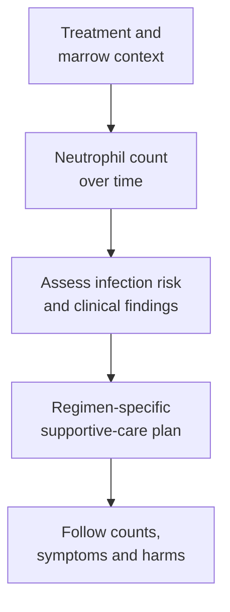

# Neutropenia and granulocyte colony-stimulating factor (G-CSF)

## In one sentence

Neutropenia is a low neutrophil count, and granulocyte colony-stimulating factor (G-CSF) supports neutrophil production in selected clinical settings.

## The intuition

Neutrophils are immune cells that help respond to invading microbes. Picture bone marrow as a supply center and the blood count as a snapshot of available staff. A smaller staff can weaken a response, but it does not prove that an intruder is present. The analogy has limits: cells also move between blood and tissues, and many defenses work together.

## How it works

Bone marrow produces blood cells, including neutrophils. Some [chemotherapy](/wiki/education/concepts/therapeutics/chemotherapy/chemotherapy) affects that production. Counts can fall and later recover as treatment and marrow recovery unfold. Neutropenia can also have other causes. A laboratory result needs its collection time and clinical context. [NCI: infection and neutropenia](https://www.cancer.gov/about-cancer/treatment/side-effects/infection).

The **absolute neutrophil count (ANC)** describes neutrophils per blood volume, commonly as cells per microliter or ×10⁹ per liter. It is more specific than the total white blood cell count. Depth and duration of a low count matter when assessing infection risk; one measurement does not describe an entire cycle.

**Febrile neutropenia** combines fever with neutropenia under a named clinical definition. Infection can be serious before its source is found. A low count alone does not establish infection, and a person can have an infection without neutropenia. Other defenses, tissue injury, devices, medicines and exposures also matter. [ASCO 2026 guideline](https://doi.org/10.1200/JCO-25-02938).

**Granulocyte colony-stimulating factor (G-CSF)** is a growth signal for the neutrophil lineage. Medicines using this pathway act through a receptor on relevant marrow cells, supporting their proliferation and maturation. They do not instantly supply a complete immune system or directly replace all missing blood-cell types. [Filgrastim prescribing information, section 12.1](https://dailymed.nlm.nih.gov/dailymed/fda/fdaDrugXsl.cfm?setid=97cc73cc-b5b7-458a-a933-77b00523e193).

*Counts inform risk assessment; they do not identify the cause of a fever by themselves.*

## Why it matters in cancer

Growth-factor support has a different job from cancer-directed therapy. It can reduce neutropenic complications in selected settings and help make planned treatment deliverable. It does not establish tumor killing. Read **what the supportive medicine is protecting**, as well as what the anticancer medicine is trying to change.

The 2026 American Society of Clinical Oncology (ASCO) update addresses adults with solid or blood cancers receiving systemic antineoplastic therapy. It considers both regimen risk and individual clinical factors when evaluating preventive growth-factor use. It does not say that every low count requires G-CSF. Evidence for one regimen, treatment goal or population cannot simply be copied to another.

These medicines also have their own harms and monitoring needs. Bone pain is one recognized adverse effect; uncommon serious effects are described in product labeling. Short- and longer-acting preparations have different delivery requirements. Naming the class does not select a product, dose or schedule.

## How to read the count and its evidence

Keep the specimen date, ANC units, laboratory reference, treatment-cycle timing and trend together. A toxicity report should state its count threshold and grading version. For a prevention study, inspect the actual regimen, risk factors, comparator, fever-and-count definition and observation period. A better count and fewer infections are related but different outcomes.

During cancer treatment, fever or signs of infection need prompt contact with the care team; infections can require urgent medical attention. Do not use a reassuring earlier count to dismiss a new symptom. [NCI's reporting advice](https://www.cancer.gov/about-cancer/treatment/side-effects/infection).

## Common confusions

- **Low neutrophils versus infection:** one is a blood finding; the other involves microbes and clinical assessment.
- **White cells versus neutrophils:** the total includes several cell types with different jobs.
- **Growth-factor support versus cancer treatment:** supporting blood-cell recovery does not prove anticancer activity.
- **One count versus risk over time:** an isolated result misses duration and changing clinical context.
- **G-CSF versus a general immune booster:** its clinical use and effects are specific, not a promise of stronger antitumor immunity.

## Try it

Fictional learners compare two treatment records with the same low ANC on one date. One has a brief dip; the other has a prolonged low count and new fever. Can the matching number establish matching risk?

**Answer:** No. Duration, symptoms, treatment and other clinical factors differ. The fever needs clinical assessment; the count alone cannot establish or exclude infection.

## Related concepts

- [Chemotherapy](/wiki/education/concepts/therapeutics/chemotherapy/chemotherapy)
- [Lymphodepletion](/wiki/education/concepts/therapeutics/toxicities-and-supportive-care/lymphodepletion)

## Sources and scope

Source-checked October 9, 2026; expert and learner review pending. This is supportive-care vocabulary, with a fictional exercise, rather than a dosing or infection-management protocol.

- [NCI: Infection and neutropenia during cancer treatment](https://www.cancer.gov/about-cancer/treatment/side-effects/infection) — counts, infection risk and urgent reporting.
- [Gyawali et al., 2026: WBC growth factors, ASCO guideline update](https://doi.org/10.1200/JCO-25-02938) — adult population and regimen-specific supportive-care evidence; PMID 41740078.
- [Filgrastim prescribing information, sections 5, 6 and 12.1](https://dailymed.nlm.nih.gov/dailymed/fda/fdaDrugXsl.cfm?setid=97cc73cc-b5b7-458a-a933-77b00523e193) — neutrophil-lineage mechanism and product-specific harms.

<!-- BEGIN GENERATED USED IN -->
## Used in

- [Read the safety plan for engineered cells](/wiki/education/guides/engineered-cell-therapy/07-reading-the-safety-plan)
- [Read the jobs in the treatment plan](/wiki/education/guides/treating-early-tnbc/01-read-the-jobs-in-the-plan)
<!-- END GENERATED USED IN -->
