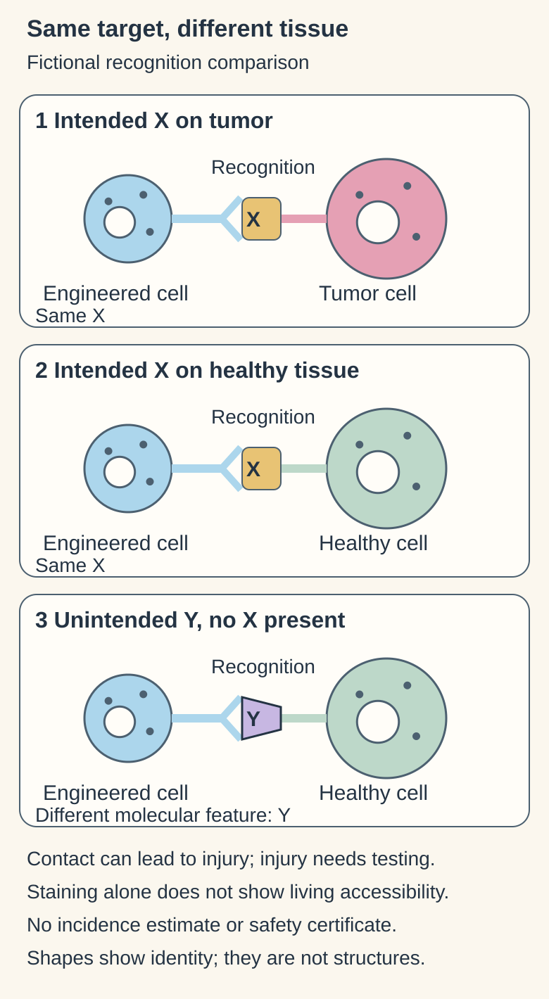

# On-target, off-tumor toxicity

## In one sentence

On-target, off-tumor toxicity occurs when a treatment recognizes its intended target on healthy tissue and harms that tissue.

## The intuition

An address can be correct and still be unsafe to use. If the intended target appears on both cancer cells and an important healthy tissue, accurate recognition can harm both. Calling a receptor “specific” answers only part of the safety question.

## How it works

Many candidate cancer targets are normal proteins expressed at different levels or locations. A [chimeric antigen receptor (CAR)](/wiki/education/concepts/therapeutics/cell-therapies/car-anatomy) or another targeted treatment may recognize its chosen molecular feature wherever it is accessible. Tissue location, target density, receptor properties and treatment exposure all affect the outcome.

This differs from off-target cross-reactivity, where the receptor recognizes an unintended molecular target. Both need investigation. It also differs from [cytokine release syndrome](/wiki/education/concepts/therapeutics/toxicities-and-supportive-care/cytokine-release-syndrome), which concerns systemic inflammatory activation. These categories can occur together rather than forming mutually exclusive boxes.

Developers assess target distribution and function in relevant healthy cells, using complementary methods. A stained tissue section is useful evidence but does not fully reproduce the living tissue's accessibility and treatment response. Animal models may not express the human target in the same places.

A historical [human epidermal growth factor receptor 2 (HER2, also called ERBB2)](/wiki/education/concepts/breast-cancer/receptors-and-subtypes/her2)-directed CAR-T case in metastatic colon cancer ended in fatal respiratory toxicity. The authors proposed recognition of low ERBB2 expression on lung cells as a mechanism; a single case cannot establish class-wide incidence or prove every causal step. [Morgan et al.](https://pubmed.ncbi.nlm.nih.gov/20179677/).

Contrast **off-target cross-reactivity** in an affinity-enhanced [T-cell receptor (TCR)](/wiki/education/concepts/immunology/t-cells/t-cell-receptor) study in myeloma and melanoma. The intended MAGE-A3 peptide was not detected in heart tissue, while functional testing identified recognition of an unrelated titin peptide. That is an unintended molecular target, not simply the intended target in the wrong tissue. [Linette et al.](https://pubmed.ncbi.nlm.nih.gov/23770775/).

## Why it matters in cancer

Solid-tumor target selection asks two connected questions: does the tumor offer enough accessible target, and do important healthy tissues offer it too? A highly expressed tumor target can still have an unacceptable safety profile. A poorly expressed healthy-tissue target can still matter if the receptor responds at low density.

Affinity tuning, recognition logic and control switches may help particular designs. They need their own evidence. A switch that stops one receptor signal may leave engineered cells, other signals or existing tissue injury in place.

## Worked example

*Molecular specificity and tissue selectivity answer different questions. In these fictional scenes, the intended X is shared by tumor and healthy tissue; unintended Y is a separate recognition problem. Contact is not a measured injury, and staining alone cannot settle living accessibility or safety. [Morgan 2010, case report](https://pubmed.ncbi.nlm.nih.gov/20179677/); [Linette 2013, cross-reactivity experiments](https://pubmed.ncbi.nlm.nih.gov/23770775/).*

A fictional receptor kills X-positive tumor cells. In a separate test it also kills normal airway cells carrying the same X. Another normal-cell population lacks X but is still killed; investigators find binding to a different protein, Y.

**Try it:** Which observation is on-target, off-tumor, and which is off-target? Has a low tumor/normal staining ratio settled safety?

**Answer:** Recognition of X on airway cells is on-target, off-tumor. Recognition of unintended Y is off-target. Neither is resolved by a staining ratio alone. Accessible protein, receptor response, exposure and functional tissue injury need their own measurements. A negative result in one normal-tissue panel does not prove absence everywhere.

## Common confusions

- Tumor-associated does not mean tumor-exclusive.
- Binding specificity does not establish tissue selectivity.
- A safe antibody experience does not automatically establish the safety of a living cell with a different recognition and signaling system.
- An early study can miss uncommon harms or effects outside its model.

## How it is measured

| Test | Readout and limit |
|---|---|
| Target distribution | Staining intensity, positive-cell fraction or calibrated molecules/cell; retain tissue, assay and sensitivity |
| Binding specificity | Recognition of intended and unintended molecular features; binding is not injury |
| Healthy-cell function | Percent killing or released cytokine at a named time; viable-cell tests consume the sample |
| Clinical observation | Organ injury, severity, timing and outcomes in the actual population and regimen |

No single “high expression” cutoff serves as a universal safety threshold. Fixed tissue may conceal or expose features differently from a living organ, and a model may lack the relevant human target. Use complementary tests rather than treating one negative result as a safety certificate.

## Explain it back

“Accurate recognition can still harm ___ because ___.” One answer: “healthy tissue; it also displays the intended target.”

## Takeaway

**Molecular specificity and healthy-tissue safety answer different questions.**

## Related concepts

- [CAR anatomy](/wiki/education/concepts/therapeutics/cell-therapies/car-anatomy)
- [Ex vivo versus in vivo engineering](/wiki/education/concepts/engineering-and-manufacturing/cell-manufacturing/ex-vivo-vs-in-vivo-engineering)

## Sources and scope

Source check: October 10, 2026. This page explains a method or mechanism. Expert and learner review remain pending.

- [Primary ERBB2 CAR T-cell case report](https://pubmed.ncbi.nlm.nih.gov/20179677/) — a specific serious event, not an incidence estimate for all CAR therapies.
- [Linette et al., 2013](https://pubmed.ncbi.nlm.nih.gov/23770775/) — unintended titin-peptide recognition in an affinity-enhanced TCR study, illustrating the distinct off-target mechanism.
- [FDA CAR T-cell preclinical and clinical-development guidance](https://www.fda.gov/media/156896/download).

<!-- BEGIN GENERATED USED IN -->
## Used in

- [The journey through a solid tumor](/wiki/education/cellular-therapies/08-solid-tumor-barriers)
- [Aiming a drug at a surface target](/wiki/education/guides/aiming-a-drug-at-a-surface-target/index)
- [Choose a target with a usable safety window](/wiki/education/guides/engineered-cell-therapy/02-choosing-a-target)
- [Read the safety plan for engineered cells](/wiki/education/guides/engineered-cell-therapy/07-reading-the-safety-plan)
- [How engineered immune cells can attack a solid tumor](/wiki/education/guides/engineered-cell-therapy/index)
- [Separate the address from the killing mechanism](/wiki/education/targeted-therapy-modalities/01-mechanism)
- [Questions for a targeted-therapy proposal](/wiki/education/targeted-therapy-modalities/04-decision-questions)
- [Compare formats with evidence and normal-tissue risk](/wiki/education/targeted-therapy-modalities/06-comparisons)
<!-- END GENERATED USED IN -->
