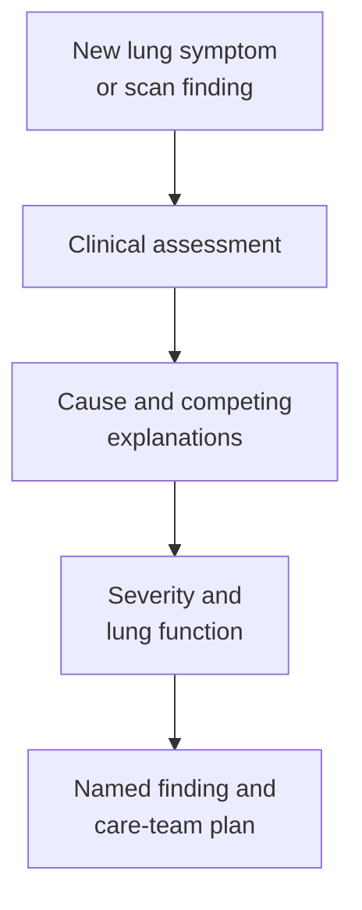

# Pneumonitis

## In one sentence

Pneumonitis is inflammation of lung tissue whose cause and severity require clinical assessment.

## The intuition

Think of the lungs as a huge surface where air and blood meet. Irritation and inflammation can make that exchange harder. “Pneumonitis” names an inflammatory lung problem, much as “engine trouble” names a problem without identifying the broken part. The analogy stops there: lungs are living tissue, and several causes can act together.

## How it works

[Inflammation](/wiki/education/concepts/immunology/the-immune-system/inflammation) changes cells, signals and tissue function. In the lungs, it can affect the air sacs and surrounding tissue. The word pneumonitis does not establish one cause. Radiation, medicines, inhaled substances, infection and other diseases can enter the assessment. In cancer-treatment reports, it often refers to noninfectious lung injury; check the report's definition. [NCI definition](https://www.cancer.gov/publications/dictionaries/cancer-terms/def/pneumonitis).

One important setting is an [immune-related adverse event (irAE)](/wiki/education/concepts/therapeutics/toxicities-and-supportive-care/immune-related-adverse-event) after checkpoint inhibition. Immune regulation has changed, and healthy lung tissue may be injured. This is a clinical attribution, not proof from a cough or one immune marker. Treatment timing matters, including previous treatment; an immune effect may appear after treatment has stopped. [Pembrolizumab label, section 5.1](https://dailymed.nlm.nih.gov/dailymed/fda/fdaDrugXsl.cfm?setid=9333c79b-d487-4538-a9f0-71b91a02b287).

Symptoms can include cough or breathlessness. Some cases first appear on imaging without obvious symptoms. A **computed tomography (CT) scan**, which uses X-rays to form cross-sectional images, can show abnormal lung patterns, but similar appearances can have different causes. Infection, cancer involving the lungs, fluid and other treatment effects remain relevant competing explanations. [SITC guideline](https://pmc.ncbi.nlm.nih.gov/articles/PMC8237720/).

*The assessment separates an observation, its cause and its consequences; it is not a home diagnostic pathway.*

## Why it matters in cancer

A treatment-associated lung event can affect safe delivery even when the tumor is responding. Conversely, a concerning scan cannot by itself establish that anticancer treatment caused the change. The clinical team combines the history, examination, oxygenation, imaging and investigations appropriate to the situation.

A useful evidence card records the treatment and population, diagnostic definition, grading version, timing, competing causes, clinical outcome and follow-up. It keeps **suspected**, **attributed** and **resolved** as different states. Improvement does not automatically establish the original cause or make restarting treatment safe.

A primary study by Naidoo and colleagues examined patients receiving checkpoint antibodies at two institutions, with advanced solid cancers at one and melanoma at the other. Lung findings and timing varied; the investigators excluded confirmed infection and malignant lung infiltration from their pneumonitis cases. That teaches why ascertainment matters. It does not supply a universal incidence or an individual rechallenge rule. [Naidoo et al., 2017](https://pubmed.ncbi.nlm.nih.gov/27646942/).

For people receiving or previously treated with checkpoint therapy, new or worsening cough, chest pain or breathlessness should be reported promptly to the treating team. Severe breathing difficulty warrants urgent medical assessment. The product's symptom-reporting instructions and the team's emergency plan matter. [Pembrolizumab label, section 17](https://dailymed.nlm.nih.gov/dailymed/fda/fdaDrugXsl.cfm?setid=9333c79b-d487-4538-a9f0-71b91a02b287).

## Common confusions

- **Pneumonitis versus pneumonia:** oncology often uses these for noninfectious injury and infection, respectively. Naming conventions do not replace a cause assessment or rule out coexistence.
- **Scan pattern versus diagnosis:** an abnormal pattern is evidence to interpret, not a unique fingerprint of checkpoint toxicity.
- **Less inflammation versus full recovery:** symptoms, oxygen needs and imaging can recover on different timetables.
- **Observed recurrence versus personal risk:** a recurrence proportion depends on who restarted, their prior event and the follow-up.

## Try it

Fictional patient Lila develops a cough after checkpoint treatment. Her scan shows new hazy areas. A reader says, “The scan proves immune pneumonitis.” What is missing?

**Answer:** Clinical attribution and assessment of severity and competing causes. The scan supports a lung problem; it cannot identify its cause alone. Lila needs clinical evaluation rather than a diagnosis inferred from this teaching example.

## Explain it back

“Pneumonitis names ___; deciding what caused it requires ___.” One answer: “lung inflammation; the treatment history and clinical assessment of competing explanations.”

## Related concepts

- [Immune-checkpoint inhibitors](/wiki/education/concepts/therapeutics/immunotherapy/immune-checkpoint-inhibitor)
- [Immune-related adverse events](/wiki/education/concepts/therapeutics/toxicities-and-supportive-care/immune-related-adverse-event)

## Sources and scope

Source-checked October 9, 2026; expert and learner review pending. General lung-toxicity vocabulary; the example is fictional. No personal diagnosis, management or restart recommendation is supplied.

- [NCI: pneumonitis](https://www.cancer.gov/publications/dictionaries/cancer-terms/def/pneumonitis) — broad definition and possible causes.
- [Brahmer et al., 2021: Society for Immunotherapy of Cancer (SITC) guideline](https://pmc.ncbi.nlm.nih.gov/articles/PMC8237720/) — checkpoint-related lung assessment and varied imaging appearances.
- [Naidoo et al., 2017](https://pubmed.ncbi.nlm.nih.gov/27646942/) — primary two-institution checkpoint-toxicity study; definition and population limit transfer.
- [Pembrolizumab prescribing information, revised July 2026, sections 5.1 and 17](https://dailymed.nlm.nih.gov/dailymed/fda/fdaDrugXsl.cfm?setid=9333c79b-d487-4538-a9f0-71b91a02b287) — delayed reactions and prompt reporting of new lung symptoms.

<!-- BEGIN GENERATED USED IN -->
## Used in

- [Read the jobs in the treatment plan](/wiki/education/guides/treating-early-tnbc/01-read-the-jobs-in-the-plan)
<!-- END GENERATED USED IN -->
