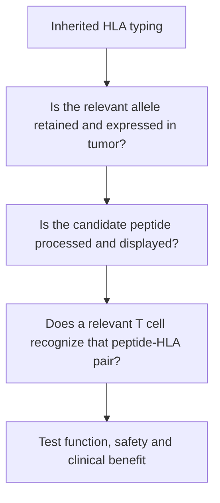

# HLA and antigen presentation in vaccine design

**A peptide target belongs with its presenting [human leukocyte antigen (HLA)](/wiki/education/concepts/immunology/antigen-presentation/hla) molecule; a matched name alone does not prove tumor recognition.**

**Before you start:** [human leukocyte antigen (HLA)](/wiki/education/concepts/immunology/antigen-presentation/hla), [antigen and epitope](/wiki/education/concepts/immunology/antigen-presentation/antigen-and-epitope), and [T-cell receptor (TCR)](/wiki/education/concepts/immunology/t-cells/t-cell-receptor).

**You will be able to:** Read a fictional typing result, separate four stages of evidence, and spot a comparison made with the wrong allele or prediction output.

## The intuition

Two display stands can hold different shapes of object. A peptide that fits one HLA molecule need not fit another, and a receptor recognizes the peptide together with its stand. A vaccine design therefore starts with both candidate tumor sequences and the person's presentation system.

That is a useful first constraint. Several further steps still stand between a candidate sequence and effective tumor-directed immunity.

## Read a fictional HLA report

[HLA typing and nomenclature](/wiki/education/concepts/immunology/antigen-presentation/hla-typing-and-nomenclature) describe inherited allele versions. HLA is the human major histocompatibility complex (MHC). A simplified **fictional** report reads:

| Locus | Allele from one inherited copy | Allele from the other copy |
| --- | --- | --- |
| HLA-A | HLA-A*02:01 | HLA-A*24:02 |
| HLA-B | HLA-B*07:02 | HLA-B*08:01 |
| HLA-C | HLA-C*07:01 | HLA-C*07:02 |

In `HLA-A*02:01`, `HLA-A` names the gene, `02` names an allele group, and the next field distinguishes the protein sequence. Further fields can distinguish synonymous coding or noncoding differences. Some names also have expression suffixes: for example, `N` means a null allele. Read the laboratory's resolution and ambiguity notes before assuming a report settles every sequence question.

People can share these alleles, so the report is not a unique barcode. HLA-C*07:01 and HLA-C*07:02 also share a first field without being interchangeable proteins. A study performed with one allele needs evidence before its peptide or receptor findings can be transferred to another.

## Class I and class II serve different recognition routes

| System | Main display context | Conventional reader |
| --- | --- | --- |
| Class I, including HLA-A, HLA-B and HLA-C | Most nucleated cells; commonly intracellular protein-derived peptides | CD8 T cells |
| Class II, including HLA-DR, HLA-DP and HLA-DQ | Mainly professional antigen-presenting cells, with inducible expression elsewhere | CD4 T cells |

Typical class-I peptides are shorter than class-II peptides, although lengths and processing vary. CD4 help can support a response, and some CD4 cells have cytotoxic functions. Detecting a helper response does not by itself demonstrate that a tumor displays the same target through class I.

## Keep four observations separate

Typing answers the first question. Tumor measurements address the next questions. Changes in [antigen-processing machinery](/wiki/education/concepts/immunology/antigen-presentation/antigen-processing-machinery) can interrupt the chain after an accurate typing result.

[Beta-2 microglobulin (B2M)](/wiki/education/concepts/immunology/antigen-presentation/b2m) supports classical class-I structure. Its loss can affect several class-I targets together without removing class-II presentation by that same mechanism. RNA expression alone does not establish assembled surface peptide–HLA.

[Binding prediction](/wiki/education/concepts/measurement/computational-analysis/binding-prediction) is a computational filter. Predicted affinity, eluted-ligand scores and percentile ranks describe different outputs. Keep the allele, model version and output label attached. A 0.5% rank is not a 99.5% chance of clinical benefit. Training coverage also varies by allele; weak coverage calls for additional scrutiny rather than a blanket claim that an allele cannot present useful targets.

## Worked example: the missing bridge

Using the fictional report above, a team predicts strong binding of peptide P to HLA-A*02:01. Another experiment finds that a receptor recognizes P on HLA-A*24:02. The tumor sample contains RNA for the source protein.

These observations do not yet connect into one demonstrated target. The receptor experiment concerns a different peptide–HLA surface. The RNA result supports source expression, rather than naturally processed peptide display. Request matched-allele recognition evidence and assess whether the tumor retains and displays the relevant pair. A well-controlled tumor-recognition experiment can then test a more direct functional claim.

## Where clinical observations fit

The TNBC-MERIT study described B2M-associated presentation escape in a relapse specimen. That observation illustrates a possible failure mode in a particular small study; it does not supply an individual's recurrence probability or prescribe a rescue treatment.

Surface-target [chimeric antigen receptors (CARs)](/wiki/education/concepts/therapeutics/cell-therapies/car-anatomy) can avoid that particular peptide–HLA recognition requirement. Natural killer (NK) cells can respond to altered inhibitory and activating signals. Neither route becomes automatically effective because HLA presentation is lost: target availability, cell access, activating signals, safety and clinical evidence still matter.

## Try it

A candidate has an excellent prediction for HLA-C*07:01. The patient's report lists HLA-C*07:02. Is “both are HLA-C*07” enough to accept the score?

**Answer:** No. The names identify different protein variants. Request the prediction for the reported allele and check its resolution and model support. Even an appropriate prediction would still leave presentation, recognition and outcome questions.

## Explain it back

Tell a friend why inherited typing, tumor retention, peptide display and T-cell recognition need separate evidence. Include one experiment that would move the candidate beyond prediction.

## Takeaway

**Keep the exact peptide–HLA pair attached to every claim, and ask which step was actually measured.**

**Next:** [Read a candidate design board](/wiki/education/designing-a-vaccine/04-how-to-read-a-neoantigen-design-board), where these distinctions become columns in an evidence ledger.

## Sources

Source-checked October 9, 2026. The typing report, peptide and receptor comparison are fictional. Expert and learner review remain pending.

- [Official HLA nomenclature](https://hla.alleles.org/pages/nomenclature/naming_alleles/), for allele fields and expression suffixes.
- [Official NetMHCpan-4.1 documentation](https://services.healthtech.dtu.dk/services/NetMHCpan-4.1/), for prediction tasks and percentile ranks.
- [Sarkizova and colleagues: HLAthena](https://www.nature.com/articles/s41587-019-0322-9), a primary allele-specific presentation dataset and modeling study.
- [TNBC-MERIT primary paper](https://www.nature.com/articles/s41586-025-10004-2), for the scoped presentation-escape observation.
