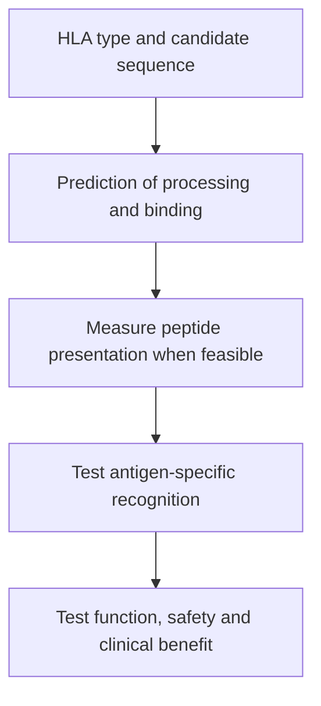

# HLA and antigen presentation in vaccine design

**Before you start:** [human leukocyte antigen (HLA)](/wiki/education/concepts/immunology/antigen-presentation/hla), [beta-2 microglobulin (B2M)](/wiki/education/concepts/immunology/antigen-presentation/b2m), [T-cell receptor (TCR)](/wiki/education/concepts/immunology/t-cells/t-cell-receptor).

**You will be able to:** Explain how HLA type constrains a candidate peptide without proving immune recognition.

A personalized vaccine design must consider both the tumor's candidate antigens and the patient's antigen-presentation system. **Human leukocyte antigen (HLA)** is the human major histocompatibility complex (MHC). These molecules display peptides that T cells can inspect.

**Before starting:** [HLA](/wiki/education/concepts/immunology/antigen-presentation/hla) is the canonical definition; [TCRs](/wiki/education/molecular-profiling/tcr-and-tcr-sequencing) explain recognition.

## Class I and class II

| System | Main display context | Conventional reader |
|---|---|---|
| Class I, including HLA-A, HLA-B and HLA-C | Most nucleated cells; commonly intracellular protein-derived peptides | CD8 T cells |
| Class II, including HLA-DR, HLA-DP and HLA-DQ | Mainly professional antigen-presenting cells, with inducible expression elsewhere | CD4 T cells |

Typical class-I peptides are shorter than class-II peptides, but lengths and processing vary. CD4 help can support a response; some CD4 cells also have cytotoxic functions. Class II is not merely a preliminary substitute for class-I recognition.

## Type, display and recognition

*A predicted fit is one filter; each subsequent claim needs its own evidence.*

An **HLA type** identifies inherited allele versions. People can share alleles; the type is not a unique barcode. A mutation can produce a candidate peptide suited to one allele and poorly suited to another.

Tumor cells may lose an allele or alter presentation machinery. **B2M**, beta-2 microglobulin, supports classical class-I HLA structure. B2M loss can compromise many class-I targets without removing class-II presentation by the same mechanism. RNA expression alone does not establish assembled surface peptide–HLA.

## Prediction quality is allele-specific

Algorithms use experimental binding or presentation data and sequence features. Training coverage differs by allele. HLA-C often has lower surface abundance than HLA-A/B, and allele representation can affect model confidence. That does not make HLA-C broadly more permissive, nor does one atlas's predicted yield establish that a patient's HLA-C targets are absent.

New binding, presentation or recognition experiments can address uncertainties, but these assays test different things. Calibrating a predictor requires held-out evaluation; cytokine responses cannot simply be treated as peptide-binding measurements.

## Escape does not select the rescue

Losing a peptide or the relevant HLA display can limit a vaccine-induced TCR (T-cell receptor) response. In TNBC-MERIT, a relapse specimen illustrated B2M-associated presentation escape. It is a mechanistic observation from a small study, not a personal recurrence probability.

Surface-target [chimeric antigen receptors (CARs)](/wiki/education/concepts/therapeutics/cell-therapies/car-anatomy) or engagers can avoid that particular recognition requirement. NK (natural killer)-cell missing-self biology may also become relevant. Effective killing still depends on activating signals, target availability, trafficking and clinical evidence. HLA loss does not make a tumor automatically susceptible to any of these therapies.

## Try it

A candidate binds HLA strongly in a prediction. What additional question matters most before calling it an effective vaccine target?

**Explain it back:** Whether the relevant tumor cells process and display it, whether useful T cells recognize it, and whether that response safely changes clinical outcomes.

## Explain it back

HLA matching constrains design; presentation and recognition must be distinguished from predicted binding.

## Takeaway

**HLA matching constrains design; presentation and recognition must be distinguished from predicted binding.**

**Next:** [Immunopeptidomics](/wiki/education/designing-a-vaccine/03-immunopeptidomics). Case-specific interpretation belongs in [molecular profile](/wiki/care/molecular-profile) and [the HLA/B2M question](/wiki/questions/hla-b2m-loss).

## Sources

Checked October 8, 2026.

- [Sarkizova et al., HLAthena](https://www.nature.com/articles/s41587-019-0322-9) — primary presentation dataset and prediction methods.
- [TNBC-MERIT primary paper](https://www.nature.com/articles/s41586-025-10004-2).
- [FDA tebentafusp review](https://www.accessdata.fda.gov/drugsatfda_docs/nda/2022/761228Orig1s000ChemR.pdf) — allele-specific peptide–HLA recognition.
