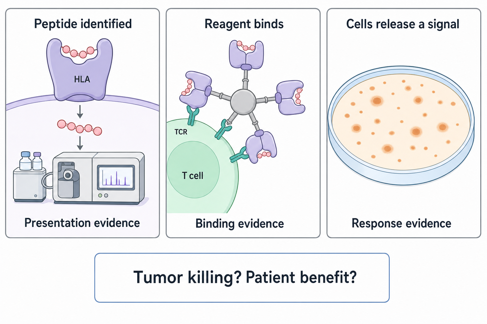

# Measure presentation, binding and response

**Three useful immune measurements can agree without proving the final clinical claim.** Read each result as an answer to a specific question. This is step five of the [vaccine guide](/wiki/education/guides/personalized-cancer-vaccine/index).

**Before you start:** [Human leukocyte antigen (HLA)](/wiki/education/concepts/immunology/antigen-presentation/hla) displays protein fragments. [Immunopeptidomics](/wiki/education/concepts/measurement/proteins-and-spatial/immunopeptidomics) identifies recovered fragments. [Peptide–HLA multimers](/wiki/education/concepts/measurement/immune-monitoring/peptide-hla-multimer-staining) label binding cells. [Enzyme-linked immunospot (ELISpot)](/wiki/education/concepts/measurement/immune-monitoring/elispot) measures secretion under test conditions.

## Where this step sits

You have a candidate board with evidence and open questions. Before treating a score as a target, ask what an experiment could add. The aim is to reduce a named uncertainty, not simply collect more positive-looking graphs.

## The intuition: ask the experiment a smaller question

Suppose a candidate has a credible mutation and a promising binding prediction. You might reasonably feel excited. Now pause and ask: was the peptide actually recovered with HLA? Can a receptor bind it? Do cells respond? Each question deserves its own evidence.

The short methods pages explain how the assays work. Here we connect their outputs. A measurement can be useful even when it leaves the next step open; that is how an evidence chain becomes more informative.

## Three assays, three questions

*Presentation, binding and secretion each answer one question; none alone establishes patient benefit. The ELISpot panel is schematic: in the assay, cells incubate on the capture membrane.*

| Measurement | The question it answers | What remains open |
|---|---|---|
| Immunopeptidomics | Which HLA-associated peptides were identified in this preparation? | Cell of origin, completeness, recognition and function |
| Peptide–HLA multimer staining | Which sampled cells bound this specified reagent? | Activation, natural tumor recognition and safe killing |
| Peptide-stimulated ELISpot | Did sampled cells release the measured molecule after stimulation? | Which receptors responded and whether naturally presenting tumor cells are recognized |
| Controlled tumor-cell assay | Did the cells recognize or affect the tested tumor cells under defined conditions? | Tissue safety, access, persistence and patient benefit |

These are complementary experiments, not interchangeable substitutes. Not every study uses all of them. Read the peptide sequence, allele, cell preparation, controls and analysis method before comparing the answers.

## Natural presentation changes the question

Adding synthetic peptide to cells can provide abundant target without asking the tumor to make or process it. That helps test a response, but can bypass a weak biological step. A positive result after artificial loading needs a separate bridge to natural tumor recognition.

For HLA-associated peptide identification, mixed tissue adds another issue: the peptide may come from cancer, immune or stromal cells. Detection can support presentation in the sampled preparation without proving tumor exclusivity. Recovery and identification are also incomplete, so non-detection needs sensitivity context.

The [T-cell receptor (TCR)](/wiki/education/concepts/immunology/t-cells/t-cell-receptor) is only part of a responding cell. Its state and signaling matter too. A binding reagent can label cells whose functional behavior differs, while a secretion assay may miss cells that use another response program.

## Worked example: four lines in an evidence notebook

Here is an invented experiment. No line is a personal treatment rule.

1. **Peptide A is identified in a mixed-tissue HLA preparation.** Record the identification confidence and ask which cells supplied it.
2. **An A–HLA multimer labels blood cells.** Record the allele, staining controls and denominator. These cells bind the test reagent.
3. **Post-dose cells make more spots when stimulated with A.** Check background, viability and whether the cells were expanded in culture first.
4. **Recognition of naturally presenting tumor cells is not yet tested.** Keep this line visible. Three positive readouts do not fill it in.

The next experiment should address that gap. If a controlled tumor-cell test is positive, the evidence becomes stronger for that target under those conditions. Healthy-tissue specificity and clinical benefit still require their own evidence.

## What can go wrong at this step

A negative assay can reflect poor sample quality, incomplete recovery or the wrong reagent. A positive assay can reflect background, artificial loading or culture selection. Check the controls before interpreting either.

Matched methods also matter over time. Changing cell preparation or counting rules between baseline and follow-up can create an apparent response. Keep the specimen, method version and analysis rules tied to each result.

## Try it

A candidate was not detected by immunopeptidomics, but peptide-loaded cells trigger a strong ELISpot response. Does this prove that the tumor naturally displays it?

**Answer:** No. The response supports activity against the test stimulus. Non-detection may be biological or technical, and artificial loading bypasses natural presentation. A suitable natural-presentation experiment would address the unresolved question.

## Explain it back

“This assay measured ___ under ___; it has not yet established ___.” One answer: “secretion after peptide stimulation; those laboratory conditions; safe recognition of naturally presenting tumor cells.”

## Takeaway

**Name the measured step, then keep the untested steps visible.**

**Next:** [Write the vaccine message](/wiki/education/guides/personalized-cancer-vaccine/06-writing-the-message).

## Sources and scope

Source check: October 9, 2026. Assay teaching and a fictional example; expert and learner review pending.

- [HLA-peptide isolation and identification protocol](https://www.nature.com/articles/s41596-019-0133-y).
- [Primary antigen-specific T-cell labeling study](https://pubmed.ncbi.nlm.nih.gov/8810254/).
- [Peptide-specific ELISpot protocol](https://pmc.ncbi.nlm.nih.gov/articles/PMC8410284/).
- [Primary neoantigen prediction/recognition benchmark](https://pubmed.ncbi.nlm.nih.gov/33038342/).
