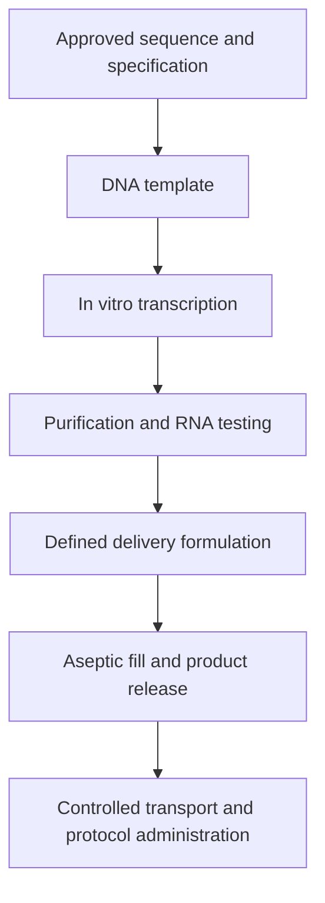

# How a personalized vaccine is manufactured

**Personalization chooses what to encode; manufacturing turns the design into a defined product that can be tested and released.** This is step seven of the [vaccine guide](/wiki/education/guides/personalized-cancer-vaccine/index).

**Before you start:** [Messenger RNA (mRNA) construct anatomy](/wiki/education/concepts/engineering-and-manufacturing/nucleic-acid-design/mrna-construct-anatomy) describes the message. [In vitro transcription](/wiki/education/concepts/engineering-and-manufacturing/nucleic-acid-design/in-vitro-transcription) explains RNA synthesis. [RNA-lipoplex](/wiki/education/concepts/engineering-and-manufacturing/delivery-vehicles/rna-lipoplex) introduces one formulation. [Good manufacturing practice (GMP) and batch release](/wiki/education/concepts/engineering-and-manufacturing/cmc-and-quality/gmp-and-batch-release) explain the quality system.

## Where this step sits

The target windows and message have been specified. The next task is to make the exact product, with a controlled route from approved design to administered lot. Quality, access authorization and evidence of benefit answer different questions.

## The intuition: a recipe is the beginning

A kitchen needs more than ingredient names: preparation, handling and criteria for a usable batch matter too. A vaccine adds biological activity and a defined delivery formulation. The analogy stops at clinical benefit. Consistent production does not prove that the encoded targets are useful or that the treatment helps patients.

## The format changes the factory

| Format | What is manufactured | A question that remains |
|---|---|---|
| Synthetic peptide | Defined amino-acid chains plus their formulation | How will antigen-presenting cells process or load them and prime a response? |
| mRNA with [lipid nanoparticles (LNPs)](/wiki/education/concepts/engineering-and-manufacturing/delivery-vehicles/lipid-nanoparticle) | RNA and a specified particle formulation | Which cells translate the message after the intended route? |
| [RNA-lipoplex (RNA-LPX)](/wiki/education/concepts/engineering-and-manufacturing/delivery-vehicles/rna-lipoplex) | RNA complexed with specified lipids | How do this composition and route affect expression and sensing? |
| DNA or a viral vector | A DNA-containing product or engineered vector | Which cells express the cassette, for how long, and with what vector-specific risks? |

[Solid-phase peptide synthesis (SPPS)](/wiki/education/concepts/engineering-and-manufacturing/cmc-and-quality/peptide-synthesis-spps) assembles selected amino-acid chains on a support, then releases and purifies them. RNA manufacture instead produces instructions. Neither format dispenses with identity, purity, stability, handling and functional testing.

## Follow RNA from template to formulated lot

*Each arrow is a handoff with specifications, rather than a promise that a sequence file becomes a usable vial.*

[In vitro transcription](/wiki/education/concepts/engineering-and-manufacturing/nucleic-acid-design/in-vitro-transcription) uses enzymes to make RNA outside living cells. The DNA is the manufacturing pattern, not the intended payload of a conventional mRNA vaccine. The approved design specifies the cap, untranslated regions, coding sequence, poly(A) strategy and chemical building blocks.

[Modified nucleosides](/wiki/education/concepts/engineering-and-manufacturing/nucleic-acid-design/modified-nucleosides) can change sensing and translation, but are not a universal requirement for cancer RNA vaccines. Chemistry, sequence and purification are separate decisions.

Purification addresses residual DNA, proteins, incomplete RNA and [double-stranded RNA impurities](/wiki/education/concepts/engineering-and-manufacturing/nucleic-acid-design/dsrna-impurities-and-purification). Ask what each method removes and what each assay detects. Changing RNA chemistry and removing unwanted double-stranded RNA solve different problems. A purity result cannot establish integrity or sterility by itself.

Formulation then defines how the RNA is packaged and delivered. Particle composition, RNA amount and integrity, particle properties and relevant biological activity belong to that product's specification. Aseptic filling, storage and transport preserve the material until administration. Shelf life and allowable storage excursions come from product-specific stability evidence.

## Worked comparison: three published RNA-vaccine protocols

All three examples below encode personalized antigens. They differ in formulation, route, cancer setting and treatment sequence. Some papers call lipoplexes nanoparticles; inspect the actual formulation rather than relying on the label alone. Read each row as a study record, not as a dosing recommendation.

| Study product and population | Formulation and route | Published protocol context | What the comparison can establish |
|---|---|---|---|
| **TNBC-MERIT**, early-stage triple-negative breast cancer after standard treatment | Non-nucleoside-modified uridine RNA; **RNA-LPX, intravenous** | Phase I, single arm; the personalized course used eight administrations, with six weekly followed by two every other week | Feasibility and immune-response findings in this setting; it does not isolate recurrence-prevention benefit |
| **Autogene cevumeran**, Rojas et al., resected pancreatic ductal adenocarcinoma | Uridine RNA; **RNA-LPX, intravenous** | Phase I, single arm; surgery followed by atezolizumab, vaccine priming, chemotherapy and a later vaccine booster | Immune-response and clinical associations within a combined treatment sequence; it cannot isolate vaccine benefit |
| **mRNA-4157/V940**, KEYNOTE-942, completely resected high-risk melanoma | **RNA-LNP, intramuscular**; the category name does not disclose an interchangeable chemical recipe | Randomized phase IIb; vaccine up to nine administrations every three weeks plus pembrolizumab versus pembrolizumab alone | Tests adding this product to this treatment backbone in this population; it does not compare LPX with LNP |

The TNBC-MERIT paper describes two RNA strands, each encoding up to ten selected target windows. This architecture is a specific [multi-epitope design](/wiki/education/concepts/engineering-and-manufacturing/nucleic-acid-design/multi-epitope-constructs), not a requirement for every RNA vaccine. Its methods explicitly use ordinary uridine. The pancreatic study also uses an RNA-lipoplex approach, but its cancer and combined treatment sequence differ.

KEYNOTE-942 supplies the randomized melanoma comparison and intramuscular schedule. A primary V940 protocol abstract explicitly describes LNP encapsulation. Neither “mRNA” nor “LNP” supplies the complete lipid composition, cap, RNA chemistry, impurity limits or stability specification. Do not fill missing details from a different vaccine's methods.

A TNBC-MERIT run-in subgroup also received a bridging shared-antigen vaccine. This is another reason to read the actual participant protocol when interpreting a schedule. Cross-trial percentages cannot tell us which formulation is intrinsically more effective, and these examples do not establish equivalence of routes or manufacturing processes.

## Four reviews answer different questions

A [contract development and manufacturing organization (CDMO)](/wiki/education/concepts/engineering-and-manufacturing/cmc-and-quality/cdmo-role) can perform agreed development, manufacturing or testing activities. Name who owns the design, approves changes and reviews quality. Outsourcing an activity does not erase applicable responsibilities.

| Review | Question |
|---|---|
| Antigen and construct | Does the exact design encode plausible, appropriately specific targets? |
| Handoff and change control | Which version is approved, and what happens after a proposed edit? |
| Manufacturing and release | Does this lot meet its identity, purity, potency, sterility and formulation criteria? |
| Clinical and regulatory | Who owns the protocol, authorization, administration and adverse-event monitoring? |

[Chain of identity and custody](/wiki/education/concepts/engineering-and-manufacturing/cell-manufacturing/chain-of-identity-and-custody) connects the intended recipient, construct version, lot and handoffs. A passing assay on a wrongly assigned vial cannot repair that connection.

[Potency assays](/wiki/education/concepts/engineering-and-manufacturing/cmc-and-quality/potency-assays) test relevant biological activity. An expression assay may address part of an RNA product's mechanism. It does not prove peptide presentation, tumor recognition or clinical benefit.

A fictional manufacturer shortens a spacer to improve production. The team records a controlled revision, reassesses affected biology and connects the released lot to the final specification. A “manufacturability edit” can still change antigen processing. [Manufacturing comparability](/wiki/education/concepts/engineering-and-manufacturing/cmc-and-quality/manufacturing-comparability) asks whether earlier evidence remains relevant after a change. Matching RNA amounts and passing routine release limits alone may miss important differences.

Use [platform versus personalized components](/wiki/education/concepts/engineering-and-manufacturing/cmc-and-quality/platform-vs-personalized-components) to locate the change: a patient-specific sequence and a shared formulation raise different review questions.

## What can go wrong at this step

A batch may have the correct sequence but inadequate integrity or functional activity. A new formulation may change which cells translate the message. A storage excursion needs an assessed disposition. Timelines also include testing, review, queue time and failed-lot handling; no universal sequence-to-vial duration applies.

## Try it

A fictional RNA-LNP product passes its identity test. Its team borrows an intravenous RNA-LPX study's handling instructions and claims that nondetectable dsRNA means the lot is sterile. Identify two unsupported transfers.

**Answer:** Formulation and route do not justify borrowing handling or stability requirements. A dsRNA assay answers one impurity question, not microbial sterility. Use the product's own validated specifications and complete release criteria.

**Second card:** A fictional team moves manufacture to a new facility. The final RNA amount is unchanged. Is that enough to bridge the process?

**Answer:** No. Assess the properties the change could affect, including impurities, formulation, activity and stability. The relevant evidence depends on the actual change and product.

## Explain it back

“Shared targets do not make products interchangeable because ___; a passing release panel does not prove ___.”

One answer: “RNA design, chemistry, formulation, route and protocol can differ; tumor recognition or clinical benefit.”

## Takeaway

**Compare the exact message, formulation, route and protocol, then keep product quality separate from evidence that patients benefit.**

**Next:** [Dose and measure response](/wiki/education/guides/personalized-cancer-vaccine/08-dosing-and-measuring-response).

## Sources and scope

Protocol source check: October 9, 2026; manufacturing-role and peptide-synthesis additions checked October 10, 2026. Expert and learner review pending. Published protocols describe studies, not recommendations for dose, schedule or access. Practice cards are fictional; no head-to-head LPX-versus-LNP benefit comparison is supplied.

- [Sahin et al., 2026: TNBC-MERIT primary study and manufacturing methods](https://www.nature.com/articles/s41586-025-10004-2).
- [Rojas et al., 2023: autogene cevumeran pancreatic-cancer study and protocol](https://www.nature.com/articles/s41586-023-06063-y).
- [Weber et al., 2024: randomized KEYNOTE-942 melanoma trial](https://pubmed.ncbi.nlm.nih.gov/38246194/).
- [AACR primary protocol abstract CT251, 2025: V940 formulation and route](https://doi.org/10.1158/1538-7445.AM2025-CT251) — a formulation description, not outcome evidence for KEYNOTE-942.
- [Karikó et al., 2011: experimental purification and translation of mRNA](https://pubmed.ncbi.nlm.nih.gov/21890902/).
- [FDA: vaccine chemistry, manufacturing and controls guidance](https://www.fda.gov/media/73614/download).
- [FDA, 2016: contract manufacturing and quality agreements](https://www.fda.gov/media/86193/download) — commercial scope; investigational-work limits are explained in the linked CDMO concept.
- [Primary neoantigen peptide-synthesis study, 2020](https://www.nature.com/articles/s41598-019-56943-5) — synthesis and purification, not clinical efficacy.
