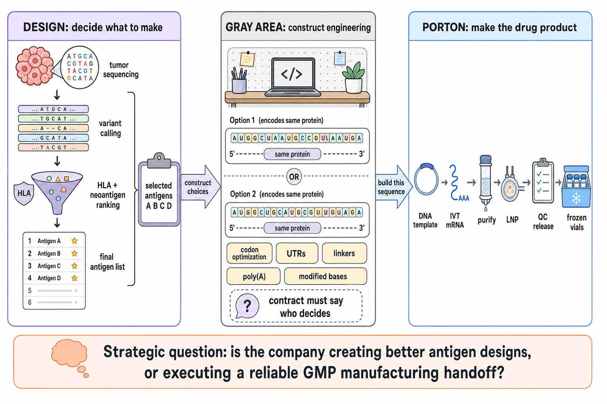
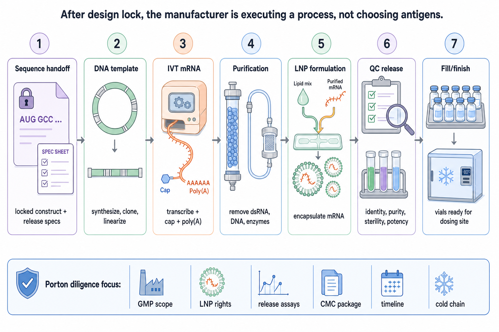

# Porton mRNA manufacturing handoff

This page answers a narrow operational question: if the personalized-vaccine partner uses **Porton** as the mRNA manufacturing partner, what exactly is Porton doing, and what still belongs to the vaccine-design company?

Naming note: Porton's public mRNA/CDMO pages are under **Porton Advanced Solutions** and **Porton Pharma Solutions**. If a proposal says "Porton Therapeutics," confirm the exact contracting entity, facility, quality system, and whether the quote covers GMP mRNA drug product, GMP LNP drug product, or only an engineering/research-grade LNP run.

The clean boundary is:

- **Design decides what sequence should go into the patient.**
- **Manufacturing turns the specified sequence into released vaccine vials.**



---

## The one-sentence split

For a personalized mRNA cancer vaccine, the sponsor or design company usually owns the scientific wager:

```text
Patient tumor data -> mutations -> HLA-presentable antigen choices -> final vaccine payload
```

Porton, as a CDMO-style partner, should usually own the execution lane:

```text
Locked sequence file -> GMP template -> mRNA -> LNP formulation -> QC release -> frozen vials
```

That distinction is strategically important. A company that gets paid because it can identify better patient-specific neoantigens is a **design company**. A company that gets paid because it can reliably make the specified product under GMP is a **manufacturing company**. Many organizations can manufacture mRNA. Far fewer have strong evidence that they can consistently identify the best neoantigens for one patient.

---

## What Porton's public material supports

Porton's public pages describe an mRNA/LNP CDMO platform that includes:

- Template generation from plasmid.
- mRNA synthesis by IVT, with capping and poly(A) tailing.
- mRNA purification using chromatography and TFF-style concentration.
- LNP delivery/formulation capabilities.
- Analytical development, QC, CMC writing, regulatory-submission support, and IND-enabling support.

Porton's GMP manufacturing page also says the company offers non-GMP and GMP manufacturing for mRNA drug substance and drug product, CMC regulatory support, plasmid GMP manufacturing and linearization, IVT, capping/tailing, multi-step purification, QC assay packages, and fill/finish capacity.

The caution flag is the LNP wording: one Porton page describes "LNP delivery formulation," while the GMP manufacturing page specifically mentions **research-grade LNP formulation for fill/finish**. That may be a website wording artifact, but it should be treated as a diligence question until Porton confirms the exact GMP LNP drug-product scope for a personalized vaccine.

Porton also advertises delivery benchmarks: 10 weeks for mRNA drug products for investigator-initiated trials, 4 months for an mRNA-LNP engineering run, three global IND approvals, and multiple ongoing mRNA IND projects. Those are useful manufacturing capability signals. They are not, by themselves, evidence that Porton has solved personalized cancer-vaccine antigen selection.

---

## Porton manufacturing lane

Once the design team says "build this sequence," the handoff should look like a controlled CMC package, not a casual FASTA file.



### 1. Sequence handoff

The manufacturer receives a locked digital sequence and manufacturing instructions:

- Final nucleotide sequence, not just the peptide list.
- Construct map: 5' cap strategy, 5' UTR, signal sequence if used, antigen order, linkers/spacers, stop codon, 3' UTR, poly(A) strategy.
- Modified-nucleotide plan.
- Batch size, dose count, concentration, fill volume, container closure, storage conditions, and release criteria.
- Regulatory route: single-patient IND, investigator-initiated trial, or another sponsor-controlled path.

The design team can hand Porton a complete construct, or Porton can help engineer one. Those are very different relationships.

### 2. DNA template generation

The mRNA sequence is first made as DNA, usually through plasmid construction followed by linearization. This stage bakes in many upstream choices: codons, UTRs, antigen order, linkers, helper epitopes, signal sequences, and the poly(A) template.

If Porton is merely executing a fully specified construct, this is manufacturing. If Porton is choosing codons, UTRs, linker design, or construct architecture, Porton is participating in construct design.

### 3. IVT mRNA synthesis

The linearized DNA template is transcribed into RNA by in-vitro transcription. Porton's public materials describe IVT mRNA production with capping and poly(A) tailing. The key controlled variables are enzyme system, nucleotide mix, capping approach, modified bases, reaction yield, and transcript integrity.

### 4. mRNA purification

IVT produces the desired RNA plus impurities: truncated RNA, double-stranded RNA, residual DNA template, enzymes, nucleotides, salts, and process-related byproducts. Purification is where the product becomes clinically plausible instead of just chemically present.

The key release-facing questions are integrity, identity, purity, residual dsRNA, residual DNA, capping ratio, poly(A) distribution, endotoxin, bioburden/sterility path, and whether any potency assay measures expression of the intended construct.

### 5. LNP formulation

The purified mRNA is encapsulated in lipid nanoparticles. This is not a trivial packaging step. The ionizable lipid, helper lipid, cholesterol, PEG-lipid, mixing process, particle size, encapsulation efficiency, and storage buffer all affect delivery, tolerability, and stability.

For a Porton relationship, the highest-value diligence questions are:

- Is the LNP formulation GMP clinical drug product, or a research/engineering run?
- Are the LNP lipids Porton's, a partner's, or sponsor-provided?
- Does the sponsor get rights to use the LNP system in the US under the planned regulatory route?
- Is there a DMF or comparable regulatory file that FDA can reference?
- Has the same LNP system been used for intramuscular mRNA vaccine dosing?

### 6. QC release

Release testing turns a manufactured batch into a usable clinical product. For a personalized mRNA-LNP vaccine, the minimum release logic should cover:

| Release area | What it asks |
|---|---|
| Identity | Is this the intended patient-specific sequence and product? |
| Purity | How much intact target mRNA vs. truncated RNA, dsRNA, residual DNA, enzymes, solvents, or lipids? |
| LNP quality | Particle size, polydispersity, encapsulation efficiency, mRNA integrity after formulation. |
| Safety | Sterility, endotoxin, bioburden, adventitious-agent logic where applicable. |
| Potency | Does the mRNA express the intended antigen construct in a relevant assay? |
| Stability | What storage temperature, retest date, thaw handling, and shipping constraints apply? |

The sponsor should know which tests are release-critical, which are characterization-only, and which are waived or replaced for a single-patient product.

### 7. Fill/finish and cold chain

The final product is filled into vials, labeled, packed, released, and shipped to the dosing site under cold-chain constraints. This is where operational details become clinical details: number of vials, overfill, thaw rules, temperature excursion handling, chain of custody, and whether all doses must remain at one site.

---

## QC split

A useful point is that "QC" is not one thing. It lives at four different interfaces, and each one needs a different reviewer.

| QC layer | Primary owner | What to check |
|---|---|---|
| **Design QC before sequence lock** | Sponsor/design team, Epitope Board, outside reviewers | Does the final construct make biological sense before it becomes a manufacturing order? |
| **Interface QC between design partner and Porton** | Sponsor plus design partner plus Porton | Is the handoff unambiguous, version-controlled, and owned by someone? |
| **Manufacturing QC inside Porton** | Porton QA/QC, sponsor CMC reviewer | Can the CDMO reliably make, test, release, and document this exact batch? |
| **Dosing-site QC after release** | PI / administering clinician / site pharmacy | Can the product be stored, thawed, administered, monitored, and combined with the clinical regimen safely? |

This split matters because a strong answer in one layer does not automatically solve the others. Porton could have excellent cleanrooms and release assays while the construct design still needs an independent review. Conversely, a biologically strong design does not guarantee that the LNP formulation, release package, cold chain, or dosing-site plan is adequate.

### Design QC before the text file leaves

Before the construct goes to Porton, an independent reviewer should sanity-check the final sequence package. This is not the same as re-running the whole neoantigen model; it is a final "does this look safe and manufacturable?" pass.

The checklist should include:

- 5' cap strategy, 5' UTR, Kozak context, open reading frame, stop codon, 3' UTR, and poly(A) strategy.
- Human-expression codon optimization.
- Antigen order, linker/spacer choices, and whether any helper epitope or signal peptide is included.
- Modified-base plan and whether the modified bases are annotated clearly enough for the manufacturer.
- RNA secondary structure: avoid obvious hairpin-heavy or highly structured regions that could impair expression.
- Human-proteome/off-target screen: look for short encoded regions that could plausibly mimic normal human proteins and create avoidable autoimmune concern.
- Version control: the exact FASTA/CSV/spec package Porton receives should be the same one the design reviewers approved.

This is the layer where the design company should be strongest. If these checks feel amateurish, that is a design-partner red flag, not a Porton red flag.

### Interface QC between design partner and Porton

The collaboration risk is not just "is the design partner good?" plus "is Porton good?" It is the touchpoint between them.

If the handoff is truly a sequence/specification file, the safety risk at the interface can be low, but only if the file is complete. The sponsor should ask for an interface-control document that names:

- The final sequence owner.
- The final sequence reviewer.
- The change-control process after sequence lock.
- Who decides cap, UTRs, Kozak context, codons, modified bases, linkers, poly(A), and LNP formulation.
- Who converts the antigen list into the final nucleotide sequence.
- Who signs off that the sequence Porton manufactures matches the sequence the Epitope Board reviewed.
- What Porton can change for manufacturability without sponsor approval.

The failure mode to avoid is "everyone thought someone else checked it." For a single-patient product, that is more likely than a spectacular technical failure.

### Manufacturing QC to ask Porton directly

The practical recommendation is to take detailed manufacturing questions directly to Porton rather than expecting the design partner or sponsor to answer them secondhand. Porton should be able to provide an itemized process/QC list for the actual proposal.

Ask Porton for:

- Cleanroom classification, air-quality controls, and environmental monitoring for template handling, IVT, purification, LNP formulation, and fill/finish.
- Raw-material controls for DNA template, enzymes, nucleotides, modified nucleotides, lipids, buffers, filters, vials, and stoppers.
- In-process controls for plasmid/template identity, linearization, IVT yield, capping ratio, poly(A), RNA integrity, and residual DNA.
- Purification controls for dsRNA, truncated RNA, residual enzymes, residual solvents/reagents, endotoxin, and bioburden.
- LNP controls for particle size, polydispersity, encapsulation efficiency, lipid composition, mRNA integrity after formulation, and storage stability.
- Release assay list with acceptance criteria, turnaround time, and which assays are required before dosing.
- Batch record, certificate of analysis, deviation/CAPA process, QA release signoff, retest policy, and failed-batch remake timeline.

If Porton's QC package is weak, that does **not** automatically rule out the design partner. It means the team can either push for a more expensive/higher-touch Porton manufacturing package, find a different CDMO, or keep the design while changing the manufacturing path.

### Dosing-site QC is a separate risk

The clinical site is not just a freezer plus an injection chair. For a personalized mRNA vaccine, the PI/dosing site needs to own:

- IND/spIND responsibility and adverse-event reporting.
- Product receipt, storage temperature, chain of custody, thawing, dose preparation, and temperature-excursion handling.
- Dosing calendar and how vaccination overlaps with pembrolizumab or any other immune therapy.
- Monitoring plan: symptoms, labs, immune-response readouts, ctDNA, and rules for holding or continuing doses.
- Who makes clinical decisions if the vaccine causes unexpected inflammation, autoimmune symptoms, or ambiguous post-dose signals.

This is why a technically excellent CDMO still does not solve the whole route-to-patient problem. Manufacturing gets the vial to the clinic; it does not replace the need for a serious clinical owner.

---

## The gray area to negotiate

The contract should say exactly who decides each construct-level feature.

| Decision | Usually belongs to | Why it matters |
|---|---|---|
| Tumor sequencing and variant calling | Sponsor/design team | Defines the candidate mutation universe. |
| HLA typing and antigen ranking | Sponsor/design team | This is the core design IP: which antigens deserve to be in the patient. |
| Final antigen selection | Sponsor/design team | Determines the therapeutic hypothesis. |
| Antigen order and linkers | Gray area | Can change processing, immunodominance, and class-I/class-II presentation. |
| Signal peptide/helper epitope | Gray area | Can change expression and immune priming. |
| Codon optimization | Gray area | Same protein, different RNA, potentially different expression. |
| UTR selection | Gray area | Can strongly affect translation and mRNA half-life. |
| Poly(A) strategy and modified bases | Gray area/manufacturing | Affects stability, innate sensing, and expression. |
| LNP formulation | Manufacturing/delivery platform | Essential to delivery; may be proprietary and regulatory-file dependent. |
| Release assays and CMC package | Manufacturer plus sponsor | Porton can prepare the package; the sponsor/physician still needs to own the regulatory responsibility. |

The gray area is where investors and partners should push hardest. If Porton is choosing codons, UTRs, linkers, helper epitopes, or LNP composition, then Porton is contributing more than commodity manufacturing. If Porton only receives a locked sequence and release spec, then Porton is the execution partner.

---

## How to read a Porton proposal

Use this checklist before treating "Porton can manufacture it" as operationally solved:

1. **Exact entity and facility:** Which Porton legal entity, which site, and which GMP modules are named?
2. **Scope:** Is the deliverable mRNA drug substance, mRNA-LNP drug product, or both?
3. **LNP status:** GMP clinical LNP drug product, engineering run, or research-grade formulation?
4. **Regulatory bridge:** Is there a DMF, master file, prior IND cross-reference, or equivalent CMC package?
5. **Single-patient fit:** Has Porton supported personalized or very-small-batch mRNA products under an IND-like route?
6. **Sequence ownership:** Who owns the final nucleotide sequence and any optimized variants?
7. **Interface control:** What exact file/spec package moves from the design partner to Porton, and who signs it?
8. **Construct engineering:** Who decides codons, UTRs, Kozak context, linkers, helper epitopes, signal peptide, poly(A), and modified nucleotides?
9. **Manufacturability edits:** Can Porton change the sequence or formulation for manufacturability, and who approves those changes?
10. **Process QC:** What are the in-process controls for template, IVT, purification, LNP formulation, and fill/finish?
11. **Potency assay:** Does release include expression of the intended antigen construct, or only analytical identity/purity?
12. **Batch plan:** How many doses, what overage, what concentration, what vial count, and what retest interval?
13. **Timeline:** What is on the critical path: DNA template, IVT, purification, LNP, QC, sterility, QA release, shipping?
14. **Cold chain:** Where can the vials be stored, shipped, thawed, and administered?
15. **Dosing site:** Who is the PI, who stores/administers the product, and who owns post-dose monitoring and adverse-event decisions?
16. **Failure plan:** If LNP formulation, QC, or sterility fails, what is the remake timeline?

---

## Strategic interpretation

If the sponsor gives Porton selected antigens A/B/C/D plus a fully locked construct, and Porton returns frozen GMP vials, Porton is primarily a manufacturing partner.

If Porton is deciding codon optimization, UTRs, linkers, modified bases, poly(A), and LNP system, then Porton is also shaping construct performance. That does not make Porton the neoantigen-design company, but it does mean some value and risk have moved from "manufacturing" into "construct engineering."

For personalized cancer vaccines, the central diligence question remains:

> Can the sponsor/design team consistently choose the right antigens for this patient?

Porton can make the handoff credible. Porton does not, by itself, answer the antigen-selection question.

---

## Cross-links

- [[wiki/education/designing-a-vaccine]] - parent pipeline.
- [[wiki/education/designing-a-vaccine/05-how-vaccines-are-manufactured]] - broader peptide-vs-mRNA manufacturing overview.
- [[wiki/treatment/therapeutics/vaccine-modalities-comparison]] - vaccine modality comparison.

## Sources

- [Porton Advanced - mRNA and LNP CDMO platform](https://www.portonadvanced.com/cdmo-solutions/mrna-and-lnp/) - public description of mRNA process, end-to-end service categories, LNP delivery/formulation, QC, CMC/regulatory support, and advertised delivery benchmarks.
- [Porton Advanced - GMP manufacturing](https://www.portonadvanced.com/cdmo-solutions/gmp-manufacturing/) - public description of non-GMP/GMP manufacturing, mRNA DS/DP modules, QC packages, and fill/finish capacity.
- [Porton Pharma Solutions - corporate CDMO overview](https://www.portonpharma.com/en) - public overview of Porton Advanced as the ATMP CRO/CDMO arm and Porton's global site footprint.
- User-provided QC discussion transcript (June 8, 2026) - design/manufacturing/interface/dosing-site QC framing; private attachment, not linked.
