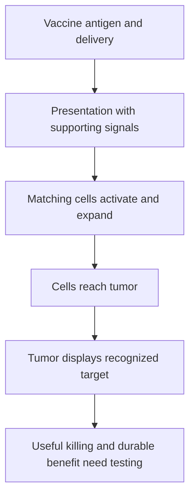

# Why a personalized cancer vaccine can help

**A vaccine can prime and expand useful antigen-reactive cells; it does not normally rewrite their receptors.** This lesson starts the [personalized-vaccine guide](/wiki/education/guides/personalized-cancer-vaccine/index).

**Before you start:** [Innate and adaptive immunity](/wiki/education/concepts/immunology/the-immune-system/innate-vs-adaptive-immunity) separates sensing from a specific response. [A T-cell receptor (TCR)](/wiki/education/concepts/immunology/t-cells/t-cell-receptor) recognizes a peptide together with [human leukocyte antigen (HLA)](/wiki/education/concepts/immunology/antigen-presentation/hla).

## Where this step sits

First understand recognition. Then identify credible tumor-specific sequences, select targets and build a product. A tumor mutation is a source, rather than an object a conventional T cell directly sees.

## The intuition: expand a matching reader

The body contains many T cells with different receptors. A useful receptor may already exist at low frequency. An antigen delivered in a suitable context can select matching cells to activate and expand. The vaccine can therefore generate more responding cells without inventing a new receptor in each mature cell.

Adult receptor diversity is maintained through several processes, including continued but declining thymic output. “The repertoire is fixed at age 20” is inaccurate. A pre-dose sample is a comparison point, not a complete archive of every receptor.

## Priming and tumor killing happen in different places

[Priming](/wiki/education/concepts/immunology/t-cells/t-cell-priming-three-signals) is the initial activation of a naive T cell. Dendritic cells are important for supplying peptide display and supporting signals. If a cell translates vaccine RNA itself, it can present that antigen directly. [Cross-presentation](/wiki/education/concepts/immunology/antigen-presentation/cross-presentation) supplies another route from externally acquired antigen to class-I display.

An activated cell must later reach cancer cells that display an appropriate target and remain able to act. Recognition during vaccination cannot make every tumor cell display that target. A shared [processing defect](/wiki/education/concepts/immunology/antigen-presentation/antigen-processing-machinery) may limit many candidate targets at once.

*Successful priming and successful tumor attack are separate claims.*

## A worked example

In a fictional study, a peptide-reactive population expands in blood after vaccination. This supports a response in the sampled compartment. It does not establish that the cells enter the tumor, recognize naturally processed antigen or prevent recurrence.

The next experiments should match the unresolved question: peptide specificity, recognition of appropriate tumor cells, functional killing or clinical outcomes. Repeating the blood count cannot settle every rung.

## What can go wrong at this step

A matching population may be rare or unavailable. Antigen may reach the wrong cells, fail to generate suitable display, or encounter weak supporting signals. Later, cells may face access barriers or altered functional states. These failures need different measurements.

## Try it

A vaccine causes a tenfold rise in one sampled receptor sequence. Has a new receptor specificity been created?

**Answer:** The observation shows expansion of that sampled sequence. Specificity needs testing. Expansion does not show that the vaccine rewrote the receptor or that the cells kill cancer.

## Explain it back

“A vaccine can increase ___, while the tumor still needs to ___.” One possible answer: “useful responding cells; display a target they recognize.”

## Takeaway

**A vaccine response must connect priming to recognition of the actual tumor and then to clinical benefit.**

**Next:** [Read tumor and normal data](/wiki/education/guides/personalized-cancer-vaccine/02-reading-tumor-and-normal-data).

## Sources and scope

Source check: October 8, 2026; expert and learner review pending. Mechanism teaching, with no product or schedule recommendation.

- [NCI cancer treatment vaccines](https://www.cancer.gov/about-cancer/treatment/types/immunotherapy/cancer-treatment-vaccines).
- [Adult thymic-output measurements](https://pubmed.ncbi.nlm.nih.gov/9872319/).
- [Primary systemic RNA delivery experiments](https://pubmed.ncbi.nlm.nih.gov/27281205/).
